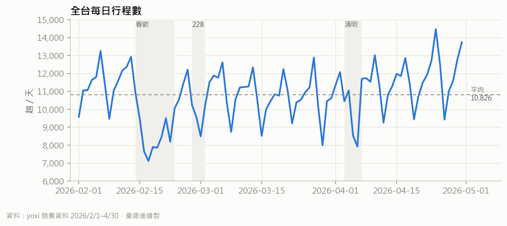
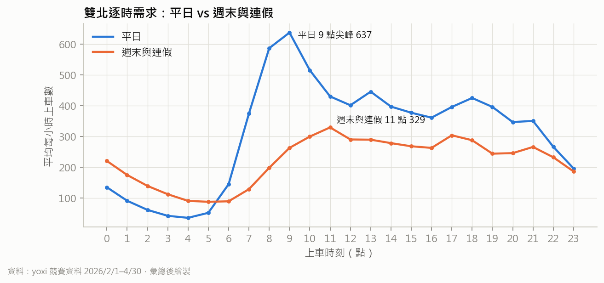
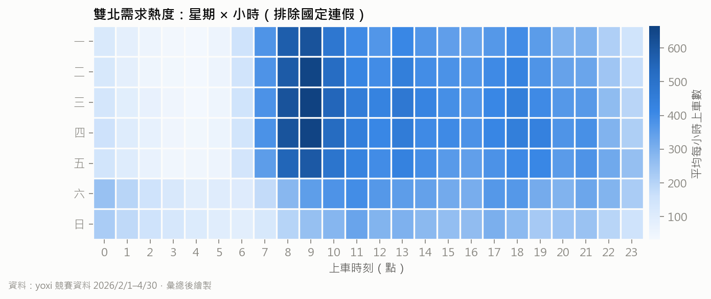
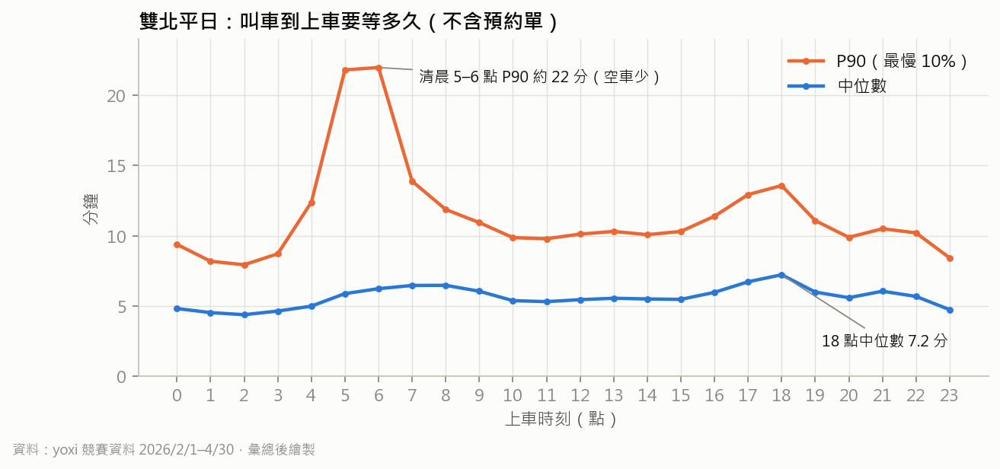
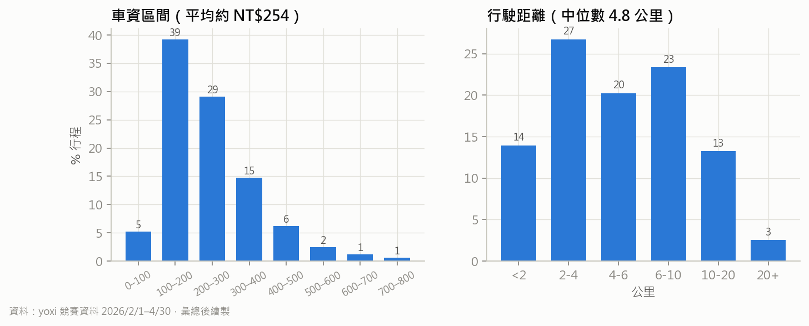
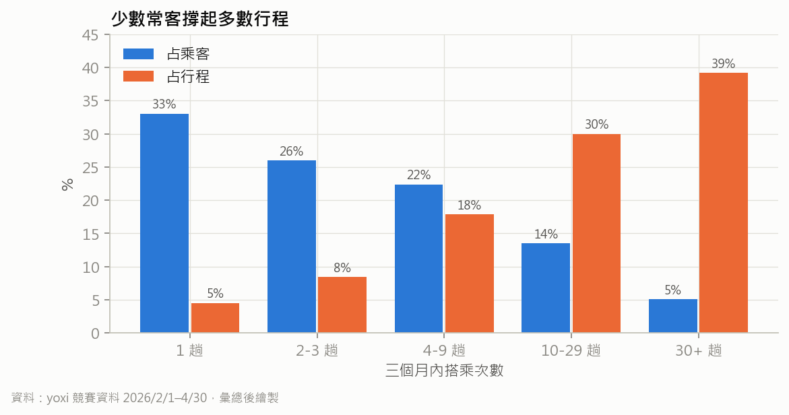
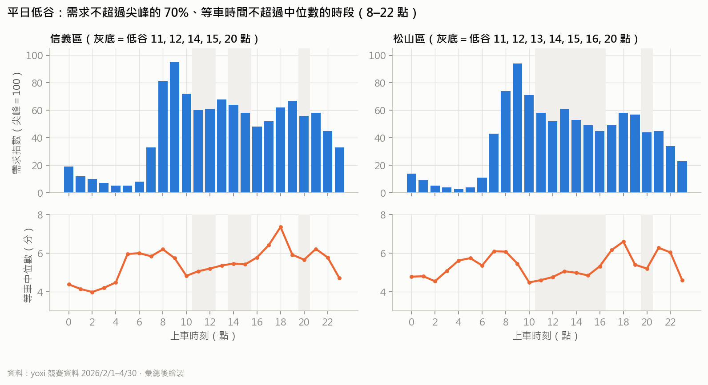
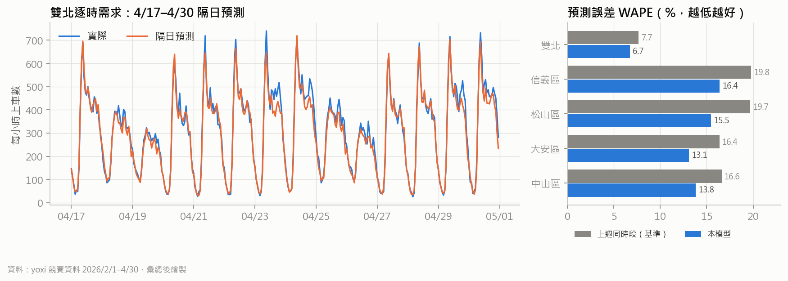

# yoxi 叫車資料分析報告

> 2026 和泰 AI 黑客松・yoxi 題目「不搭車，也打開 yoxi」｜團隊：yoxi 點燈城
> 資料：yoxi 競賽資料（2026/2/1–4/30，964,991 筆行程）｜分析程式：`data-pipeline/scripts/00–07`｜更新：2026/10/12
>
> 本報告只呈現彙總後的數字，不含任何個別行程、乘客編號或精確座標。

## 摘要

1. **叫車是低頻行為**：當月有搭車的乘客，平均 **89% 的日子不搭車**；33% 的乘客三個月只搭 1 次。App 只在「要出門」時被打開，這正是題目要解的問題。
2. **常客撐起營收，而且生活很規律**：搭 5 次以上的乘客只占 34%，卻貢獻 **83% 的行程**；他們的上下車點中位數有 58% 集中在最常去的 2 個六角格，48% 的行程落在同一個 3 小時時段。規律到可以做個人化任務。
3. **供需有明顯的尖峰與低谷**：雙北平日 9 點每小時約 637 趟，是週末同時段的 2.4 倍；叫車到上車的中位數在 18 點拉長到 7.2 分鐘。信義區平日的 11–12、14–15、20 點，以及松山區的 11–16、20 點，需求低、車子也好叫，適合導流。
4. **需求可以預測**：用「近 4 週同時段型態＋近 7 天水位」做隔日逐時預測，雙北 WAPE 為 **6.7%**，各區的誤差比「上週同時段」基準低 **12–21%**。
5. **商業數字要修正**：平均車資約 **NT$254**（雙北 NT$266），不是簡報原本用的 NT$300；資料期間每天平均約 **1.08 萬趟**。

這些發現對應到「yoxi 點燈城」的設計：每天的 AI 情境任務提供不搭車也打開 App 的理由（發現 1）、任務依個人常去的地點與時段生成（發現 2）、任務與限時乘車金排進低谷時段（發現 3、4）。

---

## 1. 資料與清理

| 項目 | 數值 |
|---|---|
| 原始筆數 | 964,991 |
| 有效筆數（`valid`） | 963,525（99.85%） |
| 乘客數 | 131,962 |
| 期間 | 2026/2/1–4/30（另有 40 筆於 5/1 凌晨開始，不影響結論） |
| 欄位 | 行程編號、乘客編號、叫車／上車／下車時間、上下車經緯度、行駛時間與距離、上下車地點名稱、車資區間 |

清理規則：只標記、不刪除，分析時用 `valid == True`。

| 標記 | 條件 | 筆數 |
|---|---|---|
| `flag_short` | 行駛距離 < 100 公尺 | 1,122 |
| `flag_long` | 行駛距離 > 200 公里，或行駛時間 > 240 分鐘 | 241 |
| `flag_speed` | 平均時速 > 130 公里 | 128 |
| 座標超出台灣、負等待時間 | — | 0 |
| `is_reserve`（預約單） | 叫車到上車 > 60 分鐘 | 1,031（0.1%） |

新增欄位：叫車到上車分鐘數 `lead_min`（附近空車越少，等越久，當作空車的替代指標）、時段、星期、國定連假（春節 2/14–2/22、228 連假 2/27–3/1、兒童節與清明 4/3–4/6）、車資區間中點、H3 第 8／9 級六角格、行政區（內政部鄉鎮市區界）、上下車地點分類（住家、公司、yoxi 上車點、機場、交通、醫院……）。

## 2. 市場輪廓：在哪裡、多少量

### 2.1 地區分布

| 縣市 | 上車占比 |
|---|---|
| 台北市 | 42.9% |
| 新北市 | 19.3% |
| 高雄市 | 15.2% |
| 台中市 | 12.4% |
| 台南市 | 5.1% |
| 桃園市 | 4.1% |
| 其他 | 1.0% |

**雙北占 62.2%**。雙北上車量前 10 名的行政區：

| 排名 | 行政區 | 上車數 | 排名 | 行政區 | 上車數 |
|---|---|---|---|---|---|
| 1 | 台北市中山區 | 86,874 | 6 | 新北市板橋區 | 34,913 |
| 2 | 台北市大安區 | 76,541 | 7 | 台北市內湖區 | 29,704 |
| 3 | 台北市松山區 | 46,831 | 8 | 新北市三重區 | 27,147 |
| 4 | 台北市信義區 | 44,702 | 9 | 新北市中和區 | 26,757 |
| 5 | 台北市中正區 | 42,312 | 10 | 新北市永和區 | 22,324 |

原型選信義、松山兩區做示範：需求量排第 3、4，而且有台北 101、市府、松山機場、大巨蛋、松山文創園區等 yoxi 指定上車點，容易做出看得見的點燈效果。

### 2.2 每日趨勢



| 指標 | 數值 |
|---|---|
| 每天平均 | 10,826 趟（不含 5/1） |
| 非連假平日平均 | 11,604 趟 |
| 春節（2/14–2/22）平均 | 8,562 趟（比平日少 26%） |
| 單日最低／最高 | 2/17（初一）7,113 趟／4/24（五）14,475 趟 |
| 月別每天平均 | 2 月 10,372 → 3 月 10,675 → 4 月 11,405 趟（2→4 月 +10%） |

每週的形狀很固定：非連假日的平均，週五最高（12,959 趟），週日最低（9,070 趟），週一到週五逐日增加。連假會把需求壓低，但結束後很快恢復。

### 2.3 一天之中：平日與休息日



- **平日**：7 點起快速上升，9 點達到尖峰（每小時約 637 趟），中午 13 點與傍晚 18 點各有一個小高峰，晚上逐漸下降。尖峰約是 22 點（266 趟）的 2.4 倍。
- **週末與連假**：沒有通勤尖峰，11 點最高（329 趟），凌晨 0–3 點反而比平日多（夜歸）。
- 平日白天 10–16 點和 20 點後，需求明顯低於早上尖峰，但司機仍在線上。這段落差就是導流的空間。



星期 × 小時的熱度圖顯示，週二到週四早上 8–9 點最集中；平日晚上的需求從週一往週五逐漸增加，週五 22–23 點最明顯；週六凌晨（週五夜歸）的需求比其他日子明顯多。

## 3. 等車時間：哪些時段車子難叫



整體（不含預約單）叫車到上車：P25 4.1 分、**中位數 5.9 分**、P75 8.2 分、P90 11.3 分。

雙北平日依時段來看：

- **傍晚尖峰最難叫**：18 點中位數 7.2 分、P90 13.6 分；早上 7–8 點中位數約 6.5 分。
- **清晨 5–6 點**中位數只有 6 分左右，但 P90 衝到約 22 分：需求少，但在線上的車更少，運氣不好就要等很久。
- **白天 10–15 點**中位數約 5.3–5.6 分，是一天中最穩定、車子最好叫的時段。

叫車到上車時間包含司機開過來的時間，資料沒有司機端的空車數，所以這裡只能當作「附近空車多寡」的替代指標。

## 4. 行程內容：多遠、多少錢、去哪裡



| 指標 | 數值 |
|---|---|
| 行駛距離中位數 | 4.8 公里 |
| 行駛時間中位數 | 14 分鐘 |
| 平均車資（區間中點估計） | **NT$254**；雙北 NT$266 |
| 最常見車資區間 | NT$101–200（39%） |
| 資料期間的月車資總額（估計） | 約 NT$8,160 萬 |

車資只有 100 元區間，所以平均車資以區間中點計算（例如 `[100,200]` 記為 150.5 元），實際平均可能略有偏差。

### 4.1 上下車地點類型

地點名稱來自乘客自己存的名稱或 App 的地點，68% 的上車點沒有名稱，所以以下只看有名稱的部分。

| 類型 | 上車 | 下車 | 觀察 |
|---|---|---|---|
| 住家 | 88,559 | 1 | 「住家」是乘客存的上車常用地點 |
| 公司 | 30,821 | — | |
| yoxi 指定上車點 | 15,938 | 9,331 | |
| 交通（車站、捷運、高鐵） | 7,528 | 51,229 | 下車是上車的 6.8 倍：yoxi 常用來「接駁到車站」 |
| 醫院 | 10,363 | 32,765 | 下車是上車的 3.2 倍：就醫情境 |
| 機場 | 499 | 8,974 | 去機場搭 yoxi，回程多半排班計程車或其他方式 |
| 飯店 | 9,574 | 16,755 | |
| 購物、休閒 | 11,723 | 31,141 | |

只有 14.6% 的乘客曾從「住家」或「公司」標記上車。大多數人沒有設定常用地點，所以 App 要自己從歷史行程學出常去的地點（見 5.3）。

### 4.2 最常用的 yoxi 指定上車點

| 上車點 | 次數 |
|---|---|
| 台北車站 捷運出口 M3（天成飯店） | 1,140 |
| 板橋車站 北門（站前路） | 979 |
| 台南火車站 大門外 | 969 |
| 台北市府路 門口右側黃線臨停區 | 795 |
| 台北 101 松智路出口 | 722 |
| 松山機場加油站 | 445 |
| 南港車站 興中路臨停區 | 437 |
| 南港車站 忠孝東路臨停區 | 393 |
| 台大醫院正門 | 378 |
| 高雄火車站 站西路臨停接送區 | 364 |

原型地圖上的 yoxi 上車點座標，是信義、松山範圍內這些上車點的上車座標中位數（8 個點，`data-pipeline/data/processed/yoxi_pickup_spots.csv`）。

## 5. 乘客：頻率、留存與規律

### 5.1 少數常客撐起多數行程



| 三個月搭乘次數 | 占乘客 | 占行程 |
|---|---|---|
| 1 趟 | 33.0% | 4.5% |
| 2–3 趟 | 26.0% | 8.4% |
| 4–9 趟 | 22.4% | 17.9% |
| 10–29 趟 | 13.5% | 30.0% |
| 30 趟以上 | 5.1% | 39.2% |

- 每位乘客平均 7.3 趟、中位數 3 趟。
- **前 10% 的乘客貢獻 54% 的行程**。
- 搭 5 次以上的乘客有 45,493 位（34.5%），貢獻 **83.5%** 的行程。

### 5.2 不搭車的日子才是常態

| 指標 | 數值 |
|---|---|
| 每月活躍乘客（MAU） | 2 月 79,000／3 月 77,808／4 月 78,561 |
| 每位活躍乘客每月趟數 | 3.68 → 4.25 → 4.36 |
| 當月有搭車的乘客，搭車日占當月天數 | 中位數 6.5%、平均 10.6% |
| **平均不搭車的日子** | **89.4%** |
| 兩次搭乘間隔 | 中位數 1.3 天、P75 5.1 天 |
| 2 月乘客 3 月再搭 | 58.8% |
| 2 月乘客 4 月再搭 | 56.8% |

MAU 穩定在 7.8–7.9 萬，留存約六成，代表乘客會回來，但一個月大概只有 3 天會打開 App。點燈城要填的就是剩下的 27 天。

### 5.3 常客的生活很規律

針對搭 5 次以上的 45,493 位乘客：

| 指標 | 數值 |
|---|---|
| 上下車點落在最常去的 2 個 H3 第 9 級六角格（約 0.1 平方公里）的比例 | 中位數 **58%** |
| 這個比例 ≥ 50% 的乘客 | 77% |
| 行程落在最常搭的 3 小時時段的比例 | 中位數 **48%** |

也就是說，常客大多是「固定兩個地方之間、固定時段」在移動，例如家和公司。AI 可以用這些規律生成個人化的情境任務（例如「平常 18 點下班叫車的人，今天 15 點提早出發可拿乘車金」），而不需要乘客自己設定。

## 6. 低谷時段：任務與乘車金要排在哪裡



定義：平日 8–22 點中，需求指數不超過該區平日尖峰的 70%，且等車中位數不超過該區白天中位數的時段。

| 行政區 | 平日低谷 |
|---|---|
| 台北市信義區 | 11–12 點、14–15 點、20 點 |
| 台北市松山區 | 11–16 點、20 點 |

這些時段有空車、等車短，把任務和限時乘車金排在這裡，乘客叫得到車、司機多接一單，而且不會讓尖峰更擠。原型直接使用這份結果：營運頁（`src/views/OpsView.tsx`）標出低谷時段、讓 Gemini 設計空車時段任務；乘客端生成每日任務與小精靈對話時，也會把低谷時段交給 Gemini（`src/lib/store.tsx` → `src/lib/ai.ts`）。

## 7. 需求預測



**方法**：預測隔天 24 小時、每小時的上車數。

1. 型態：近 4 週非連假、同星期同小時的平均。
2. 水位：最近 7 天實際量 ÷ 型態預期量，限制在 0.8–1.25 倍，乘回型態。
3. 驗證：用 4/16 以前的資料建模，4/17–4/30 每天只用「當天以前」的資料預測隔天（滾動起點），再跟實際比較。

**結果**（WAPE＝絕對誤差總和 ÷ 實際總量，越低越好）：

| 範圍 | 平均每小時上車數 | 基準：上週同時段 | 本模型 | 改善 |
|---|---|---|---|---|
| 雙北 | 280.4 | 7.65% | **6.71%** | 12.3% |
| 台北市信義區 | 20.9 | 19.79% | **16.39%** | 17.2% |
| 台北市松山區 | 21.9 | 19.68% | **15.46%** | 21.4% |
| 台北市大安區 | 35.8 | 16.37% | **13.09%** | 20.0% |
| 台北市中山區 | 40.7 | 16.61% | **13.82%** | 16.8% |

- 雙北整體誤差不到 7%，已經可以用來排隔天的任務與乘車金。
- 單一行政區每小時只有 20–40 趟，隨機波動大，誤差 13–16%；用在「哪幾個小時是低谷」的判斷已經足夠，不適合拿來精準調度車輛。
- 試過把模型與「上週同時段」各半混合，雙北 WAPE 6.78%，沒有比較好，所以採用單純的型態＋水位模型。
- 決賽版改用 BigQuery ML 的 ARIMA_PLUS（SQL 在 `data-pipeline/data/processed/bigquery/sql/`），可以處理連假效應，也能用 BigQuery 排程每天自動更新。

## 8. 對產品與簡報的意涵

| 發現 | 產品設計 | 簡報要更新的地方 |
|---|---|---|
| 89% 的日子不搭車；每月約 3 天打開 App | 每日 AI 情境任務、點亮街區、拍車召喚小精靈，提供不搭車也打開 App 的理由 | 痛點頁補上這個數字 |
| 常客 34% 貢獻 83% 行程，地點與時段高度集中 | 任務依個人常去的六角格與時段生成；點亮自己的生活圈 | 個人化頁引用 58%／48% |
| 平日尖峰是低谷的 2 倍以上；傍晚等車最久 | 任務與限時乘車金排進低谷（信義 11–12、14–15、20 點；松山 11–16、20 點） | 雙邊受惠的論點 |
| 隔日預測 WAPE 6.7%，比基準好 12–21% | 營運頁：需求熱度、低谷時段、下一週預測、AI 派任務 | AI 整合度 |
| 車站、醫院、機場的下車遠多於上車 | 情境任務可以設計「搭車去車站／醫院」的主題 | — |
| 平均車資 NT$254（雙北 NT$266） | — | 車資改用 NT$254，SOM 從約 1.8 億改為約 1.6 億 |
| 每天約 1.08 萬趟 | — | 每日趟數 |

## 9. 限制

- **沒有供給端資料**：沒有司機上線數或空車位置，等車時間只能當作空車多寡的替代指標，也會受天氣、路況影響。
- **只有三個月，而且包含春節**：季節性（暑假、颱風、年底）看不到；預測驗證期（4/17–4/30）是一般平日與週末，沒有測到連假。
- **車資只有區間**：平均車資用區間中點估計。
- **地點名稱是自由文字**：68% 的上車點沒有名稱，分類用關鍵字比對，「住家」「公司」的比例會低估。
- **資料範圍**：這份是競賽提供的資料，不一定代表 yoxi 全部的營運量；月車資總額只是這份資料的估計。

## 10. 隱私與重現

- 逐筆資料含乘客編號與精確座標，只在團隊內部使用；`raw_df.pkl`、`*.parquet`、原始 CSV 都列在 `.gitignore`，不進版控。
- App 只放 0–100 的彙總指數（`src/data/demand.json`）：152 個 H3 第 9 級六角格（至少 30 趟才列入）、信義與松山的星期 × 小時需求指數、低谷時段、下一週預測指數、8 個 yoxi 上車點。
- 重現步驟（在 `data-pipeline/` 底下，約 1 分鐘）：

```bash
pip install -r requirements.txt
python scripts/01_load_csv.py       # 原始 CSV 放在 data/extracted/yoxi/
python scripts/02_preprocess.py
python scripts/03_analysis.py       # → data/processed/metrics.json
python scripts/04_forecast.py       # → forecast_results.json、how_profiles.json
python scripts/05_export.py         # → BigQuery 表、demo 指數、上車點
python scripts/07_report_charts.py  # → docs/data-analysis/*.png（本報告的圖）
```

本報告所有數字都來自 `data-pipeline/data/processed/` 底下的 `metrics.json`、`forecast_results.json` 與 `demo/demand_xinyi_songshan.json`。
