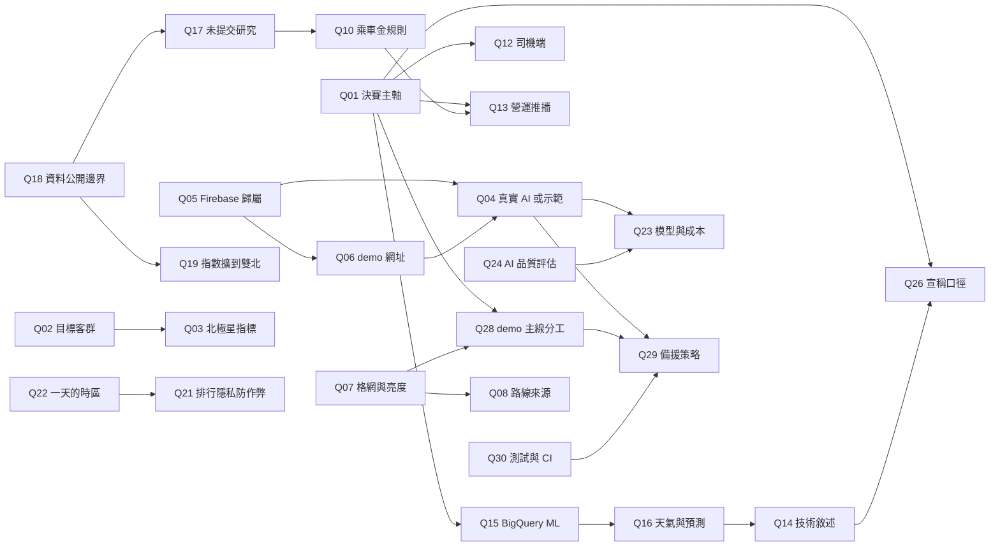

# 團隊待決議的 30 題問題

> 日期：2026-10-12　｜　分析基準 commit：`18e94b3`（origin/main「調整網格大小以及新增調整網格深淺功能」），文件分支 `docs/project-discussion-20261012`
> 相關文件：[01 專案現況與整體說明](01-project-overview.md)・[03 技術架構、創新亮點與 Demo 規劃](03-architecture-innovation-and-demo.md)・[04 資料分析與資料狀態](04-data-status.md)

**證據標記**：【程式碼確認】讀過程式碼或設定；【執行驗證】這次實際跑過（build、e2e、OCR 檢查、線上網址探測）；【推論】由證據合理推得；【待確認】需要人或實機確認；【提案】本文件的建議，不是既定決議。
**功能狀態**：✅ 已驗證可用／🟡 已實作未驗證／🟠 部分完成／🎭 mock・展示用途／⛔ 尚未實作。
**問題編號** I1–I18 的完整說明見 [01 文件的「已知限制、風險與技術債」](01-project-overview.md)，本文件只簡短引用。

## 目錄

- [會議快讀摘要](#會議快讀摘要)
- [最先討論的 5 題](#最先討論的-5-題)
- [demo 前必須定案的題目](#demo-前必須定案的題目)
- [決策之間的依賴關係](#決策之間的依賴關係)
- [建議的 60 分鐘會議議程](#建議的-60-分鐘會議議程)
- [一、問題定義、客群與核心價值（Q01–Q03）](#一問題定義客群與核心價值q01q03)
- [二、demo 環境與部署（Q04–Q06）](#二demo-環境與部署q04q06)
- [三、使用者流程、UX 與功能範圍（Q07–Q13）](#三使用者流程ux-與功能範圍q07q13)
- [四、對外敘述、資料與預測（Q14–Q19）](#四對外敘述資料與預測q14q19)
- [五、隱私、安全與規則（Q20–Q22）](#五隱私安全與規則q20q22)
- [六、AI 設計與評估（Q23–Q25）](#六ai-設計與評估q23q25)
- [七、創新定位與商業延伸（Q26–Q27）](#七創新定位與商業延伸q26q27)
- [八、demo、驗證與分工（Q28–Q30）](#八demo驗證與分工q28q30)
- [決策紀錄表](#決策紀錄表)

## 會議快讀摘要

- **時程壓力分兩段**：初賽 10/14（三）13:00 交提案 PDF ＋ 3 分鐘影片（只剩約 2 天）；決賽 11/21（六）現場 demo，評分是可行性 25%、AI 整合度 20%、商業價值 20%、原型完成度 20%、簡報表現 15%。下面的「demo」若沒特別註明，指的是 10/14 影片錄製與 11/21 現場 demo 兩者。
- **原型本身能跑**：`npm run build` 通過、`scripts/e2e.py` 在手機尺寸無頭 Chromium 跑完全部流程「全部通過」、PaddleOCR 模型對 5 張示範車牌全部辨識正確（信心 ≥ 0.99）【執行驗證】。但都是**示範模式**：Gemini 與 Firestore 從沒在真機接通過（I2）。
- **線上網址落後**：GitHub Pages（`https://n-cobblers.github.io/Lighting-City/`）目前跑的是 `08538f7` 的版本，`18e94b3` 的部署 workflow 被取消（I1）【執行驗證】。
- **地圖剛改過**：`18e94b3` 把個人點燈地圖改成 H3 第 10 級，並加了預設 35% 的「六角格深淺」滑桿；搭車後點亮格子明顯變淡（I4）【執行驗證】。這會直接影響錄影效果，需要立刻決定（Q07）。
- **對外敘述與原型不一致**：簡報 P9 與影片旁白仍寫 Flutter、ML Kit、ARCore、Vertex AI、「BigQuery ML 用降雨預報預測」，原型實際是 Web、PaddleOCR、model-viewer、Firebase AI Logic，預測沒有用天氣（I7）。這是 10/14 前最該修的一件事（Q14、Q16）。
- **repo 是公開的**：`gh repo view` 顯示 `PUBLIC`【執行驗證】，裡面有競賽資料的彙總結果（逐時上車數 CSV、路段流量、指標）。競賽資料使用規範是否允許公開彙總結果【待確認】（Q18）。

## 最先討論的 5 題

| 順序 | 題目 | 為什麼先談 |
|---|---|---|
| 1 | [Q01 決賽主軸](#q01) | 決定簡報、影片、demo 時間怎麼分配，其他題的取捨都依它 |
| 2 | [Q14 技術敘述與 Flutter](#q14) | 10/14 要交的 PDF 和影片目前寫的技術與原型不符 |
| 3 | [Q04 真實 AI 或全程示範](#q04) | 決定這兩天要不要花時間建 Firebase；影響錄影能不能出現綠色「Gemini」標籤 |
| 4 | [Q06 demo 網址](#q06) | 現在線上版本落後；實機錄影要用哪個網址 |
| 5 | [Q07 格網與亮度](#q07) | 「搭車點亮」是主視覺，現在預設太淡，錄影前要定 |

## demo 前必須定案的題目

| 題目 | 最晚定案 | 原因 |
|---|---|---|
| [Q01](#q01) 決賽主軸 | 10/13 | 影片 45 秒體驗段與 30 秒 AI 段的比重 |
| [Q04](#q04) 真實 AI 或示範 | 10/13 | 錄影前要知道是否要建 Firebase |
| [Q05](#q05) Firebase 歸屬與 App Check | 10/13（若 Q04 選接真實服務） | 誰的帳號、權杖怎麼管 |
| [Q06](#q06) demo 網址 | 10/13 | 實機錄影與現場都用它 |
| [Q07](#q07) 格網與亮度 | 10/13 | 錄影畫面 |
| [Q14](#q14) 技術敘述 | 10/13 | PDF P9 與旁白 ⑤ 要改 |
| [Q18](#q18) 資料公開邊界 | 10/14 繳交前 | repo 公開、簡報要引用數字 |
| [Q28](#q28) demo 主線與分工 | 10/13（影片）／11/14（決賽彩排前） | 錄影腳本與現場講者 |
| [Q29](#q29) 備援策略 | 10/13（影片）／11/14 | 網路或 API 失敗時怎麼辦 |

其餘 P1 題目建議在 10/28 公布決賽名單後、11/07 工作坊前處理；P2 題目可延到決賽後。

## 決策之間的依賴關係

箭頭表示「左邊先定，右邊才好定」。

## 建議的 60 分鐘會議議程

| 時間 | 議題 | 產出 |
|---|---|---|
| 0–5 分 | 快讀本頁摘要，看兩張 e2e 截圖（搭車點亮、營運頁），確認大家知道現況是「示範模式可跑、真實服務未接」 | 共同前提 |
| 5–18 分 | [Q01](#q01) 主軸、[Q14](#q14) 技術敘述（連帶 [Q16](#q16) 天氣說法） | 影片與 PDF 的改稿方向 |
| 18–30 分 | [Q05](#q05)、[Q06](#q06)、[Q04](#q04)：Firebase 誰建、網址用哪個、錄影接不接真實 AI | 負責人與 10/13 前的設定清單 |
| 30–38 分 | [Q07](#q07)：在手機上比較 35% 與 70–80% 亮度 | 預設亮度與是否回第 9 級 |
| 38–44 分 | [Q18](#q18)：repo 公開與競賽資料規範 | 誰去查規範、是否先轉私有 |
| 44–54 分 | [Q28](#q28)、[Q29](#q29)：影片腳本誰錄、誰操作、備援 | 錄影排程與備援清單 |
| 54–60 分 | 其餘 P1 題指派負責人與期限（填下方決策紀錄表） | 填好的表 |

---

## 一、問題定義、客群與核心價值（Q01–Q03）

### Q01｜決賽主軸：「乘客每日互動」還是「雙邊需求導流」為第一亮點

- **優先級**：P0　**參與角色**：產品、簡報／影片、資料、AI
- **決策問題**：決賽 demo 與簡報要把哪一個當成第一亮點、分到最多時間：乘客端的每日互動（點燈地圖、AI 任務、拍車小精靈），還是營運端的需求預測導流（低谷時段、派任務、乘車金）？
- **背景與證據**：
  - 既有決策 `docs/decisions-50.md` 第 38 題列了三大亮點並列（雙邊導流、AI 任務與小精靈、好友幸運數字），第 39 題的決賽 demo 只寫點燈地圖與拍車 AR，沒有把營運頁列為主線。
  - 原型兩邊都有：乘客端 `src/views/MapView.tsx`、`ScanView.tsx`；營運端 `src/views/OpsView.tsx` 用 `src/data/demand.json` 的彙總指數畫熱度、低谷、下一週預測【程式碼確認】。
  - 營運端目前證據最紮實的是資料分析（隔日預測 WAPE 雙北 6.7%，見 [04 文件](04-data-status.md)），但「推播」只是本機加一張任務卡（I5，Q13）。
  - 決賽評分「AI 整合度 20%＋商業價值 20%」與營運端關係較大；「原型完成度 20%」與乘客端關係較大【推論】。
- **為什麼現在要決定**：影片 3 分鐘只能放一條主線；決賽前一個月的開發也要依主軸排。
- **選項**：

| 選項 | 好處 | 代價與限制 |
|---|---|---|
| A. 乘客互動為主，導流為「背後的引擎」 | 畫面吸睛、可操作程度高；符合題目「不搭車也打開」 | 商業價值要靠口頭說明；營運頁容易被看成附屬 |
| B. 雙邊導流為主，乘客互動是「導流的介面」 | 和題目「主動提供價值」、商業轉換最直接；有真資料撐 | 營運頁目前互動少、推播是假的，需要補 Q12、Q13、Q15 |
| C. 用一個故事串起兩者（小涵的一天 → 營運看到她被導進低谷） | 兩邊都講到，最符合「雙邊受惠」 | 時間切分更難，操作者要切兩個角色 |

- **建議**：選 C，但時間比重約 6:4 偏乘客端。理由：乘客端已驗證可跑、是原型完成度的主要分數來源；導流是差異化核心，用「同一個低谷時段同時出現在小涵的任務卡和營運頁」把兩邊串起來即可，不必等 Q12、Q13 全做完。
- **決策前需補充**：用 [03 文件的 demo 腳本](03-architecture-innovation-and-demo.md)計時彩排一次；找 1–2 位非團隊成員看完後說出「這產品是什麼」。
- **影響範圍**：影片分鏡（`docs/video-script.md`）、決賽簡報結構、Q12／Q13／Q15 是否要做、Q28 時間分配。

### Q02｜試辦首波目標客群：通勤上班族、大學生，還是既有常客

- **優先級**：P1　**參與角色**：產品、資料、簡報／影片
- **決策問題**：提案中的「試辦」第一波要鎖定哪一群人？這會決定任務設計、乘車金對象與成效指標的分母。
- **背景與證據**：
  - 既有決策第 3 題：「都會通勤上班族（20–35 歲）＋大學生」。示範玩家「小涵」是信義區上班族（`src/data/demo.ts` 的 `PERSONA`）。
  - 資料顯示：搭 5 次以上的乘客占 34% 卻貢獻 83% 行程；33% 三個月只搭 1 次（`data-pipeline/data/processed/metrics.json`）【程式碼確認】。
  - 未提交的分群研究（`data-pipeline/data/processed/research/rider_segments.json`，**未提交、作者待確認**）用規則分群：「平日白天常客」占乘客 17.4%、行程 45.3%；「通勤族」（平日尖峰 ≥ 40%）占乘客 6.9%、行程 17.7%；「偶爾搭」占乘客 63.3%、行程 16.1%。
  - 競賽資料沒有年齡或學生身分，「大學生」無法用資料驗證【待確認】。
- **為什麼現在要決定**：決賽簡報的「情境與資料應用規劃」要寫清楚目標使用者；如果主角從上班族改成平日白天常客，小涵的故事也要調整。
- **選項**：

| 選項 | 好處 | 代價與限制 |
|---|---|---|
| A. 維持「通勤上班族＋大學生」 | 與既有簡報、小涵一致，不用改 | 通勤尖峰正是要避開的時段，和導流目標有張力；大學生沒資料支撐 |
| B. 改成「已搭過的常客（含平日白天常客）」 | 資料最充分、轉換最快；他們的低谷時段出行較有彈性【推論】 | 和「不搭車也打開」的新客擴張故事較弱 |
| C. 主客群維持通勤上班族，試辦指標另外拆出「偶爾搭」族群看喚回率 | 兼顧故事與資料 | 分析與簡報要多一層說明 |

- **建議**：C。小涵仍是通勤上班族（她的導流情境是「下午去松菸」這種非通勤行程），試辦成效則用資料可以算的分群呈現；「大學生」從主客群降為延伸客群，避免評審追問資料依據。
- **決策前需補充**：確認 `rider_segments.json` 的作者與規則是否定稿（Q17）；查簡報 `docs/proposal-deck/slides/users.html` 目前怎麼寫。
- **影響範圍**：簡報使用者頁、`PERSONA` 設定、Q03 指標分母、Q10 乘車金對象。

### Q03｜北極星指標「非搭車日開啟率」的定義與 demo 中的呈現方式（前瞻決策）

- **優先級**：P1　**參與角色**：產品、資料、簡報／影片
- **決策問題**：「非搭車日開啟率」的分子分母怎麼定義？demo 裡要不要（以及怎麼）呈現它？
- **背景與證據**：
  - 既有決策第 29 題已定北極星指標為「非搭車日開啟率」，第 30 題驗證方式為「雙北單一行政區試辦（對照其他區）＋追蹤司機端空車時段接單」。指標名稱已定，**定義與計算細節沒有寫過**【待確認】。
  - 資料基準：當月有搭車的乘客平均約 89% 的日子不搭車（`metrics.json`）；競賽資料沒有 App 開啟紀錄，現況開啟率無法從資料算出【程式碼確認】。
  - 原型沒有任何埋點或事件紀錄（全專案沒有 analytics 相關程式）【程式碼確認】。
- **為什麼現在要決定**：這是前瞻決策；決賽評分有「成效驗證方式」，評審會問「怎麼量」「基準是多少」。
- **選項**：

| 選項 | 好處 | 代價與限制 |
|---|---|---|
| A. 分母 = 當月有開過 App 的使用者的非搭車日；分子 = 其中有開啟點燈城的日數 | 直接對應題目 | 需要 yoxi 的開啟紀錄當基準，目前沒有 |
| B. 改用「每週有互動天數（含搭車日）」當北極星，非搭車日開啟率當輔助 | 好量、好解釋 | 和已定名稱不同，要改簡報 |
| C. 維持 A，demo 不顯示數字，只在簡報講定義與試辦設計 | 不需做新功能 | demo 沒有「看得到的驗證」 |

- **建議**：A＋C。定義寫進決賽簡報，並附上「基準要由 yoxi 提供開啟紀錄」的說明；原型可在營運頁加一張「試辦指標」卡片，明確標「試算」，不放假實績。
- **決策前需補充**：yoxi 是否能提供 App 開啟紀錄（可在 11/07 工作坊詢問）；Q02 定的分群。
- **影響範圍**：決賽簡報驗證頁、營運頁是否加卡片、Q28。

---

## 二、demo 環境與部署（Q04–Q06）

### Q04｜正式 demo 要接真實 Gemini／Firestore，還是全程示範模式並揭露

- **優先級**：P0　**參與角色**：前端、AI、demo 操作、簡報／影片
- **決策問題**：10/14 影片與 11/21 現場，要呈現真實 Gemini 生成與 Firestore 即時排行，還是用示範資料並清楚揭露？
- **背景與證據**：
  - 每個 AI 功能都有示範資料備援，畫面標「示範資料」或「Gemini」（`src/lib/ai.ts` 的 `generateTasks`、`chatReply`、`spriteLine`、`opsPlan`）【程式碼確認】；這是既有決策，不在本題討論範圍。
  - 這次 e2e 截圖全部顯示「示範資料（Gemini 未連線）」「示範好友（Firestore 未連線）」【執行驗證】。Firebase 專案從沒建立或實測過（I2）。
  - 影片腳本錄影步驟第 1 步寫「綠色『Gemini 即時生成』標籤」，第 4 步寫「兩支手機同一房間」（`docs/video-script.md`），都要真實服務。
  - 決賽評分 AI 整合度占 20%；全程示範模式會讓評審質疑 AI 是否真的存在【推論】。
- **為什麼現在要決定**：如果要接真實服務，10/13 就要建 Firebase、設 App Check、在兩支手機上測；不接就要改影片步驟。
- **選項**：

| 選項 | 好處 | 代價與限制 |
|---|---|---|
| A. 影片與現場都接真實服務 | AI 整合度說服力最高 | 10/13 要完成 Q05、Q06 與實機除錯；可能卡在 App Check 或模型名稱 |
| B. 影片用示範模式並揭露，決賽現場接真實服務、失敗切示範 | 10/14 風險最低；決賽前有一個月可以穩定 | 影片中 AI 的說服力較弱，要在旁白說明「示範資料由 Gemini 規格產生」 |
| C. 全程示範模式 | 零風險 | AI 整合度分數風險高 |

- **建議**：B。10/13 先嘗試建 Firebase（半天內能拿到綠色標籤就用真實畫面錄 AI 任務卡，拿不到就用示範並在字幕標「示範資料」）；決賽一定要接真實服務，並保留 `forceDemo` 一鍵切換（設定頁「全部使用示範資料」）。
- **決策前需補充**：實機測 1 次 Firebase AI Logic＋App Check 的完整流程，記錄錯誤訊息；確認 `gemini-3.1-flash-lite` 在 AI Logic 可用（Q23）。
- **影響範圍**：`docs/video-script.md` 錄影步驟、Q05、Q06、Q23、Q29。

### Q05｜Firebase 專案歸屬、權限與 App Check 方式

- **優先級**：P0　**參與角色**：前端、AI、demo 操作
- **決策問題**：Firebase 專案建在誰的帳號底下？誰有管理權限？demo 用偵錯權杖還是 reCAPTCHA v3？
- **背景與證據**：
  - 既有決策：Spark 免費方案、Firebase AI Logic、匿名登入（`docs/implementation-decisions.md` 第 6、7、30 題）。**誰來建、誰持有**沒有決定【待確認】。
  - `src/lib/firebase.ts` 的 `getFirebase()`：偵錯模式設定 `FIREBASE_APPCHECK_DEBUG_TOKEN` 後用一個會丟錯的 `CustomProvider` 初始化；這種寫法依賴 SDK 在偵錯模式下忽略 provider，未實測（I15）【程式碼確認】【待確認】。
  - 設定（Firebase 設定、偵錯權杖）存在瀏覽器 localStorage（`src/lib/settings.ts`），換手機要重貼；改設定後要重新整理才生效（I13）。
  - 偵錯權杖等同繞過 App Check 的憑證，不可出現在 repo、影片或簡報畫面【推論】。
- **為什麼現在要決定**：Q04 若選 A 或 B，都要先有專案；權杖外流要能撤銷。
- **選項**：

| 選項 | 好處 | 代價與限制 |
|---|---|---|
| A. 團隊共用 Google 帳號建立，2 人以上有擁有者權限 | 不綁個人，交接容易 | 共用帳號的安全管理 |
| B. 一位成員個人帳號建立，其他人加為成員 | 最快 | 該成員缺席時無法處理 |
| App Check：偵錯權杖 | 任何網域可用、彩排快 | 權杖外流就失去保護；每台手機要貼 |
| App Check：reCAPTCHA v3 | 正式做法 | 要登記網域（Pages 與 Firebase Hosting 不同），Q06 先定 |

- **建議**：B 起步（指定一位負責人＋一位備援擁有者），App Check 影片與彩排用偵錯權杖、決賽現場改 reCAPTCHA v3，並在決賽後撤銷所有偵錯權杖。偵錯權杖只透過私訊傳遞，不寫進任何檔案。
- **決策前需補充**：實測偵錯模式能否拿到 token（I15）；確認 Spark 方案下 AI Logic 的免費額度。
- **影響範圍**：`src/lib/firebase.ts`、`firestore.rules` 部署、Q04、Q06、Q29。

### Q06｜正式 demo 網址：GitHub Pages 或 Firebase Hosting

- **優先級**：P0　**參與角色**：前端、demo 操作
- **決策問題**：錄影與現場用哪個網址？兩者都留的話，哪個是「正式」？
- **背景與證據**：
  - `.github/workflows/deploy-pages.yml` 在推上 main 時自動部署到 GitHub Pages；目前線上版本的 JS 檔名與 `08538f7` 本機建置相同，`18e94b3` 的 workflow run 被取消（I1）【執行驗證】。
  - Pages 上 `/__/firebase/init.json` 回 404【執行驗證】，所以在 Pages 上必須手動貼 Firebase 設定；部署在 Firebase Hosting 時 `hostingConfig()` 會自動讀取（`src/lib/firebase.ts`）【程式碼確認】。
  - Pages 對 `.onnx`、`.glb` 回應正常（`application/octet-stream`、`model/gltf-binary`）【執行驗證】。
  - CLAUDE.md 還寫「還沒部署」，已過時（I8）。
- **為什麼現在要決定**：reCAPTCHA 要登記網域、影片要用固定網址、手機要預先快取 25 MB 模型（I11）。
- **選項**：

| 選項 | 好處 | 代價與限制 |
|---|---|---|
| A. GitHub Pages 為正式網址 | 已經自動部署、免帳號設定 | 每台手機都要貼 Firebase 設定；部署被取消時不易察覺 |
| B. Firebase Hosting 為正式網址，Pages 當預覽 | 自動讀設定、和簡報架構一致、`firebase.json` 已有快取標頭 | 要先有 Q05 的專案與 `.firebaserc`，部署要手動或另寫 workflow |
| C. 只用 Pages，Firebase 只當後端 | 最少變動 | 同 A |

- **建議**：短期（10/14）用 A，先手動重跑 Pages workflow 讓線上版本變成最新 main；決賽改用 B 為正式網址，Pages 保留當預覽與備援。每次部署後比對線上 JS 檔名與本機建置。
- **決策前需補充**：重新部署後在 iPhone 與 Android 各開一次；確認 workflow 被取消的原因（`concurrency: cancel-in-progress`）。
- **影響範圍**：`.github/workflows/deploy-pages.yml`、`firebase.json`、`README.md`、Q05 的 reCAPTCHA 網域、Q29。

---

## 三、使用者流程、UX 與功能範圍（Q07–Q13）

### Q07｜點燈地圖格網解析度（H3 第 9／10 級）與預設亮度

- **優先級**：P0　**參與角色**：設計、前端、demo 操作
- **決策問題**：個人點燈地圖維持 H3 第 10 級嗎？「六角格深淺」預設值要多少？搭車新點亮的格子要不要受滑桿影響？
- **背景與證據**：
  - `18e94b3` 把 `src/lib/geo.ts` 的 `RES` 從 9 改成 10，並在 `docs/implementation-decisions.md` 第 15 題更新為「分析用第 9 級、個人地圖用第 10 級」。**解析度本身已有新決策**，本題只在亮度證據出現後請團隊重新確認。
  - `src/views/MapView.tsx` 的 `gridOpacity` 預設 35，會乘到所有格子：最亮一階 `0.58 × 0.35 ≈ 0.20`、最低一階 `0.16 × 0.35 ≈ 0.06`【程式碼確認】。
  - e2e 截圖：第 9 級時搭車後顯示「點亮 31%」、格子明顯；第 10 級＋35% 時顯示「點亮 12%」、格子幾乎看不出來（I4）【執行驗證】。
  - CLAUDE.md 的 e2e 檢查「點亮比例有增加」仍通過【執行驗證】，但它不檢查視覺亮度。
- **為什麼現在要決定**：「搭車點亮整條路線」是影片 1:20–1:40 的高潮畫面。
- **選項**：

| 選項 | 好處 | 代價與限制 |
|---|---|---|
| A. 保留第 10 級，預設亮度調到 70–80% | 足跡細緻、保留新功能 | 格子變多，點亮百分比數字變小，要改說法 |
| B. 保留第 10 級＋滑桿，但搭車路線與新點亮格子固定高亮、不受滑桿影響 | 主視覺穩定，滑桿只調背景格網 | 要改 `addLayers` 與 `setPaintProperty` 的邏輯 |
| C. 回到第 9 級 | 與資料分析、簡報「約 0.1 km²」一致 | 推翻隊友剛做的決定 |

- **建議**：A 立刻做（只改預設值），B 放決賽前；同時在 e2e 加一張「搭車後」截圖的亮度門檻檢查（例如路線附近像素平均亮度）。簡報與影片統一說「個人地圖用更細的第 10 級」。
- **決策前需補充**：在兩支實機上比較 35%、70%、100% 的截圖；問提交 `18e94b3` 的隊友調成 35% 的原因。
- **影響範圍**：`src/views/MapView.tsx`、`scripts/e2e.py`、影片分鏡、簡報 H3 說法、Q08。

### Q08｜搭車點亮的路線來源：手畫折線或預先算好的道路路線

- **優先級**：P1　**參與角色**：資料、前端、設計
- **決策問題**：示範搭車的路線要繼續用手畫折線，還是改用本機 OSRM 預先算好的真實道路路線？
- **背景與證據**：
  - `src/lib/geo.ts` 的 `ROUTES` 是「沿主要道路的概略路線（示範用）」手寫座標；動態任務用 `taskRoute()` 畫 L 形折線（`MapView.tsx`）【程式碼確認】。
  - 資料管線已有本機 OSRM 流程（`data-pipeline/scripts/08–10`），報告提到「搭 yoxi 點亮路線」可以沿真實道路點亮【程式碼確認】。
  - 既有決策：示範歷史路線走敦化北路、示範搭車走光復南北路，讓錄影時搭車會點亮新格子；改路線時要確認 e2e 檢查仍通過（CLAUDE.md）。
- **為什麼現在要決定**：第 10 級格子更細，手畫折線偏離道路會更明顯【推論】；評審問「是真的路線嗎」時需要一致答案。
- **選項**：

| 選項 | 好處 | 代價與限制 |
|---|---|---|
| A. 維持手畫折線，畫面標「示意路線」 | 零成本 | 細格網下可能穿過建築 |
| B. 用本機 OSRM 對示範地點（公開地標與虛構住家）算好路線後寫進 `ROUTES` | 沿真實道路、不涉及競賽逐筆資料 | 需要 Docker 與 OSRM；要確認仍走光復南北路並通過 e2e |
| C. 正式版接即時路線 API | 最真實 | 原型不需要；牽涉金鑰與成本 |

- **建議**：B，在決賽前做；只對示範 POI 之間的固定路線計算，不送任何競賽座標，並保留敦化北路／光復南北路的差異。10/14 前維持 A。
- **決策前需補充**：確認本機 OSRM 處理檔仍在（`data-pipeline/data/osrm/` 不進版控）；算完比對點亮格數。
- **影響範圍**：`src/lib/geo.ts`、`scripts/e2e.py`、Q07。

### Q09｜步行任務「我到了」是否加入定位驗證

- **優先級**：P1　**參與角色**：產品、前端、demo 操作
- **決策問題**：步行任務按「我到了」時，要不要用手機定位確認使用者真的在任務地點附近？
- **背景與證據**：
  - `MapView.tsx` 的 `doWalk()` 直接點亮格子並完成任務，沒有讀定位（I6）【程式碼確認】。拍車頁只用定位的移動速度判斷「移動中，停下再拍」。
  - 既有決策第 16 題：個人資料只收「完成任務時的定位（不做背景追蹤）」——**定位驗證是既定方向，未定的是何時做、demo 怎麼處理**。CLAUDE.md 下一步第 4 項也列了它。
  - 決賽現場在室內，真實定位不會在國父紀念館【推論】。
- **為什麼現在要決定**：評審會問防作弊；但 demo 現場無法真的走到地點。
- **選項**：

| 選項 | 好處 | 代價與限制 |
|---|---|---|
| A. 加定位驗證（距離 POI ≤ 150 公尺），設定頁提供「示範定位」開關 | 回答防作弊、符合既定方向 | 要處理權限被拒、室內誤差；現場要開示範開關並揭露 |
| B. 不做，簡報說明正式版的驗證方式 | 零開發 | 「可行性」被追問時較弱 |
| C. 只在單次按下時讀一次定位、不擋流程，畫面顯示「距離 xx 公尺」 | 有證據又不卡 demo | 不算真正驗證 |

- **建議**：決賽前做 A，示範開關預設關閉、彩排與現場開啟並在畫面標「示範定位」；10/14 前不做。
- **決策前需補充**：iPhone Safari 與 Android Chrome 的定位權限流程實測。
- **影響範圍**：`src/views/MapView.tsx`、`src/lib/settings.ts`、Q26 宣稱口徑。

### Q10｜限時乘車金的規則與 demo 中可宣稱的程度

- **優先級**：P1　**參與角色**：產品、資料、簡報／影片
- **決策問題**：乘車金的金額範圍、使用條件與每人上限怎麼定？demo 與簡報可以宣稱到什麼程度？
- **背景與證據**：
  - 既有決策第 9、34 題：乘車金限空車時段、每人每日上限、集團夥伴共同出獎。**具體數字沒有定**。
  - Gemini 任務提示詞要求 20–50 元、只能在低谷折抵（`src/lib/ai.ts` 的 `TASK_SYSTEM`），回傳後截斷在 0–80 元；示範任務是 30 元【程式碼確認】。原型沒有發放或折抵流程（🎭）。
  - 未提交的試算 `data-pipeline/data/processed/research/valley_value.json`（**未提交、作者待確認**，假設都標為試算）：只算 yoxi 派遣費時，每趟損益兩平的乘車金約 8 元（保守）、13.3 元（中間）、18.6 元（樂觀）；把司機收入也算進來約 73／122／171 元（見[文件 4](04-data-status.md)）。示範的 30 元高於「yoxi 單方」損益兩平【推論】。
- **為什麼現在要決定**：評審會追問「誰出錢、會不會虧」；任務卡上的 30 元會被當成正式提案。
- **選項**：

| 選項 | 好處 | 代價與限制 |
|---|---|---|
| A. 維持 20–50 元，簡報說明由 yoxi、司機與集團夥伴共同分擔 | 吸引力足 | 要有分擔比例的試算，否則被質疑 |
| B. 降到 10–20 元，並限「增量行程」才給 | 符合 yoxi 單方損益兩平 | 吸引力下降 |
| C. 金額由營運頁依低谷深度動態決定，上限寫在規則裡 | 和「需求預測導流」最一致 | 需要新邏輯與試算說明 |

- **建議**：決賽採 C 的說法（上限 30 元、依低谷深度調整），原型先把提示詞與示範資料改成 10–30 元並在任務卡註明「試辦規則」。在 Q17 確認試算後，簡報附損益兩平頁並標「試算」。
- **決策前需補充**：Q17 的研究定稿；yoxi 現行優惠形式（研究筆記 `docs/research-notes/yoxi_company_product.md`）。
- **影響範圍**：`src/lib/ai.ts`、`src/data/demo.ts`、`src/views/OpsView.tsx`、商業頁、Q13。

### Q11｜拍車玩法定位與現場道具（列印車牌、平板、手動輸入）

- **優先級**：P1　**參與角色**：產品、前端、demo 操作
- **決策問題**：拍車召喚小精靈在 demo 中要怎麼演示？用列印車牌、平板顯示，還是手動輸入？以及「示範車隊」的說法要怎麼講才準確？
- **背景與證據**：
  - 拍車流程：取景框裁切 → PP-OCRv4 單行辨識 → `extractPlate()` → 雜湊比對 `DEMO_FLEET_HASHES`（`src/lib/lucky.ts`、`src/views/ScanView.tsx`）【程式碼確認】。e2e 用假相機辨識出 TDX-3963、OCR 檢查 5 張示範車牌全對【執行驗證】；真機相機【待確認】。
  - 首次開啟拍車要下載約 25 MB（ONNX Runtime wasm 約 14 MB＋模型 10.8 MB，I11）；沒有 service worker 快取【程式碼確認】。
  - `docs/plates/` 只有 PNG；README 提到的 PDF 由 `scripts/make_fixtures.py` 產生、未進版控（I8），且該腳本會改寫已追蹤的 PNG（I9）【執行驗證】。
  - 雜湊用的鹽寫在前端程式裡，台灣車牌組合有限，正式車隊名單若照這樣做可被窮舉還原【推論】。示範用虛構車牌沒有問題。
  - 幸運數字依日期算（今天是 26），錄影要在設定覆寫成 21 才會「中了」（I16）。
- **為什麼現在要決定**：影片 1:05–1:20 與決賽現場都要拍車；道具要提前準備。
- **選項**：

| 選項 | 好處 | 代價與限制 |
|---|---|---|
| A. 列印車牌（A4）＋現場手持 | 最像真實 | 光線、反光、對焦影響辨識 |
| B. 平板全螢幕顯示車牌圖片 | 光線穩定 | 螢幕反光、摩爾紋 |
| C. 手動輸入車牌當備援 | 一定成功 | 看不到 OCR 能力 |

- **建議**：主用 A、備援 C（Q29）；對外說法改成「示範車隊以雜湊比對；正式版由伺服器比對，名單不放在手機上」，不宣稱「雜湊即無法還原」。錄影前在 Wi-Fi 下先開一次拍車頁快取模型。
- **決策前需補充**：在現場類似燈光下用兩支手機各拍 10 次記錄成功率。
- **影響範圍**：`src/lib/lucky.ts` 說明文字、`docs/video-script.md`、Q26、Q29。

### Q12｜司機端要做獨立畫面，還是維持營運頁一張卡

- **優先級**：P1　**參與角色**：產品、設計、前端
- **決策問題**：決賽要不要做司機端畫面，呈現「司機在低谷多接單」？
- **背景與證據**：
  - 既有決策：實作第 26 題「司機端併在營運端，用一張卡呈現預估多接的單」；提案第 36 題的司機誘因是「空車時段優先派單、被收集小額獎金」。
  - 目前司機端只有營運頁「每位參與司機多接（單）」一個數字，算法是 `expectedRides / 12`，「12 位自願加入的司機」是寫死的假設（`src/views/OpsView.tsx`）【程式碼確認】🎭。
  - CLAUDE.md 下一步第 4 項列了「司機端畫面」，與第 26 題不一致，所以需要重新確認。
- **為什麼現在要決定**：「雙邊受惠」是三大亮點之一；只有乘客畫面時，司機那一邊只能靠口述。
- **選項**：

| 選項 | 好處 | 代價與限制 |
|---|---|---|
| A. 維持一張卡 | 不花時間 | 雙邊故事弱 |
| B. 做一個唯讀的司機端示意頁（今日低谷時段、預估多接單、被收集次數） | 半天到一天可完成【推論】、視覺上補齊雙邊 | 全是示範數據，要標示 |
| C. 做可互動的司機接單流程 | 最完整 | 超出原型範圍、與 yoxi 實際派單系統無關 |

- **建議**：若 Q01 選 B 或 C，做 B，數據全部從 `demand.json` 與營運頁試算帶出並標「試算」；選 A 則維持現狀。
- **決策前需補充**：Q01 結果；司機收入相關試算（Q17）。
- **影響範圍**：新增頁面或分頁、`src/App.tsx` 分頁列、Q28 時間分配。

### Q13｜營運「推播給附近玩家」要做到什麼程度

- **優先級**：P1　**參與角色**：前端、AI、產品
- **決策問題**：營運頁按「推播給附近玩家」後，要真的送到另一支手機，還是維持本機示意？示範文案與數字不一致要怎麼修？
- **背景與證據**：
  - `OpsView.tsx` 的 `push()` 只把任務加進本機任務清單、地點固定是 `spot-songyan`，不管選的是信義區還是松山區；「附近玩家 520 人」寫死（I5）【程式碼確認】⛔ 真推播。
  - 示範派任務理由 `FALLBACK_OPS.reason` 寫「叫車到上車也比全天中位數短」，但截圖中 14:00 顯示「叫車到上車 5.6 分（全天中位數 5.6）」，數字相等（I5）【執行驗證】。
  - 提案架構原本有 FCM 推播（簡報 P9）；原型沒有。
- **為什麼現在要決定**：若 demo 演「營運派任務 → 乘客手機收到」，需要跨裝置機制。
- **選項**：

| 選項 | 好處 | 代價與限制 |
|---|---|---|
| A. 維持本機示意，改按鈕文字為「推播預覽」並修正示範文案 | 最小改動、誠實 | 跨角色的戲劇效果弱 |
| B. 用 Firestore 一個 `broadcasts` 集合，乘客端訂閱後跳出任務卡 | 雙手機可演、沿用現有 Firebase | 要改 `firestore.rules`、依賴 Q04 |
| C. 接 FCM 真推播 | 最接近正式版 | iOS 網頁推播限制多，原型不划算 |

- **建議**：10/14 前做 A（修文案、讓地點跟著選的行政區）；決賽若 Q01 選 B 或 C，再做 B。
- **決策前需補充**：Q04、Q05 結果；跨裝置延遲實測。
- **影響範圍**：`src/views/OpsView.tsx`、`src/data/demo.ts`、`firestore.rules`、Q10。

---

## 四、對外敘述、資料與預測（Q14–Q19）

### Q14｜簡報與影片的技術敘述：原型 Web 與決賽是否轉 Flutter

- **優先級**：P0　**參與角色**：產品、簡報／影片、前端
- **決策問題**：10/14 的提案與影片要怎麼描述技術架構？決賽版本是否真的要轉 Flutter？
- **背景與證據**：
  - 既有決策：提案第 24–27 題寫 Flutter、Vertex AI、Cloud Functions、BigQuery ML；實作第 2、7 題改成手機網頁、Firebase AI Logic。CLAUDE.md「不要改掉的決策」也說「決賽版若要轉 Flutter，簡報要同步」——**轉不轉沒有決定**。
  - 簡報 P9（`docs/proposal-deck/slides/arch.html`）仍寫 Flutter、Maps SDK、ML Kit、ARCore／ARKit、FCM、Cloud Functions、Vertex AI；影片旁白 ⑤ 寫「整套系統用 Flutter、Firebase 和 Google Cloud 打造」（I7）【程式碼確認】。
  - 原型實際：React＋Vite、MapLibre＋OpenFreeMap、PaddleOCR＋ONNX Runtime Web、three.js＋model-viewer、Firebase AI Logic（`package.json`、`src/`）【程式碼確認】。
- **為什麼現在要決定**：初賽評分「可行性 25%」；評審若看到原型與架構不符，會懷疑可行性。10/14 就要交。
- **選項**：

| 選項 | 好處 | 代價與限制 |
|---|---|---|
| A. 簡報改成「原型（Web）已完成，正式版為 yoxi App 內分頁（原生）」，不承諾決賽轉 Flutter | 誠實、與原型一致、不增加工作 | 要改 P9 圖與旁白 |
| B. 承諾決賽版轉 Flutter | 與原本提案一致 | 開發環境無法編譯 Flutter（既有決策原因）、一個月重寫風險高 |
| C. 簡報不改 | 省時 | 可行性被質疑 |

- **建議**：A。P9 分兩欄：「原型實作（已完成）」與「正式整合（yoxi App 原生分頁）」；ML Kit、ARCore 改列為正式版選項而非現況。影片旁白 ⑤ 改成「原型用網頁技術完成，AI 走 Firebase 與 Gemini」。
- **決策前需補充**：逐頁比對簡報與 [03 文件的現行架構](03-architecture-innovation-and-demo.md)。
- **影響範圍**：簡報 P9、影片旁白 ⑤、決賽簡報、Q16、Q26。

### Q15｜決賽前是否實跑 BigQuery ML ARIMA_PLUS 並接回營運頁

- **優先級**：P1　**參與角色**：資料、前端
- **決策問題**：決賽前要不要真的在 BigQuery 跑 ARIMA_PLUS，並把結果放進營運頁？
- **背景與證據**：
  - SQL 已寫好在 `data-pipeline/data/processed/bigquery/sql/01–04`，從沒實跑【待確認】；營運頁顯示「正式版改用 BigQuery ML ARIMA_PLUS」（`OpsView.tsx`）。
  - 目前預測是本機的「近 4 週型態＋近 7 天水位」，雙北 WAPE 6.71%、信義 16.39%、松山 15.46%（`forecast_results.json`）【程式碼確認】。
  - 營運頁的「下一週預測」是 5/1–5/7 的歷史期間，週末顯示週五型態（I17）【程式碼確認】。
- **為什麼現在要決定**：決賽 AI 整合度與可行性都會問「預測怎麼上線」；BigQuery 沙盒要提前申請與上傳資料。
- **選項**：

| 選項 | 好處 | 代價與限制 |
|---|---|---|
| A. 實跑 ARIMA_PLUS，比較 WAPE，把較好的結果匯出到 `demand.json` | 能說「已在 BigQuery 跑過」 | 上傳的是彙總逐時表，仍要符合 Q18 |
| B. 不跑，維持本機模型並在簡報說明 | 零成本、本機模型已有驗證 | 「正式版改用」的說法沒有證據 |
| C. 跑但不接回 App，只放簡報比較表 | 證據有了、App 不變 | 營運頁和簡報說法要一致 |

- **建議**：C，若 ARIMA_PLUS 明顯較好再考慮 A。不論結果如何都把比較表放進決賽簡報，並修正營運頁「下一週」字樣為「5/1–5/7 預測（歷史驗證期）」。
- **決策前需補充**：BigQuery 沙盒帳號、`hourly_pickups_town_metro.csv` 上傳是否符合規範（Q18）。
- **影響範圍**：`data-pipeline/`、`src/data/demand.json`、`src/views/OpsView.tsx`、Q16。

### Q16｜天氣是否進入需求預測模型，或修正「用降雨預報預測」的說法

- **優先級**：P1　**參與角色**：資料、簡報／影片、AI
- **決策問題**：要把降雨納入需求預測，還是把影片與簡報裡「用降雨預報預測需求低谷」的說法改掉？
- **背景與證據**：
  - 影片旁白 ⑤：「BigQuery ML 用 yoxi 的叫車資料和降雨預報，預測每個街區、每個時段的需求低谷」（`docs/video-script.md`）（I7）。
  - 實際預測模型沒有任何天氣變數（`data-pipeline/scripts/04_forecast.py`）【程式碼確認】。天氣只用在 Gemini 任務提示詞（傍晚降雨機率 ≥ 60% 要有預約回家任務）與小精靈對話，而且預設是「傍晚下雨」示範情境（`src/lib/weather.ts` 的 `rainScenario`）。
  - 競賽資料期間的歷史天氣沒有進資料管線【程式碼確認】。
- **為什麼現在要決定**：10/14 影片要交，旁白是對外承諾。
- **選項**：

| 選項 | 好處 | 代價與限制 |
|---|---|---|
| A. 改旁白：「預測需求低谷；再依天氣預報與個人習慣，由 Gemini 排任務」 | 與現況一致，10 分鐘可改 | 少一個「多資料融合」的賣點 |
| B. 決賽前把歷史雨量（氣象署觀測資料）加入預測，或用 ARIMA_PLUS_XREG | 說法變成真的 | 要找歷史資料、重新驗證，且 Q15 要先做 |
| C. 不改 | 省時 | 被追問時答不出來 |

- **建議**：10/14 前做 A；B 列為決賽前的加分選項，有驗證結果才寫進簡報。
- **決策前需補充**：氣象署歷史觀測資料取得方式與授權。
- **影響範圍**：`docs/video-script.md`、簡報 P8、`data-pipeline/scripts/04_forecast.py`、Q14、Q15。

### Q17｜未提交的資料研究（低谷價值、乘客分群、路線深度）是否納入主線

- **優先級**：P1　**參與角色**：資料、產品、簡報／影片
- **決策問題**：工作區中還沒提交的三個研究（`data-pipeline/scripts/11_route_deep.py`、`12_valley_value.py`、`13_rider_segments.py` 與輸出）要不要提交、納入簡報？
- **背景與證據**：
  - Git 狀態顯示這些檔案未追蹤（I14），連同 `docs/data-analysis/14–17_*.png`【執行驗證】。作者與完成度【待確認】。
  - 內容：`valley_value.json`（尖峰移到低谷的情境、乘車金損益兩平，假設標為試算）、`rider_segments.json`（規則分群，每群至少 10 人，只含彙總）；`routes_deep.json` 尚未產生（`research/` 只有前兩個檔）【執行驗證】。
  - 這些結果會直接影響 Q02 客群與 Q10 乘車金。
- **為什麼現在要決定**：商業價值占決賽 20%；若要用在 10/14 PDF，今天就要確認數字。
- **選項**：

| 選項 | 好處 | 代價與限制 |
|---|---|---|
| A. 作者複核後提交，數字進決賽簡報（標「試算」） | 商業論點有量化支撐 | 要複核假設與程式 |
| B. 先只提交程式、不引用數字 | 保留進度 | 簡報仍缺量化 |
| C. 暫不提交 | 不增加風險 | 他人工作可能遺失 |

- **建議**：A，但不趕 10/14；請作者在 10/20 前複核並提交（只提交程式、彙總 JSON 與圖，逐筆快取如 `pair_roads.parquet` 維持不進版控），再由 [04 文件](04-data-status.md)更新狀態。
- **決策前需補充**：作者確認；Q18 公開邊界。
- **影響範圍**：`data-pipeline/`、`docs/data-analysis-report.md`、Q02、Q10、Q12。

### Q18｜競賽資料與彙總結果的公開邊界（repo 可見度、簡報、App）

- **優先級**：P0　**參與角色**：產品、資料、簡報／影片
- **決策問題**：哪些由競賽資料產生的結果可以公開？repo 要維持公開嗎？
- **背景與證據**：
  - `gh repo view N-cobblers/Lighting-City` 回傳 `"visibility":"PUBLIC"`【執行驗證】。
  - 已追蹤的檔案包含彙總結果：`data-pipeline/data/processed/bigquery/hourly_pickups_town_metro.csv`（雙北各區逐時上車數）、`hourly_pickups_h3r8_xinyi_songshan.csv`（第 8 級六角格逐時上車數）、`routes/segments.json`、`metrics.json`、`yoxi_pickup_spots.csv`，以及 `src/data/demand.json`（0–100 指數）【程式碼確認】。逐筆資料與 parquet 都在 `.gitignore`。
  - CLAUDE.md 規定逐筆資料不得公開、App 只放 0–100 指數；**彙總後的逐時「上車數」（非指數）是否可公開沒有規定**。競賽資料使用規範原文【待確認】。
  - GitHub Pages 會把 `dist/` 公開，`dist/` 只含 `demand.json` 指數【程式碼確認】。
- **為什麼現在要決定**：公開後可能已被快取或索引；10/14 簡報也會引用數字。
- **選項**：

| 選項 | 好處 | 代價與限制 |
|---|---|---|
| A. repo 轉私有，Pages 改用其他方式部署（或升級方案） | 最保守 | GitHub 免費方案私有 repo 不能用 Pages【待確認】，會影響 Q06 |
| B. repo 維持公開，但把非指數的彙總檔（逐時上車數 CSV、路段流量）移出版控 | Pages 不受影響 | 已經在 Git 歷史中，要評估是否改寫歷史 |
| C. 維持現狀 | 零成本 | 可能違反規範 |

- **建議**：今天先由一人讀競賽資料使用規範原文；規範不明確時採 B（新的 commit 移除這些檔，歷史改寫另議），並在 README 寫明公開邊界。簡報只引用百分比、指數與 WAPE 等彙總指標。
- **決策前需補充**：競賽官網或報名資料中的資料使用條款；必要時寄信詢問主辦方。
- **影響範圍**：`.gitignore`、`data-pipeline/`、Q06、Q15、Q17、Q19。

### Q19｜App 內需求指數的範圍與粒度是否擴到雙北（前瞻決策）

- **優先級**：P2　**參與角色**：資料、前端、產品
- **決策問題**：營運頁與任務生成要不要從信義／松山擴到雙北？格網要不要更細？
- **背景與證據**：
  - `demand.json` 只有 152 個第 9 級格子（至少 30 趟）、信義與松山的星期 × 小時型態與低谷（`OpsView.tsx` 的 `PROFILE` 只取兩區）【程式碼確認】。
  - 既有決策：雙北是服務構想範圍，原型先聚焦信義／松山（CLAUDE.md）。
  - 預測誤差：單區 WAPE 13–16%，只適合判斷「哪幾個小時是低谷」（`docs/data-analysis-report.md` 第 7 章）。
- **為什麼現在要決定**：前瞻決策；決賽若被問「擴到雙北要多少工」需要答案，但原型不必擴。
- **選項**：

| 選項 | 好處 | 代價與限制 |
|---|---|---|
| A. 維持兩區 | 與 demo 故事一致 | 規模感較弱 |
| B. 營運頁加「雙北總覽」只顯示區級低谷 | 規模感、資料已有 | 要擴 `05_export.py` 匯出與營運頁 |
| C. 雙北第 9 級格子全部放進 App | 最完整 | 檔案變大、細格子的小樣本雜訊大，需符合 Q18 |

- **建議**：決賽前維持 A；若時間允許做 B。C 不建議。
- **決策前需補充**：Q18 結果；匯出檔大小評估。
- **影響範圍**：`data-pipeline/scripts/05_export.py`、`src/data/demand.json`、`src/views/OpsView.tsx`。

---

## 五、隱私、安全與規則（Q20–Q22）

### Q20｜足跡資料只存本機，或提供雲端備份／換機

- **優先級**：P2（前瞻決策）　**參與角色**：產品、前端
- **決策問題**：正式版是否提供足跡的雲端備份或換機轉移？demo 要不要提？
- **背景與證據**：
  - 既有決策：點燈地圖以單人私有足跡為核心，「足跡只保存在使用者裝置，不分享精確路線」（CLAUDE.md、`docs/implementation-decisions.md`）——**原型的作法已定，本題只處理正式版的延伸**。
  - 足跡存在 localStorage（`yoxi-lighting-city:lit:v6`、`visits:v2`），`18e94b3` 已處理舊版資料升級（`src/lib/store.tsx`）【程式碼確認】。清除瀏覽器資料或換手機就消失。
- **為什麼現在要決定**：評審可能問「換手機城市就暗掉了嗎」；需要一個一致回答。
- **選項**：

| 選項 | 好處 | 代價與限制 |
|---|---|---|
| A. 正式版也只存本機 | 隱私最強 | 留存動機可能受損 |
| B. 選擇加入的端對端加密備份 | 兼顧隱私與換機 | 需要金鑰管理 |
| C. 只備份 H3 格子與亮度（不含時間戳與路線順序） | 揭露程度低、實作簡單 | 仍屬位置資料，需同意 |

- **建議**：簡報回答採 C 作為正式版選項（經同意、只存格子與亮度），原型維持本機。
- **決策前需補充**：yoxi 現行隱私政策對位置資料的規範。
- **影響範圍**：簡報隱私頁、未來 `src/lib/store.tsx`。

### Q21｜好友排行的隱私與防作弊

- **優先級**：P1　**參與角色**：前端、產品
- **決策問題**：好友排行要防到什麼程度？誰能看到誰的資料？
- **背景與證據**：
  - `firestore.rules`：登入（含匿名）就能讀任何房間；只能寫自己那筆、限定欄位，`sum` 須為 0–36 整數，`diff`、`plateMasked`、`palette` 沒有驗證（I12）【程式碼確認】。
  - 分數由前端計算後寫入（`src/views/FriendsView.tsx` 的 `ensureSubmit`），可直接竄改；房間代碼預設 `demo`（`src/lib/settings.ts`）。
  - 車牌只上傳遮罩後的 `TDX-39**`【程式碼確認】。
- **為什麼現在要決定**：若 Q04 接真實 Firestore，demo 時任何知道房間代碼的人都能寫入；評審也會問防作弊。
- **選項**：

| 選項 | 好處 | 代價與限制 |
|---|---|---|
| A. 原型維持，demo 用隨機房間代碼 | 零開發 | 防作弊只能口述 |
| B. 加強 rules（`diff` 型別與範圍、`plateMasked` 長度、`updatedAt` 必須是伺服器時間） | 小改動、降低亂寫 | 仍防不了改前端 |
| C. 正式版改由伺服器（Cloud Functions）比對車牌與計分 | 真正防作弊 | 原型不划算 |

- **建議**：決賽前做 A＋B，簡報說明正式版採 C 並搭配「車輛即時位置比對」（既有決策第 15 題）。
- **決策前需補充**：Firestore 模擬器或實機測 rules；Q22 的日期規則。
- **影響範圍**：`firestore.rules`、`src/lib/social.ts`、Q26。

### Q22｜「一天」的時區與重置規則

- **優先級**：P1　**參與角色**：前端、產品
- **決策問題**：每日幸運數字、每車每天收一次、個人最佳、好友房間，各自的「一天」從何時開始？
- **背景與證據**（I3）【程式碼確認】：
  - 幸運數字 `luckyNumber()` 與好友房間 `dayKey()`（`src/lib/social.ts`）用**本地日期**。
  - 每車每天收一次（`ScanView.tsx` 的 `dayKey`）與今日最佳（`FriendsView.tsx` 的 `bestKey`）用 `toISOString()`，也就是 **UTC 日期**。
  - 台灣是 UTC+8：00:00–08:00 之間，「今天已收集」與「今日最佳」會算到前一天，與幸運數字、房間不同步【推論】。
- **為什麼現在要決定**：凌晨或早上 8 點前的彩排會出現怪現象；修正很小。
- **選項**：

| 選項 | 好處 | 代價與限制 |
|---|---|---|
| A. 全部改用台灣本地日期（午夜重置） | 直覺、一致 | 需改兩處，並清掉舊 key |
| B. 全部以凌晨 4 點為一天的分界 | 夜歸族不會跨日 | 要解釋規則 |
| C. 不改 | — | 彩排與跨夜使用會出錯 |

- **建議**：A，抽一個共用的 `localDayKey()` 函式給四處使用；B 留給正式版討論。
- **決策前需補充**：無，直接修正後在 e2e 加一個模擬 07:00 的檢查。
- **影響範圍**：`src/views/ScanView.tsx`、`src/views/FriendsView.tsx`、`src/lib/social.ts`、`src/lib/lucky.ts`。

---

## 六、AI 設計與評估（Q23–Q25）

### Q23｜Gemini 模型選擇、成本與失敗容忍度

- **優先級**：P1　**參與角色**：AI、前端、簡報／影片
- **決策問題**：demo 與成本試算用哪個模型？逾時多久切示範資料？
- **背景與證據**：
  - 既有決策：預設 `gemini-3.1-flash-lite`，與簡報成本試算一致（`src/lib/settings.ts` 的 `DEFAULT_MODEL`、CLAUDE.md）。設定頁可改模型名稱。
  - 逾時：任務與營運 20 秒、拍車台詞 12 秒（`src/lib/ai.ts` 的 `TIMEOUT_MS`）【程式碼確認】。20 秒在現場 demo 很長【推論】。
  - 該模型在 Firebase AI Logic 是否可用、實際延遲與費用【待確認】；簡報與未提交試算假設雲端成本每月活每月約 0.71 元。
- **為什麼現在要決定**：Q04 若接真實服務，就要知道模型名稱可用、延遲多少。
- **選項**：

| 選項 | 好處 | 代價與限制 |
|---|---|---|
| A. 維持 flash-lite，逾時改 8 秒（任務）／6 秒（台詞） | 成本最低、與簡報一致 | 若品質不足需調整提示詞 |
| B. demo 用較強的 Flash 模型，成本試算仍用 flash-lite | 品質較好 | 簡報與實際不一致，要揭露 |
| C. 預先生成並快取，現場只在「重新生成」時呼叫 | 延遲最穩 | 即時感下降 |

- **建議**：A＋C 的混合：開頁時先顯示快取結果，同時背景呼叫 Gemini，回來後替換並標「Gemini 即時生成」；逾時縮短。
- **決策前需補充**：實機量 10 次延遲與成功率（Q24 一起做）。
- **影響範圍**：`src/lib/ai.ts`、`src/views/MapView.tsx`、簡報成本頁。

### Q24｜AI 任務品質如何評估（規則檢查與小型 eval）

- **優先級**：P1　**參與角色**：AI、資料、前端
- **決策問題**：怎麼證明 Gemini 產生的任務「合規、有用」？要不要做一個小型評估？
- **背景與證據**：
  - `TASK_SYSTEM` 規則可程式化檢查：3 個任務、至少 1 個 walk、傍晚降雨 ≥ 60% 時有回家的 ride、乘車金只出現在低谷時段、字數上限（`src/lib/ai.ts`）【程式碼確認】。
  - 目前回傳後只做欄位截斷與預設值，**沒有檢查規則是否被遵守**；沒有任何 eval 紀錄【程式碼確認】。
  - 決賽 AI 整合度占 20%，評審可能問「AI 錯了怎麼辦」。
- **為什麼現在要決定**：要在接真實服務後、決賽前累積數據。
- **選項**：

| 選項 | 好處 | 代價與限制 |
|---|---|---|
| A. 加執行期規則檢查，不合規就自動重試一次或補上示範任務 | 使用者看不到壞結果 | 多一次呼叫 |
| B. 離線 eval：4 個時段 × 2 種天氣 × 10 次，統計規則通過率與人工評分 | 簡報可放數字 | 需要約半天人工評分【推論】 |
| C. 不做 | — | 只能口述 |

- **建議**：A＋B。B 的結果放決賽簡報 AI 頁（例如「規則通過率 x%」），不預設數字。
- **決策前需補充**：Q04 接通後才能跑；需要一份人工評分表。
- **影響範圍**：`src/lib/ai.ts`、新增 eval 腳本、決賽簡報、Q23。

### Q25｜小精靈對話的範圍與安全邊界

- **優先級**：P2　**參與角色**：AI、產品、設計
- **決策問題**：小精靈可以聊什麼？能不能代為「預約」？
- **背景與證據**：
  - `CHAT_SYSTEM` 規定 60 字內、不捏造優惠或價格、提醒拍車安全（`src/lib/ai.ts`）【程式碼確認】。
  - 示範回覆會說「好的，幫你預約 18:10…司機到了我會提醒你」（`src/data/demo.ts` 的 `FALLBACK_CHAT`），但原型沒有真的預約，只會在地圖播放模擬搭車（🎭）；只要最後一句含「預約／叫車／回家」就顯示預約按鈕（`SpriteChat.tsx` 的 `offerRide`）【程式碼確認】。
  - 沒有離題或不當內容的額外過濾，依賴 Gemini 預設安全設定【程式碼確認】。
- **為什麼現在要決定**：P2；但示範回覆的「幫你預約」在 demo 中可能被當成真功能。
- **選項**：

| 選項 | 好處 | 代價與限制 |
|---|---|---|
| A. 小精靈只「建議」與「帶到預約頁」，文案改成「要幫你打開預約嗎？」 | 不誤導 | 魅力略減 |
| B. 維持代為預約的說法並在畫面標「模擬」 | 故事流暢 | 揭露負擔 |
| C. 正式版串接 yoxi 預約 API | 最完整 | 原型不可能 |

- **建議**：A，並在系統提示詞加「離題時溫和拉回城市與出行」。
- **決策前需補充**：用 Q24 的方式抽測 20 段對話。
- **影響範圍**：`src/lib/ai.ts`、`src/data/demo.ts`、`src/views/SpriteChat.tsx`。

---

## 七、創新定位與商業延伸（Q26–Q27）

### Q26｜創新與差異化的對外宣稱口徑

- **優先級**：P1　**參與角色**：產品、簡報／影片、資料
- **決策問題**：哪些亮點可以宣稱為「已實作」，哪些只能說「構想」？有沒有可以說「首創」的地方？
- **背景與證據**：
  - 已驗證可展示（示範模式）：搭車點亮與重訪亮度、手機端車牌辨識（照片不上傳）、3D 小精靈與系統 AR、需求低谷與預測驗證【執行驗證】。
  - 未驗證：真實 Gemini 生成、好友即時排行、真機相機與 AR（I2）。
  - 尚未實作：真推播、乘車金發放、位置驗證、司機端、和泰導流（Q09–Q13、Q27）。
  - 競品比較只在研究筆記（`docs/research-notes/taiwan_market_competitors.md`），沒有做過「首創」查證【待確認】。
- **為什麼現在要決定**：簡報、影片、現場口述要一致，避免被抓到誇大。
- **選項**：

| 選項 | 好處 | 代價與限制 |
|---|---|---|
| A. 三層標示：「原型已可操作」「原型示範（示範資料）」「正式版構想」 | 誠實、評審好理解 | 簡報要多一層標示 |
| B. 只講亮點、不分層 | 簡潔 | 被追問時風險高 |
| C. 加「首創」字眼 | 吸睛 | 沒查證，風險高 |

- **建議**：A；不使用「首創」「唯一」。亮點用「把需求低谷轉成乘客任務」這種可驗證的描述。分層清單直接沿用 [03 文件 C 節](03-architecture-innovation-and-demo.md)。
- **決策前需補充**：Q14 結果；競品查證（官方來源）。
- **影響範圍**：簡報、影片、Q28 講稿。

### Q27｜和泰集團合作導流是否進 demo（前瞻決策）

- **優先級**：P2　**參與角色**：產品、簡報／影片
- **決策問題**：和泰集團夥伴（FunNow、去趣、iRent、TOYOTA 保養等）的導流，決賽要不要做成畫面？
- **背景與證據**：
  - 既有決策第 11 題：合作商機以和泰集團導流為主；第 33 題營收來源包含集團導流分潤。
  - 原型沒有任何合作夥伴相關畫面或資料（⛔）【程式碼確認】。
  - 不可使用他人商標或官方 logo（CLAUDE.md 視覺規範）。
- **為什麼現在要決定**：前瞻決策；決賽商業價值占 20%，但做假畫面有商標與誤導風險。
- **選項**：

| 選項 | 好處 | 代價與限制 |
|---|---|---|
| A. 只在簡報商業頁說明 | 零開發、無商標問題 | demo 看不到 |
| B. 做一張通用的「合作任務」卡（例如「搭到松菸，合作店家折扣」），不出現品牌名 | 有畫面、風險低 | 要標「構想」 |
| C. 做具名的合作畫面 | 具體 | 商標與未經同意的風險 |

- **建議**：A，時間充裕再做 B。
- **決策前需補充**：11/07 工作坊時詢問主辦方對集團品牌露出的規範。
- **影響範圍**：簡報商業頁、可能的 `src/data/demo.ts` 任務類型。

---

## 八、demo、驗證與分工（Q28–Q30）

### Q28｜demo 主線、時間分配與操作／講者分工

- **優先級**：P0　**參與角色**：全體（產品、簡報／影片、demo 操作為主）
- **決策問題**：10/14 影片與 11/21 現場的主線故事、時間分配、誰操作、誰講？
- **背景與證據**：
  - 影片腳本已有 7 段、10 個鏡頭與實機錄影步驟（`docs/video-script.md`）；App 內建「一天劇本」4 個時段（`src/App.tsx` 的 `SCRIPT`）【程式碼確認】。
  - [03 文件](03-architecture-innovation-and-demo.md)的推薦主線是「小涵的一天」：早上任務 → 午休步行點亮 → 路上拍車召喚 → 傍晚下雨預約回家、一路點亮 → 營運頁看到同一個低谷如何被設計成任務。
  - 錄影前必要設定：幸運數字覆寫 21（I16）、天氣「傍晚下雨」、彩排開「同一台車可重複收集」、正式錄影前關閉、先快取 OCR 模型（I11）、重設點燈進度。
- **為什麼現在要決定**：10/13 要錄實機片段；決賽要排彩排。
- **選項**：

| 選項 | 好處 | 代價與限制 |
|---|---|---|
| A. 一人操作、一人講述、一人待命處理備援 | 分工清楚、出錯能接手 | 需要三人到場 |
| B. 講者自己操作 | 節奏一致 | 出錯時講者分心 |
| C. 現場只播預錄影片 | 零風險 | 原型完成度分數受影響 |

- **建議**：A；時間比例依 Q01（約 6:4 乘客端:營運端）。demo 前最小補齊順序：1 重新部署並實機測（Q06）、2 調亮度（Q07）、3 Firebase 或全程示範並揭露（Q04）、4 修日期鍵（Q22）、5 修營運文案（Q13）、6 更新簡報與影片（Q14、Q16）、7 道具與重置流程（Q11）、8 預錄備援（Q29）。
- **決策前需補充**：計時彩排 2 次；Q01 結果。
- **影響範圍**：影片、決賽簡報、彩排排程、Q29。

### Q29｜demo 備援策略（離線示範、預錄、網路、雙手機）

- **優先級**：P0　**參與角色**：demo 操作、前端
- **決策問題**：網路、Gemini、Firestore、相機或 AR 失敗時，現場怎麼接？
- **背景與證據**：
  - 已有的備援【程式碼確認】：AI 失敗自動改示範資料並標示；Firestore 連不上改示範好友；底圖 7 秒載不到改離線夜色底圖（`MapView.tsx` 的 `FALLBACK_STYLE`，使用 `src/data/districts.json`）；設定頁「全部使用示範資料」；拍車可上傳照片或手動輸入車牌。
  - 缺口：沒有 service worker，首次拍車要下載約 25 MB（I11）；Google Fonts 走網路；AR 召喚依賴系統 AR（iPhone Quick Look、Android Scene Viewer），真機未測【待確認】。
  - Firebase 設定與偵錯權杖存在每支手機的 localStorage，換手機要重貼（I13）。
- **為什麼現在要決定**：現場網路不可控；決賽評分「原型完成度」看現場。
- **選項**：

| 選項 | 好處 | 代價與限制 |
|---|---|---|
| A. 雙手機（都預先載入、一支開真實服務、一支開全程示範）＋手機熱點 | 切換最快 | 兩支都要設定 |
| B. 預錄每段 15–30 秒影片，失敗就播 | 一定能播 | 要揭露是預錄 |
| C. 加 service worker 快取模型與字型 | 弱網也能跑 | 開發與快取更新的風險 |

- **建議**：A＋B（預錄片段在畫面角落標「預錄」）；C 列為決賽前選做。每次彩排前跑一次「重置流程」：設定頁重設點燈進度與圖鑑 → 幸運數字 21 → 天氣情境 → 開拍車頁確認模型已載入 → 回到地圖。
- **決策前需補充**：在現場類似環境（行動網路）測一次首次載入時間。
- **影響範圍**：彩排流程、`docs/video-script.md`、可能的 service worker、Q04、Q28。

### Q30｜測試與 CI 補強範圍及分工

- **優先級**：P1　**參與角色**：前端、資料
- **決策問題**：決賽前要補哪些自動化檢查？誰負責？
- **背景與證據**：
  - 現有檢查：`npm run build`（tsc＋vite）、`scripts/e2e.py`（Playwright，9 張截圖、3 個斷言：點亮比例增加、辨識出 TDX-39、沒有頁面錯誤）、`scripts/ocr_check.py`【執行驗證】。
  - 沒有 lint、單元測試；CI（`deploy-pages.yml`）只建置與部署，不跑 e2e（I10）【程式碼確認】。
  - 這次環境中 Playwright 新版瀏覽器下載失敗，改用已安裝的舊版 Chromium 才跑起來【執行驗證】；`make_fixtures.py` 會改寫已追蹤的車牌 PNG（I9）。
  - e2e 不檢查視覺亮度（Q07）、不檢查日期邊界（Q22）、不檢查營運文案與數字一致（Q13）。
- **為什麼現在要決定**：決賽前一個月多人同時改程式，像 `18e94b3` 這種改動需要自動擋下回歸。
- **選項**：

| 選項 | 好處 | 代價與限制 |
|---|---|---|
| A. CI 加 e2e（GitHub Actions 安裝 Playwright 與 ffmpeg），失敗不部署 | 每次推送都驗證 | CI 時間多數分鐘 |
| B. 只加 Vitest 單元測試（`lucky.ts`、`glowLevel`、日期鍵、AI 輸出驗證） | 快、穩 | 不涵蓋整合流程 |
| C. 維持手動 `/e2e` | 零成本 | 依賴紀律 |

- **建議**：B 先做（半天內）【推論】，A 在 11/07 前做；`make_fixtures.py` 改成輸出到 `scripts/fixtures/`，不再改寫 `docs/plates/`。
- **決策前需補充**：確認 GitHub Actions 免費額度足夠。
- **影響範圍**：`.github/workflows/`、`scripts/`、`package.json`、Q07、Q22、Q29。

---

## 決策紀錄表

開會時直接填寫「決議、負責人、期限」。「建議」欄是本文件的提案，不是決議。

| Q | 題目 | 優先級 | 建議 | 決議 | 負責人 | 期限 |
|---|---|---|---|---|---|---|
| [Q01](#q01) | 決賽主軸：「乘客每日互動」還是「雙邊需求導流」為第一亮點 | P0 | 一個故事串兩者，時間約 6:4 偏乘客端 | | | |
| [Q02](#q02) | 試辦首波目標客群：通勤上班族、大學生，還是既有常客 | P1 | 主客群維持通勤上班族，指標另拆「偶爾搭」喚回率 | | | |
| [Q03](#q03) | 北極星指標「非搭車日開啟率」的定義與 demo 中的呈現方式（前瞻決策） | P1 | 寫清分子分母，營運頁加「試算」卡，不放假實績 | | | |
| [Q04](#q04) | 正式 demo 要接真實 Gemini／Firestore，還是全程示範模式並揭露 | P0 | 影片可示範並揭露；決賽接真實服務、可一鍵切示範 | | | |
| [Q05](#q05) | Firebase 專案歸屬、權限與 App Check 方式 | P0 | 指定負責人＋備援擁有者；彩排偵錯權杖、決賽 reCAPTCHA v3 | | | |
| [Q06](#q06) | 正式 demo 網址：GitHub Pages 或 Firebase Hosting | P0 | 10/14 用 Pages（先重部署）；決賽以 Firebase Hosting 為正式 | | | |
| [Q07](#q07) | 點燈地圖格網解析度（H3 第 9／10 級）與預設亮度 | P0 | 保留第 10 級，預設亮度 70–80%；決賽前讓新點亮格子不受滑桿影響 | | | |
| [Q08](#q08) | 搭車點亮的路線來源：手畫折線或預先算好的道路路線 | P1 | 決賽前用本機 OSRM 算示範路線 | | | |
| [Q09](#q09) | 步行任務「我到了」是否加入定位驗證 | P1 | 決賽前加距離檢查＋「示範定位」開關 | | | |
| [Q10](#q10) | 限時乘車金的規則與 demo 中可宣稱的程度 | P1 | 上限 30 元、依低谷深度調整；原型改 10–30 元並標試辦規則 | | | |
| [Q11](#q11) | 拍車玩法定位與現場道具（列印車牌、平板、手動輸入） | P1 | 列印車牌為主、手動輸入備援；修正雜湊說法 | | | |
| [Q12](#q12) | 司機端要做獨立畫面，還是維持營運頁一張卡 | P1 | 依 Q01；若強調雙邊則做唯讀示意頁 | | | |
| [Q13](#q13) | 營運「推播給附近玩家」要做到什麼程度 | P1 | 先改「推播預覽」並修文案；決賽視 Q01 用 Firestore 跨裝置 | | | |
| [Q14](#q14) | 簡報與影片的技術敘述：原型 Web 與決賽是否轉 Flutter | P0 | 寫「原型 Web 已完成、正式版為 App 原生分頁」，不承諾轉 Flutter | | | |
| [Q15](#q15) | 決賽前是否實跑 BigQuery ML ARIMA_PLUS 並接回營運頁 | P1 | 實跑並放比較表，較好才接回 App | | | |
| [Q16](#q16) | 天氣是否進入需求預測模型，或修正「用降雨預報預測」的說法 | P1 | 10/14 前改旁白；歷史雨量列為加分選項 | | | |
| [Q17](#q17) | 未提交的資料研究（低谷價值、乘客分群、路線深度）是否納入主線 | P1 | 作者 10/20 前複核後提交，引用時標試算 | | | |
| [Q18](#q18) | 競賽資料與彙總結果的公開邊界（repo 可見度、簡報、App） | P0 | 先查規範；不明確時移除非指數彙總檔 | | | |
| [Q19](#q19) | App 內需求指數的範圍與粒度是否擴到雙北（前瞻決策） | P2 | 維持兩區，有時間加區級雙北總覽 | | | |
| [Q20](#q20) | 足跡資料只存本機，或提供雲端備份／換機 | P2 | 原型維持本機；正式版經同意只備份格子與亮度 | | | |
| [Q21](#q21) | 好友排行的隱私與防作弊 | P1 | 隨機房間代碼＋加強 rules；正式版伺服器計分 | | | |
| [Q22](#q22) | 「一天」的時區與重置規則 | P1 | 全部改台灣本地日期，共用函式 | | | |
| [Q23](#q23) | Gemini 模型選擇、成本與失敗容忍度 | P1 | 維持 flash-lite、縮短逾時、先顯示快取再替換 | | | |
| [Q24](#q24) | AI 任務品質如何評估（規則檢查與小型 eval） | P1 | 執行期規則檢查＋離線小型 eval | | | |
| [Q25](#q25) | 小精靈對話的範圍與安全邊界 | P2 | 只建議與帶到預約頁，不說「幫你預約好了」 | | | |
| [Q26](#q26) | 創新與差異化的對外宣稱口徑 | P1 | 三層標示，不用「首創」 | | | |
| [Q27](#q27) | 和泰集團合作導流是否進 demo（前瞻決策） | P2 | 只在簡報說明 | | | |
| [Q28](#q28) | demo 主線、時間分配與操作／講者分工 | P0 | 小涵的一天；操作、講述、備援三人分工 | | | |
| [Q29](#q29) | demo 備援策略（離線示範、預錄、網路、雙手機） | P0 | 雙手機＋熱點＋標示的預錄片段，固定重置流程 | | | |
| [Q30](#q30) | 測試與 CI 補強範圍及分工 | P1 | 先加單元測試，11/07 前 CI 跑 e2e | | | |
