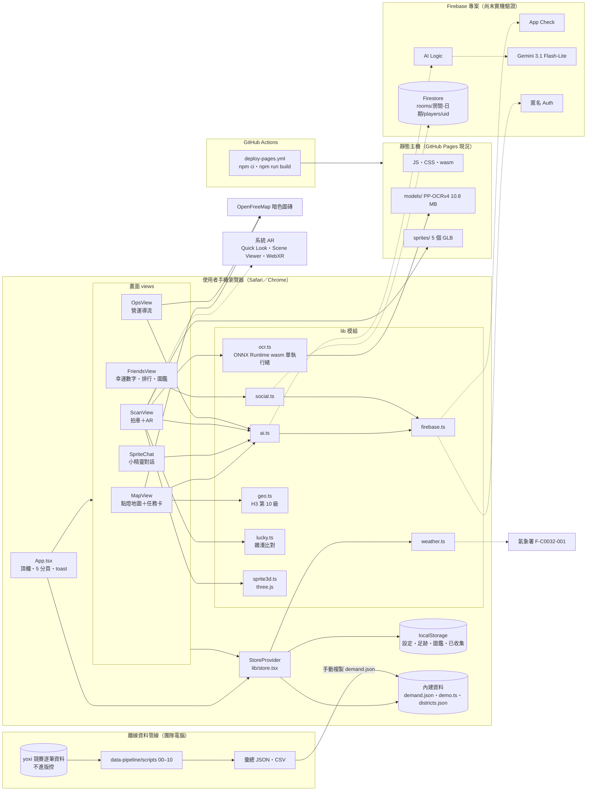
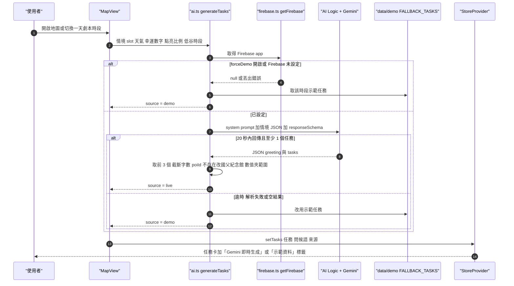
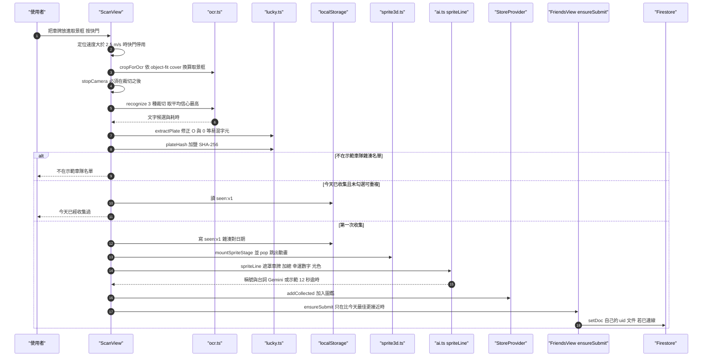
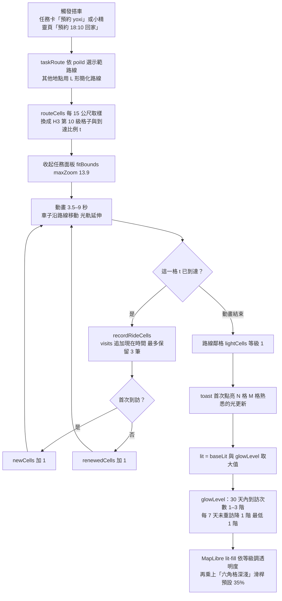
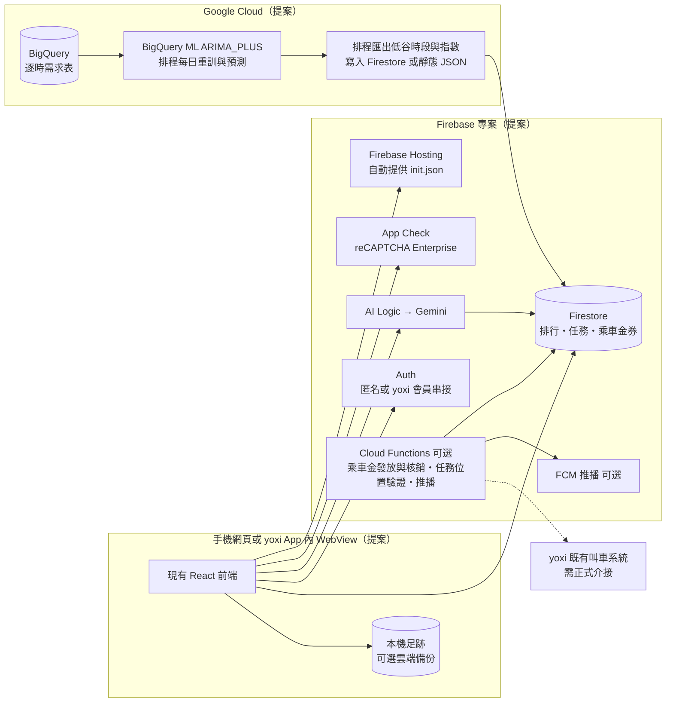

# 03｜技術架構、設計創新亮點與 Demo 規劃

| 項目 | 內容 |
|---|---|
| 文件日期 | 2026-10-12 |
| 分析基準 commit | `18e94b3`（`origin/main`「調整網格大小以及新增調整網格深淺功能」） |
| 文件分支 | `docs/project-discussion-20261012` |
| 系列文件 | [01 專案現況與整體說明](01-project-overview.md)・[02 團隊待決議的 30 題](02-thirty-decision-questions.md)・03 本文・[04 資料狀態](04-data-status.md) |
| 適用讀者 | 全體組員（快讀摘要＋E 節 Demo）；工程師（A、B 節附檔案與 symbol 可回查） |

**證據標記**：【程式碼確認】讀過程式碼確認；【執行驗證】本次實際執行確認；【推論】依程式碼或資料合理推論，未實測；【待確認】需要實機、帳號或外部確認；【提案】未來做法，目前不存在。

**狀態用詞**（與 01、02 一致）：✅ 已驗證可用｜🟡 已實作未驗證｜🟠 部分完成｜🎭 mock／展示用途｜⛔ 尚未實作。

## 目錄

- [快讀摘要](#快讀摘要)
- [A. 現行技術架構](#a-現行技術架構)
  - [A1 技術選型與版本](#a1-技術選型與版本)
  - [A2 各層職責](#a2-各層職責)
  - [A3 系統架構圖（現況）](#a3-系統架構圖現況)
  - [A4 關鍵流程](#a4-關鍵流程)
  - [A5 錯誤處理與降級](#a5-錯誤處理與降級)
  - [A6 狀態管理與本機資料](#a6-狀態管理與本機資料)
  - [A7 驗證、授權與安全](#a7-驗證授權與安全)
  - [A8 部署與 CI/CD](#a8-部署與-cicd)
  - [A9 決賽架構（提案）](#a9-決賽架構提案)
- [B. 關鍵設計與取捨](#b-關鍵設計與取捨)
- [C. 創新亮點與差異化](#c-創新亮點與差異化)
- [D. 團隊共同發想區](#d-團隊共同發想區)
- [E. Demo 規劃](#e-demo-規劃)
- [附錄：外部來源與證據索引](#附錄外部來源與證據索引)

---

## 快讀摘要

1. **架構很單純**：純前端的手機網頁 SPA（React 18＋Vite 5＋TypeScript），沒有自建後端。AI 走 Firebase AI Logic 直接呼叫 Gemini，社交排行走 Firestore，車牌辨識、AR、地圖點亮全部在手機上跑。資料管線（Python）離線執行，只把 0–100 的彙總指數（`src/data/demand.json`）放進 App。【程式碼確認】
2. **離線可 demo、線上未驗證**：`npm run build` 與 `scripts/e2e.py`（手機尺寸無頭 Chromium＋假相機）在 `08538f7` 和 `18e94b3` 各跑一次，**全部通過**；車牌辨識模型檢查 5 張示範車牌全對。【執行驗證】但 Gemini、Firestore、氣象署、真機相機與 AR 都**還沒有實際連線驗證**，目前畫面上的 AI 內容都是標示清楚的「示範資料」。【執行驗證】
3. **線上網址不是最新版**：GitHub Pages（<https://n-cobblers.github.io/Lighting-City/>）可開，但部署的是 `08538f7`；`18e94b3` 的部署 workflow 被取消（run 38253077290）。（I1）【執行驗證】
4. **最能打的亮點**是「用 yoxi 自己的資料找出需求低谷，把任務與限時乘車金排進低谷」的雙邊導流邏輯，以及「照片不離開手機」的車牌辨識。兩者在原型中都有可操作畫面。但「乘車金只在低谷有效」目前只寫在 prompt 和示範資料裡，程式沒有強制檢查。【程式碼確認】
5. **Demo 最大風險**：(1) Gemini 與 Firestore 尚未在 https 真機跑通；(2) `18e94b3` 把點燈格網改為 H3 第 10 級，六角格亮度預設 35%，搭車後點亮比例從約 31% 降到 12%，路線點亮在畫面上不如以前醒目（I4）；(3) 幸運數字依日期計算，今天（10/12）是 26，demo 要在設定覆寫成 21 才能配合示範車牌中獎（I16）。
6. **最先要討論的決策**：[Q01](02-thirty-decision-questions.md#q01)、[Q14](02-thirty-decision-questions.md#q14)、[Q04](02-thirty-decision-questions.md#q04)、[Q06](02-thirty-decision-questions.md#q06)、[Q07](02-thirty-decision-questions.md#q07)；demo 前必須定案再加上 [Q05](02-thirty-decision-questions.md#q05)、[Q18](02-thirty-decision-questions.md#q18)、[Q28](02-thirty-decision-questions.md#q28)、[Q29](02-thirty-decision-questions.md#q29)（見 [02](02-thirty-decision-questions.md)）。
7. **推薦 Demo 主線**：「小涵的一天」，順序是早上 AI 任務、午休步行點亮、路上拍車召喚小精靈、傍晚下雨預約回家點亮路線，最後切到營運頁看低谷導流。詳見 [E 節](#e-demo-規劃)。

---

## A. 現行技術架構

### A1 技術選型與版本

版本取自 `node_modules/<pkg>/package.json` 實際安裝版本（`package.json` 宣告為 `^` 範圍）。【執行驗證】

| 層 | 技術 | 實際版本 | 在專案中的角色 | 位置 |
|---|---|---|---|---|
| UI 框架 | React | 18.3.1 | 單頁應用、5 個分頁 | `../../src/App.tsx` |
| 建置 | Vite（@vitejs/plugin-react 4.3.3） | 5.4.10 | 開發伺服器、建置到 `dist/`、`base: './'` 讓任何子路徑都能部署 | `../../vite.config.ts` |
| 語言 | TypeScript | 5.6.3 | `strict: true`、`noImplicitAny: false`；`npm run build` 先跑 `tsc --noEmit` | `../../tsconfig.json` |
| 地圖 | MapLibre GL JS | 4.7.1 | 點燈地圖與營運熱度地圖；底圖 OpenFreeMap 暗色 | `../../src/views/MapView.tsx`、`../../src/views/OpsView.tsx` |
| 六角格 | h3-js | 4.1.0 | 點燈地圖用第 10 級（`RES = 10`）；資料管線與營運熱度用第 9 級 | `../../src/lib/geo.ts` |
| AI | Firebase JS SDK（`firebase/ai`） | 13.0.0 | Gemini Developer API，預設模型 `gemini-3.1-flash-lite` | `../../src/lib/ai.ts`、`../../src/lib/settings.ts` |
| 身分／資料 | Firebase Auth（匿名）、Cloud Firestore、App Check | 13.0.0 | 好友排行即時同步；AI Logic 的濫用防護 | `../../src/lib/firebase.ts`、`../../src/lib/social.ts`、`../../firestore.rules` |
| 車牌辨識 | ONNX Runtime Web（別名到 `onnxruntime-web/wasm`）＋PaddleOCR PP-OCRv4 辨識模型 | 1.30.0 | 單執行緒 wasm，只做單行辨識 | `../../src/lib/ocr.ts`、`../../public/models/` |
| 3D | three.js | 0.183.2 | 相機畫面上的小精靈跳出動畫、GLB 匯出 | `../../src/lib/sprite3d.ts` |
| AR | @google/model-viewer | 4.4.0 | `ar-modes="webxr scene-viewer quick-look"` 交給系統 AR | `../../src/views/ScanView.tsx`（`ArModal`） |
| 天氣 | 中央氣象署 F-C0032-001 | — | 傍晚降雨機率；預設用「傍晚下雨」情境 | `../../src/lib/weather.ts` |
| 資料管線 | Python 3.11、pandas、本機 OSRM（Docker） | — | 前處理、分析、預測、匯出彙總指數 | `../../data-pipeline/`（詳見 [04](04-data-status.md)） |
| 測試 | Playwright（Python）、onnxruntime（Python） | — | e2e 走過全部分頁；辨識模型檢查 | `../../scripts/e2e.py`、`../../scripts/ocr_check.py` |
| 部署 | GitHub Actions → GitHub Pages；Firebase Hosting 設定已備 | — | 每次推 `main` 自動部署 Pages；Firebase Hosting 尚未部署 | `../../.github/workflows/deploy-pages.yml`、`../../firebase.json` |

**建置產物大小**（`18e94b3`、本機建置）【執行驗證】：主程式 JS 約 1.2 MB（gzip 約 349 KB）；拍車頁 chunk 約 615 KB；model-viewer 約 443 KB；ONNX Runtime wasm 約 14.2 MB，加上辨識模型 10.8 MB，**第一次開「拍車」約需下載 25 MB**。拍車與營運頁用 `React.lazy` 延遲載入（`../../src/App.tsx`）。

### A2 各層職責

| 層 | 模組 | 職責 | 依賴 |
|---|---|---|---|
| 外框 | `App.tsx` | 頂欄（模擬時鐘＝一天劇本、AI 狀態燈、設定）、5 個分頁、toast | `lib/store`、`lib/ai`（`onAiStatus`） |
| 全域狀態 | `lib/store.tsx`（`StoreProvider`、`useStore`） | 設定、模擬時間、天氣、足跡（`baseLit`＋`visits`→`lit`）、任務、圖鑑、分頁、搭車請求 | `lib/settings`、`lib/geo`、`lib/weather`、`lib/lucky`、`data/demo`、`data/demand.json` |
| 設定 | `lib/settings.ts` | 設定型別、預設值、localStorage 讀寫 | — |
| 雲端接入 | `lib/firebase.ts`（`getFirebase`、`ensureUser`） | 解析 Firebase 設定或讀 Hosting 的 `/__/firebase/init.json`；App Check；匿名登入 | Firebase SDK（動態 import） |
| AI | `lib/ai.ts`（`generateTasks`、`chatReply`、`spriteLine`、`opsPlan`） | 4 個 Gemini 功能、情境 JSON、結構化輸出 schema、驗證截斷、示範備援、AI 狀態廣播 | `lib/firebase`、`lib/geo`、`data/demo` |
| 地理 | `lib/geo.ts` | H3 解析度、遊戲範圍、POI（yoxi 上車點座標取自競賽資料彙總）、7 條示範路線、取樣與換格 | h3-js |
| 辨識 | `lib/ocr.ts`（`loadOcr`、`cropForOcr`、`recognize`） | 載模型、取景框裁切、3 種裁切取最高信心 | onnxruntime-web |
| 遊戲規則 | `lib/lucky.ts` | 每日幸運數字、車牌解析與加總、遮罩、加鹽 SHA-256、示範車隊雜湊、配色 | Web Crypto |
| 社交 | `lib/social.ts`（`joinRoom`、`BOTS`） | Firestore 房間即時排行；連不上時回傳離線 handle | `lib/firebase` |
| 天氣 | `lib/weather.ts` | 氣象署 API 解析、傍晚下雨情境 | fetch |
| 3D | `lib/sprite3d.ts` | 小精靈建模、透明疊圖舞台、GLB 匯出 | three.js |
| 畫面 | `views/*.tsx` | 地圖、小精靈對話、拍車、好友、營運、設定 | 上述 lib |
| 資料 | `data/demand.json`、`data/demo.ts`、`data/districts.json` | 彙總指數；虛構玩家「小涵」與示範任務／對話；離線底圖行政區界 | 由 `data-pipeline` 匯出（demand） |

### A3 系統架構圖（現況）

只畫有程式碼證據的元件；虛線是「設定好才會連」的外部服務。



### A4 關鍵流程

#### 流程 1：今日 AI 任務（含示範備援）

觸發點：`MapView` 在「時段」或「傍晚降雨機率」改變時呼叫 `regenerate()`；使用者也可以按「重新生成」。【程式碼確認】



重點：
- 傳給 Gemini 的情境（`contextBlock`）包含虛構玩家「小涵」的常用地點與習慣、天氣、低谷時段（來自 `demand.json`）、幸運數字、點亮進度、可用 POI 清單。【程式碼確認】`../../src/lib/ai.ts`
- `responseSchema` 把 `kind` 與 `poiId` 限定為列舉值，回傳後再做字數截斷與數值夾範圍（`rewardCells` 1–20、`rewardCredit` 0–80）。【程式碼確認】
- **沒有檢查**「`rewardCredit > 0` 的任務必須落在低谷時段」，`window` 也不解析時間格式；這條規則目前只靠 prompt 第 3 點。【程式碼確認】

#### 流程 2：拍車辨識到小精靈與排行



重點：
- 照片與影格只在 `canvas` 上處理，程式中沒有任何上傳影像的呼叫；送給 Gemini 的只有遮罩車牌（如 `TDX-39**`）與數字。【程式碼確認】
- 已收集紀錄存的是車牌雜湊（`yoxi-lighting-city:seen:v1`），但**日期鍵用 `toISOString()`（UTC）**，台灣時間每天早上 8 點才換日；好友排行房間 ID 用本地日期，兩者不一致。【程式碼確認】
- 雜湊的鹽寫在前端原始碼裡（`SALT = 'yoxi-lighting-city-demo'`），台灣車牌空間不大，可以被窮舉；這適合示範「不存明碼」，**不能當成正式隱私保證**。【推論】

#### 流程 3：搭車點亮與足跡亮度



- 每次 render 時依現在時間（含模擬時鐘）重算亮度，不需要背景排程。【程式碼確認】`glowLevel` in `../../src/lib/store.tsx`
- 「我到了」（步行任務）直接點亮 POI 所在格與鄰格，**沒有位置驗證**。【程式碼確認】`doWalk` in `../../src/views/MapView.tsx`
- `18e94b3` 起，舊版第 9 級的本機足跡會用 `cellToChildren` 展開到第 10 級，舊資料不會遺失。【程式碼確認】`expandToCurrentResolution`

#### 流程 4：好友排行與營運派任務（簡述）

- **好友排行**：`FriendsView` 用模組層級單例 `connect()` 只加入一次房間 `rooms/{房間代碼}-{YYYYMMDD}/players/{uid}`，`onSnapshot` 即時更新；真人不到 3 人時補「示範」好友（`BOTS`）。【程式碼確認】
- **營運派任務**：`OpsView` 以 `demand.json` 的格子指數 × 該區「星期×小時」需求型態畫熱度；按「設計空車時段任務」時，若選的小時不是低谷，會自動跳到最近的低谷，再呼叫 `opsPlan`。「附近玩家數」固定 520，預估新增叫車＝520 × 8%＝42，「每位司機多接」＝42 ÷ 12 取整。「推播給附近玩家」只是把任務加到**本機**任務清單，沒有真的推播。【程式碼確認】🎭

### A5 錯誤處理與降級

| 情境 | 偵測方式 | 降級行為 | 畫面標示 | 位置 |
|---|---|---|---|---|
| Firebase 未設定／`forceDemo` | `getFirebase` 回傳 null；`getModel` 丟錯 | 4 個 AI 功能全部用 `data/demo.ts` | 「示範資料（Gemini 未連線）」、AI 燈紅或灰 | `lib/ai.ts` |
| Gemini 逾時 | `withTimeout`：任務、對話、營運 20 秒；拍車台詞 12 秒 | 同上 | 同上；燈號 `error`，`title` 顯示錯誤訊息 | `lib/ai.ts` |
| Gemini 回傳格式錯 | `JSON.parse` 失敗、空任務陣列 | 同上 | 同上 | `lib/ai.ts` |
| OpenFreeMap 載不到 | 7 秒內 style 未載入，或 `error` 事件含 style／fetch 字樣 | 換成內建行政區界的離線夜色底圖 | 「底圖載入失敗，改用離線夜色底圖」 | `MapView.tsx`、`OpsView.tsx` |
| 相機不可用 | 沒有 `getUserMedia` 或使用者拒絕 | 顯示上傳照片／手動輸入車牌 | 「無法開啟相機…」 | `ScanView.tsx` |
| 辨識引擎載入失敗 | `loadOcr` reject（會清掉快取，允許重試） | 停在拍車頁，可改手動輸入 | 「辨識引擎載入失敗：…」 | `ocr.ts`、`ScanView.tsx` |
| 讀不到車牌 | `extractPlate` 回傳 null | 提示重拍，顯示讀到的文字 | 「沒有讀到車牌」 | `ScanView.tsx` |
| 靜態 GLB 不存在 | `HEAD` 請求失敗或回傳 HTML | 現場用 three.js 匯出 blob GLB | 無 | `ArModal` |
| Firestore 連不上 | `joinRoom` 任一步失敗回傳 `live: false` | 示範好友 | 「示範好友（Firestore 未連線）」 | `social.ts`、`FriendsView.tsx` |
| 氣象署失敗 | `fetchCwa` 丟錯 | 改用傍晚下雨情境 | 天氣 chip「・情境」＋ note | `store.tsx` |
| localStorage 不可用 | try/catch | 設定只存在記憶體 | 無 | `settings.ts` |

**缺口**：
- 沒有全域 Error Boundary，畫面元件丟例外時整頁白屏。【程式碼確認】
- 沒有前端錯誤或使用事件上報，現場出錯只能看 console。【程式碼確認】
- AI 燈號是全域最後一次呼叫的狀態，不分功能。【程式碼確認】

### A6 狀態管理與本機資料

單一 React Context（`StoreProvider`），沒有外部狀態庫；少數跨元件單例放在模組層級。【程式碼確認】

| 鍵／單例 | 內容 | 生命週期 | 位置 |
|---|---|---|---|
| `yoxi-lighting-city:settings:v1` | 設定（Firebase 設定字串、App Check 模式與權杖、模型、氣象署授權碼、幸運數字覆寫、房間、暱稱、`forceDemo`、`allowRepeat`） | 永久 | `lib/settings.ts` |
| `yoxi-lighting-city:lit:v6` | 任務與鄰格點亮（`baseLit`，等級 1–3） | 永久；可在設定頁重設 | `lib/store.tsx` |
| `yoxi-lighting-city:visits:v2` | 每格最近 3 次到訪時間（搭車足跡） | 永久；首次載入用「小涵」30 天示範紀錄 | `lib/store.tsx` |
| `yoxi-lighting-city:collected:v1` | 圖鑑（最多 30 筆，只存遮罩車牌） | 永久 | `lib/store.tsx` |
| `yoxi-lighting-city:seen:v1` | 車牌雜湊 → 收集日期（UTC） | 永久，未清理 | `views/ScanView.tsx` |
| `yoxi-lighting-city:best:<UTC 日期>` | 今天最接近幸運數字的紀錄 | 每天一個新鍵，舊鍵未清理 | `views/FriendsView.tsx` |
| `handle`／`joining`／`latest` | Firestore 房間連線單例 | 頁面生命週期 | `views/FriendsView.tsx` |
| `listeners`／`status` | AI 狀態廣播 | 頁面生命週期 | `lib/ai.ts` |
| `bundlePromise` | Firebase 初始化單例；設定變更需重新整理頁面（設定頁會自動 reload） | 頁面生命週期 | `lib/firebase.ts`、`views/SettingsSheet.tsx` |

設計意涵：**足跡只在裝置上**，換手機或清除瀏覽資料就會消失。這符合 CLAUDE.md「單人私有足跡」的決策，但也代表正式版的「長期留存」需要決定足跡是否要（以及如何）同步到雲端。【推論】

### A7 驗證、授權與安全

| 面向 | 現況 | 證據 | 風險／待辦 |
|---|---|---|---|
| 使用者身分 | Firebase 匿名登入，只在加入排行時觸發 | `ensureUser` | 換裝置就是新 uid；暱稱自填無審核【程式碼確認】 |
| Firestore 權限 | 登入者可讀任何房間；只能寫自己 uid 的文件；欄位白名單；`name` ≤ 20 字、`sum` 為 0–36 的整數 | `../../firestore.rules` | `diff`、`palette`、`plateMasked` 未驗型別；房間代碼是唯一門檻；分數由前端自報，可以作弊【程式碼確認】（I12，[Q21](02-thirty-decision-questions.md#q21)） |
| AI 濫用防護 | App Check：偵錯權杖（預設）或 reCAPTCHA v3 | `getFirebase` | 官方文件：**2026-11-02 起 AI Logic 強制 App Check**，早於 11/21 決賽；官方列出的 web 正式 provider 是 reCAPTCHA Enterprise，程式只支援 v3，【待確認】v3 在 AI Logic 是否仍可用；偵錯模式靠 SDK 覆寫一個會丟錯的 `CustomProvider`，需實機確認（I15，[Q05](02-thirty-decision-questions.md#q05)） |
| 金鑰 | Firebase web 設定與氣象署授權碼存在使用者瀏覽器 localStorage；沒有任何秘密寫進原始碼 | `settings.ts` | 氣象署授權碼會出現在前端請求網址【程式碼確認】 |
| 影像隱私 | 照片只在手機上辨識，不上傳；只送遮罩車牌給 Gemini | `ocr.ts`、`ScanView.tsx` | 鹽在前端，雜湊可窮舉（見流程 2）【推論】 |
| 競賽資料 | App 只放 0–100 彙總指數（152 格、星期×小時型態、低谷、預測） | `../../src/data/demand.json`、`.gitignore` | 詳見 [04 資料狀態](04-data-status.md) |
| 拍車安全 | 定位速度 > 2.5 m/s（約時速 9 公里）時停用快門 | `tooFast` | 拒絕定位時不擋，只顯示提醒；沒有「危險路段」判斷【程式碼確認】 |

README 第二節第 6 步建議 reCAPTCHA 網域加入 `localhost`，但 Firebase 官方文件明確寫「不要把 localhost 加進 reCAPTCHA 允許網域來做本機除錯」，應改用偵錯權杖。這是文件與官方建議不一致的地方。【執行驗證：查閱官方文件】

### A8 部署與 CI/CD

| 項目 | 現況 | 證據 |
|---|---|---|
| GitHub Pages | `main` 每次 push 觸發 `deploy-pages.yml`（Node 20、`npm ci`、`npm run build`、上傳 `dist`）。網址 <https://n-cobblers.github.io/Lighting-City/> 回 200，`.onnx` 以 `application/octet-stream`、`.glb` 以 `model/gltf-binary` 提供 | 【執行驗證】`curl`、`gh run list` |
| Pages 版本 | 線上主程式為 `index-_TdyP08-.js`，與本機 `08538f7` 建置相同；`18e94b3` 本機建置為 `index-BclVyxK8.js`。`18e94b3` 的 workflow run 38253077290 狀態 **cancelled**（`concurrency.cancel-in-progress`），所以**線上不是最新版**（I1） | 【執行驗證】 |
| Pages 上的 Firebase | `/__/firebase/init.json` 在 Pages 回 404，必須在設定頁手動貼 Firebase 設定 | 【執行驗證】 |
| Firebase Hosting | `firebase.json` 已設定 GLB、ONNX、wasm 的 Content-Type 與快取；repo 沒有 `.firebaserc`，**尚未部署** | 【程式碼確認】 |
| 測試在 CI | CI 只建置，不跑 e2e 或辨識檢查 | 【程式碼確認】 |
| 環境變數 | 無建置期環境變數；所有設定都在 App 內設定頁輸入 | 【程式碼確認】 |

### A9 決賽架構（提案）

> 【提案】以下不是現況。原則：沿用 Firebase＋Google Cloud 託管服務，不拆微服務、不自架伺服器；只有「錢」和「推播」這兩件不能信任前端的事才加後端函式。相關決策：[Q06](02-thirty-decision-questions.md#q06)（網址與 Hosting）、[Q14](02-thirty-decision-questions.md#q14)（是否轉 Flutter）、[Q15](02-thirty-decision-questions.md#q15)（BigQuery ML）、[Q10](02-thirty-decision-questions.md#q10)（乘車金規則）、[Q13](02-thirty-decision-questions.md#q13)（推播）、[Q20](02-thirty-decision-questions.md#q20)（足跡備份）。



最小改動路徑：(1) 先部署到 Firebase Hosting，免手動貼設定；(2) BigQuery ML 用現成 SQL（`data-pipeline/data/processed/bigquery/sql/01–04`）實跑，結果先手動匯出成 JSON 取代 `demand.json`；(3) 真的要做乘車金與推播時，才加 1–2 個 Cloud Functions。

---

## B. 關鍵設計與取捨

| # | 選擇 | 為什麼在目前條件下合理 | 成本與限制 | 替代方案 | 建議 |
|---|---|---|---|---|---|
| B1 | **手機網頁**而非 Flutter | 開發環境無法編譯 Flutter；網頁免安裝，評審掃 QR code 就能玩；iOS／Android 一套程式【程式碼確認】 | 簡報 P9 與影片旁白仍寫 Flutter、ML Kit、ARCore；網頁相機、AR、背景定位受瀏覽器限制 | Flutter 重寫；Capacitor 包殼 | **暫時維持**。立刻同步簡報與影片文字（I7）；決賽是否轉 Flutter 見 [Q14](02-thirty-decision-questions.md#q14) |
| B2 | **Firebase AI Logic** 直連 Gemini，不自建後端 | 金鑰不放前端、Spark 方案可用、程式量最少 | 綁 App Check；prompt 與 schema 在前端可被看到；無伺服器端的規則強制（例如乘車金限低谷） | Cloud Functions 代理 Gemini | **暫時維持**；乘車金規則若要宣稱「保證只在低谷」，至少加前端驗證，正式版放後端（[Q10](02-thirty-decision-questions.md#q10)） |
| B3 | **ONNX Runtime 單執行緒 wasm** | 多執行緒需要 COOP/COEP 標頭，會擋掉 Google Fonts 與圖磚 | 首次下載約 25 MB；低階手機推論較慢 | WebGPU EP；更小的量化模型 | **暫時維持**；demo 前務必先在 Wi-Fi 暖機 |
| B4 | **只做單行辨識、不做文字偵測** | 取景框已框住車牌；舊做法（偵測＋OpenCV）會讓畫面卡住數十秒，改成單行辨識後約 0.2 秒（CLAUDE.md 記錄） | 車牌必須擺正在框內；斜拍、反光、遠距離容易失敗；真實車牌準確率未測 | 加偵測模型；改用系統 OCR | **暫時維持**；補一輪真實車牌照片測試（[Q11](02-thirty-decision-questions.md#q11)） |
| B5 | **系統 AR**（model-viewer）＋相機疊圖 | 不用自己做平面偵測；iPhone Quick Look、Android Scene Viewer 是系統功能 | 會跳出 App 到系統檢視器；Scene Viewer 不支援 blob URL（社群回報），需靠 `public/sprites/` 靜態 GLB | WebXR 自製；8th Wall 等商用 SDK | **暫時維持**；真機確認 Quick Look 自動轉 USDZ 的效果 |
| B6 | **每個 AI 功能都有示範備援** | 錄影與現場不能被網路卡住 | 評審可能看不到真 AI；示範文案固定，可能與當下數字不一致（例如營運頁 14:00 等車 5.6 分＝中位數，示範理由卻說「比中位數短」） | 預錄即時結果 | **維持**，但 demo 前要讓綠色「Gemini」標籤至少出現一次（[Q04](02-thirty-decision-questions.md#q04)）；修正示範理由文案（I5） |
| B7 | **足跡只存本機** | 隱私最單純；符合「不分享精確路線」決策 | 換機即消失；無法做好友共享地圖或跨裝置留存 | Firestore 加密備份；只上傳格子不含時間 | **暫時維持**；是否雲端備份見 [Q20](02-thirty-decision-questions.md#q20) |
| B8 | **本地預測模型** vs BigQuery ML | 本地「近 4 週型態＋近 7 天水位」已有驗證數字（雙北 WAPE 6.7%） | 營運頁顯示的是 5/1–5/7 的歷史預測，不會每天更新；BQML SQL 尚未實跑 | BQML ARIMA_PLUS 排程 | **暫時維持**；決賽前實跑 BQML 並比較 WAPE（[Q15](02-thirty-decision-questions.md#q15)）；曲線文案改「回測」（I17） |
| B9 | **點燈地圖 H3 第 10 級**（`18e94b3`） | 第 10 級平均每格約 0.015 km²（第 9 級約 0.105 km²），街區足跡更細 | 格數約 7 倍，點亮比例分母變大（搭車後約 12%）；每格更小，加上亮度預設 35%，錄影時不明顯（I4）；營運熱度與資料管線仍是第 9 級 | 回到第 9 級；地圖依縮放切換解析度 | **現在要決定**（[Q07](02-thirty-decision-questions.md#q07)，demo 前定案）；最少把預設亮度調高或只套用在格線 |
| B10 | **設定都在 App 內**（沒有環境變數） | 部署到任何靜態主機都能用；評審手機不用重建 | 每支手機要手動貼設定；設定存在 localStorage | Firebase Hosting 的 init.json；建置期 `VITE_*` 變數 | 改部署 Firebase Hosting 即可消除大部分手動步驟（[Q06](02-thirty-decision-questions.md#q06)） |

**現在值得改善**（小改動、直接影響 demo 或可信度）：
1. 重新觸發 Pages 部署，讓線上版等於 `main`（I1，[Q06](02-thirty-decision-questions.md#q06)）。
2. 決定點燈格網解析度與預設亮度（B9／I4，[Q07](02-thirty-decision-questions.md#q07)）。
3. 日期鍵統一用本地日期（`seen:v1`、`best:` 與房間 ID）（I3，[Q22](02-thirty-decision-questions.md#q22)）。
4. 前端加一行規則：`rewardCredit > 0` 的任務若 `window` 不在低谷，就把乘車金歸零（讓「乘車金限低谷」有程式依據）（[Q10](02-thirty-decision-questions.md#q10)、[Q24](02-thirty-decision-questions.md#q24)）。
5. 修正營運頁示範理由與數字不一致；「推播給附近玩家」改為「加入我的任務（示範）」或加上 🎭 標示（I5，[Q13](02-thirty-decision-questions.md#q13)）。
6. README 的 reCAPTCHA `localhost` 建議改為偵錯權杖（I8、[Q05](02-thirty-decision-questions.md#q05)）。

**暫時維持即可**：手機網頁形式、單執行緒 wasm、單行辨識、系統 AR、本機足跡、本地預測模型、單一 Context 狀態管理。這些在 demo 規模下沒有效能或維護瓶頸，改動的風險大於收益。

---

## C. 創新亮點與差異化

> 寫法原則：「用了 Gemini」「用了 H3」本身不算創新；以下每個亮點都寫出它解決的具體問題與可驗證方式。未經查證不宣稱「首創」。競品與國際案例引用團隊既有研究 [taiwan_market_competitors.md](../research-notes/taiwan_market_competitors.md)、[global_engagement_cases.md](../research-notes/global_engagement_cases.md)，本次**未重新查證**。

### C1 已實作、可以展示

#### C1-1 需求低谷導流：用 yoxi 自己的資料決定任務與乘車金「何時」出現

- **解決的問題**：一般拉高開啟率的做法（簽到、每日抽券）只增加開啟、不管供需；yoxi 現有的每日抽券也要搭車才能兌現（見影片腳本痛點）。乘客端獎勵若剛好落在尖峰，只會讓尖峰更擠。
- **與一般做法的差異**：任務與乘車金的「時段」來自資料管線算出的低谷（需求指數 ≤ 該區平日尖峰 70% 且等車不高於白天中位數）。信義區平日 11–12、14–15、20 點；松山區 11–16、20 點。
- **使用者價值**：乘客在好叫車的時段拿到優惠；司機在原本空車的時段多一單；平台不必把補貼花在尖峰。
- **技術實作**：`data-pipeline` 算出 `low_windows` → `src/data/demand.json` → `LOW_WINDOWS`（`store.tsx`）→ 放進 Gemini 情境（`contextBlock`）與營運頁（`OpsView`）。
- **目前證據**：【程式碼確認】資料流已接通；【執行驗證】營運頁 14:00 顯示「推估低谷」、派任務卡（示範資料）。預測驗證：雙北隔日逐時 WAPE 6.7%（基準 7.7%），信義 16.4%（19.8%）、松山 15.5%（19.7%）。
- **如何證明價值**：試辦時比較「低谷任務組」與對照組在低谷時段的叫車數、等車時間、司機低谷接單數；營運頁可用 A/B 推播比較轉叫車率。
- **還不能宣稱**：乘車金「只能」在低谷折抵（程式沒強制，見 B2）；「預估新增叫車 42」是 520 × 8% 的假設試算；乘客是否真的會因此移到低谷（價格彈性）沒有實測。團隊未提交的研究（`data-pipeline/scripts/12_valley_value.py`）正在做損益兩平試算，數字標示為「試算」，尚未進版控（I14），見 [04](04-data-status.md)。相關決策：[Q10](02-thirty-decision-questions.md#q10)、[Q17](02-thirty-decision-questions.md#q17)、[Q26](02-thirty-decision-questions.md#q26)。

#### C1-2 私有足跡＋重訪亮度與柔和淡化

- **解決的問題**：探索型地圖遊戲（例如迷霧類）多半只獎勵「新地方」，常客每天走同一條通勤路就沒有新鮮感；yoxi 的常客恰好高度規律（上下車點中位數 58% 集中在 2 個格、48% 行程在同一個 3 小時）。
- **與一般做法的差異**：熟悉的路線重訪會「更亮」（30 天內最多 3 階），久未經過每 7 天柔和降一階，但**最低保留一階、不抹除**；足跡只存在裝置上。
- **使用者價值**：規律通勤也有回饋；不會因為一陣子沒搭就「失去進度」的挫折感；不必擔心路線被分享。
- **技術實作**：`visits`（每格最近 3 次時間）＋`glowLevel()`；搭車時 `recordRideCells` 區分「首次點亮」與「熟悉的光更新」。
- **目前證據**：【執行驗證】e2e 搭車後 toast「首次點亮 16 格，16 格熟悉的光也更新了」、點亮比例增加。
- **如何證明價值**：試辦指標看「重訪型使用者」的 7 日／30 日回訪率；訪談是否感受到「熟悉路線變亮」的回饋。
- **還不能宣稱**：留存效果（沒有使用者數據）；足跡跨裝置保存（目前不行，[Q20](02-thirty-decision-questions.md#q20)）。

#### C1-3 照片不離開手機的車牌辨識＋雜湊名單

- **解決的問題**：「拍車」玩法天生涉及路人車牌與街景隱私；上傳到雲端辨識會帶來資料保存與合規疑慮。
- **與一般做法的差異**：辨識在瀏覽器內完成（PP-OCRv4 辨識模型＋ONNX Runtime Web），比對只用加鹽雜湊；送到雲端的只有遮罩車牌與數字。
- **使用者價值**：敢拍、敢玩；司機「自願加入可被收集」的設計（名單外的車不會出現小精靈）。
- **技術實作**：`cropForOcr` → `recognize`（3 種裁切取最高信心）→ `extractPlate` → `plateHash` → `DEMO_FLEET_HASHES`。
- **目前證據**：【執行驗證】`ocr_check.py` 5 張示範車牌全對（信心 0.990–0.997）；e2e 假相機辨識出 TDX-3963。
- **如何證明價值**：真實環境 50–100 張車牌照片的辨識率與耗時（不同光線、角度）；demo 現場直接拍列印車牌。
- **還不能宣稱**：真實車牌準確率（目前只測過合成示範車牌）；雜湊等同匿名（鹽在前端、可窮舉）；防作弊（「車輛即時位置比對」是提案，未實作）。相關決策：[Q11](02-thirty-decision-questions.md#q11)、[Q21](02-thirty-decision-questions.md#q21)。

#### C1-4 每個 AI 功能都有「標示清楚」的示範備援

- **解決的問題**：黑客松 demo 常因網路或 API 配額失敗；把預錄結果冒充即時 AI 又有誠信風險。
- **與一般做法的差異**：4 個 AI 功能失敗時自動切換，畫面同步標示「Gemini」或「示範資料」，頂欄燈號顯示狀態，設定頁可一鍵強制示範模式。
- **使用者價值**：評審與團隊隨時知道看到的是什麼；現場不會卡住。
- **技術實作**：`ai.ts` 各函式 try/catch＋`withTimeout`＋`setStatus`；`data/demo.ts` 依時段準備任務與對話。
- **目前證據**：【執行驗證】e2e 在無 Firebase 下跑完全流程，所有 AI 卡片正確標「示範資料」。
- **如何證明價值**：demo 現場刻意切換 `forceDemo` 示範一次；統計彩排時 live／demo 比例。
- **還不能宣稱**：Gemini 即時生成的品質（尚未實測）。

#### C1-5 AI 輸出受結構約束：列舉 POI、截斷、夾範圍

- **解決的問題**：LLM 任務卡可能捏造地點、獎勵金額或超長文字，直接顯示在 UI 會出錯或造成誤導。
- **與一般做法的差異**：`responseSchema` 把 `kind`、`poiId` 限定為列舉；回傳後再做字數截斷、數值夾範圍、無效 POI 替換；prompt 要求「不要捏造優惠或價格」。
- **使用者價值**：卡片可直接點擊執行（每個 POI 都對應地圖座標與路線）；營運人員看得到 `reason`（資料依據）。
- **技術實作**：`Schema.object`／`Schema.enumString`（`firebase/ai`）＋手寫驗證。
- **目前證據**：【程式碼確認】；Gemini 實際輸出【待確認】。
- **如何證明價值**：彩排時連續生成 30 次，統計需要被截斷或替換的比例、與低谷規則不符的比例。
- **還不能宣稱**：規則（低谷才給乘車金、雨天必有回家任務）一定被遵守，目前只靠 prompt（評估方式見 [Q24](02-thirty-decision-questions.md#q24)）。

#### C1-6 每日幸運數字：不搭車也能和朋友比的輕競賽

- **解決的問題**：好友互動若以「搭車次數」排名，對低頻乘客不公平，而且鼓勵不必要的搭乘。
- **與一般做法的差異**：比的是「路上遇到的 yoxi 車牌數字加總最接近今日數字」，運氣成分高、每天重置；全台同一個數字（依日期雜湊，10–26）。
- **使用者價值**：通勤路上多一個小彩蛋，也是和朋友聊天的話題；不用花錢。
- **技術實作**：`luckyNumber`、`plateDigitSum`、`ensureSubmit`（只送比今天最佳更好的紀錄）、Firestore 即時排行。
- **目前證據**：【執行驗證】示範好友排行；Firestore 兩機同步【待確認】。
- **如何證明價值**：試辦時追蹤「拍車功能使用者」的非搭車日開啟率是否高於未使用者。
- **還不能宣稱**：防作弊（手動輸入車牌也能參賽、分數由前端自報，I12，[Q21](02-thirty-decision-questions.md#q21)）。

### C2 已有雛形、尚需驗證

| 亮點 | 解決的問題 | 與一般做法差異 | 使用者價值 | 實作方式 | 目前證據 | 如何證明 | 還不能宣稱 |
|---|---|---|---|---|---|---|---|
| C2-1 Gemini 即時情境任務 | 每天固定任務容易膩 | 依天氣、時段、常用地點、低谷時段生成，含給營運看的 `reason` | 每天一個具體理由打開 App | `generateTasks` 結構化輸出 | 【程式碼確認】、示範任務【執行驗證】；即時呼叫【待確認】 | 真機出現綠色「Gemini 即時生成」；記錄延遲與規則遵守率 | 個人化效果；成本試算中的 Batch 預生成（程式是即時呼叫） |
| C2-2 Firestore 好友即時排行 | 單人遊戲缺社交拉力 | 房間代碼＋每日分房，免註冊 | 和朋友比 | `joinRoom`、`onSnapshot`、`firestore.rules` | 【程式碼確認】；兩機同步【待確認】 | 兩支手機同房間，一支拍車另一支即時更新 | 防作弊、規模化 |
| C2-3 系統 AR 召喚 | 自製 AR 成本高 | 交給 Quick Look／Scene Viewer | 把小精靈放到地上拍照 | model-viewer＋靜態 GLB | 桌面 3D 檢視【執行驗證】；真機 AR【待確認】 | iPhone、Android 各錄 2 秒 | 所有手機都支援 |
| C2-4 預測接 BigQuery ML | 本地模型不會每天更新 | 用 SQL 排程重訓 ARIMA_PLUS | 營運端每天有新低谷 | `bigquery/sql/01–04` | SQL 存在【程式碼確認】；未實跑 | 實跑並與本地 WAPE 比較 | 「已用 BigQuery ML 預測」（目前不行） |
| C2-5 氣象署即時天氣 | 下雨是叫車高峰的觸發點 | 雨天自動排「下雨前預約回家」任務 | 被提醒、少淋雨 | `fetchCwa` | 程式【程式碼確認】；API 連線與瀏覽器跨網域【待確認】 | 設定授權碼後 chip 顯示「氣象署」 | 預測需求有用到降雨（目前預測模型沒有天氣變數） |

### C3 值得團隊共同發想的新方向

| 方向 | 構想 | 現有基礎 | 對應決策 |
|---|---|---|---|
| C3-1 天氣 × 需求 | 把降雨預報當成需求預測與任務排程的特徵；雨天前一小時推「先預約」 | 天氣情境已在任務 prompt；資料管線尚未併入天氣 | [Q16](02-thirty-decision-questions.md#q16) |
| C3-2 沿真實道路點亮 | 示範路線是手繪折線；改用 OSRM 推估路線，搭車點亮貼合真實道路，也能說「低谷出發少花約 22% 時間」 | `data-pipeline/data/processed/routes/` 已有雙北路段流量 | [Q08](02-thirty-decision-questions.md#q08)；資料見 [04](04-data-status.md) |
| C3-3 司機端畫面 | 司機看到「接下來 2 小時低谷任務會導來的乘客」與「被收集」獎勵 | 營運頁有每位司機多接估算（假設值） | [Q12](02-thirty-decision-questions.md#q12) |
| C3-4 任務位置驗證 | 「我到了」改成定位落在該格才算完成；不做背景追蹤 | 已有 `geolocation.watchPosition`（拍車測速） | [Q09](02-thirty-decision-questions.md#q09) |
| C3-5 低谷價值試算 | 把乘車金成本、增量叫車、司機收入放進同一張損益兩平圖 | 未提交研究 `12_valley_value.py`、`valley_value.json`（I14） | [Q17](02-thirty-decision-questions.md#q17)；資料見 [04](04-data-status.md) |

### C4 外部查證摘要（查閱日期 2026-10-12）

| 主題 | 官方說法 | 對本專案的影響 | 來源 |
|---|---|---|---|
| Firebase AI Logic＋App Check | 從 client 直接呼叫 Gemini 應強制 App Check；**2026-11-02 起強制且無法關閉**；2026 年 7 月起新專案經主控台引導設定會自動強制；web 正式 provider 為 reCAPTCHA Enterprise；偵錯權杖要保密；不要把 localhost 加進 reCAPTCHA 網域 | 決賽（11/21）時一定在強制期內；程式只支援 reCAPTCHA v3 與偵錯權杖，需確認是否足夠 | <https://firebase.google.com/docs/ai-logic/app-check> |
| H3 解析度 | 第 9 級平均約 0.1053 km²、邊長約 0.20 km；第 10 級平均約 0.0150 km²、邊長約 0.076 km | 支持 README「第 10 級約 0.015 km²」的描述 | <https://h3geo.org/docs/core-library/restable/> |
| OpenFreeMap | 公開實例免費、無請求數限制、無 API key；**需要標示出處**，MapLibre 會自動加；影片或印刷要自行加上 | 錄影保留右下角出處（CLAUDE.md 已規定） | <https://openfreemap.org/> |
| model-viewer AR | `ar-modes` 可列 webxr、scene-viewer、quick-look；未提供 `ios-src` 時，iOS 會在按下 AR 時自動產生 USDZ；WebXR 需要 https；社群回報 blob URL 不相容 Scene Viewer | 一定要部署 https；保留 `public/sprites/` 靜態 GLB | <https://modelviewer.dev/examples/augmentedreality/>、<https://www.khronos.org/news/permalink/model-viewer-1.7-released-with-auto-generation-of-usdz-on-the-fly>、<https://discourse.threejs.org/t/passing-a-glb-model-from-three-js-to-model-viewer-ar-scene/30861> |
| PaddleOCR PP-OCRv4 | `ch_PP-OCRv4_rec` 屬 2.x 舊版模型清單；3.x 改名 PP-OCRv4_mobile_rec（模型卡約 11 MB、平均辨識準確率約 83%，為一般文字基準，非車牌）；2.x 與 3.x 權重不可混用 | 更新模型時要注意版本；83% 不能當成車牌準確率引用 | <https://www.paddleocr.ai/v3.4.1/en/version2.x/legacy/model_list_2.x.html>、<https://huggingface.co/PaddlePaddle/PP-OCRv4_mobile_rec> |
| 競品動態 | 團隊既有研究：台灣大車隊 55688、Uber、LINE GO、yoxi、Bolt 的市場結構 | 只作背景，數字請以原研究的來源連結為準 | [taiwan_market_competitors.md](../research-notes/taiwan_market_competitors.md)（未重新查證） |

待研究：Quick Look 對自動轉 USDZ 的材質與發光效果；Gemini 3.1 Flash-Lite 在 AI Logic 上的實際延遲與免費額度（成本頁單價為團隊 10/10 查詢，本次未重查）。

---

## D. 團隊共同發想區

### D1 發想方向（含最小驗證）

每一列都對應 [02 文件](02-thirty-decision-questions.md) 的決策題；發想結果用來補決策前需要的證據，不重複討論已列的選項。

| # | 方向 | 對應決策 | 目前痛點 | 可能解法 | 最小驗證方式（1–3 天內） | 預期價值 | 取捨 |
|---|---|---|---|---|---|---|---|
| D1-1 | 乘車金規則程式化 | [Q10](02-thirty-decision-questions.md#q10)、[Q24](02-thirty-decision-questions.md#q24) | 「限低谷」只在 prompt 裡 | 前端規則＋營運頁顯示「此任務不符低谷，已移除乘車金」 | 連續生成 30 次任務，記錄違規比例 | 商業價值論點有程式依據 | 多一層規則，可能讓任務變少 |
| D1-2 | 點燈視覺強度 | [Q07](02-thirty-decision-questions.md#q07) | 第 10 級＋35% 亮度不醒目 | 縮放依級距切換第 9／10 級；或搭車時暫時加亮 | 錄兩版 10 秒畫面讓 3 位非組員選 | 錄影效果、第一印象 | 解析度切換要處理足跡換算 |
| D1-3 | 不搭車任務的種類 | [Q01](02-thirty-decision-questions.md#q01)、[Q27](02-thirty-decision-questions.md#q27) | 步行任務只有「我到了」 | 雨天備傘提醒、上車點附近店家、等車時間預告 | 在 Gemini prompt 加 2 類任務，看生成品質 | 「每天打開」的理由更多元 | 合作商家需要商務洽談 |
| D1-4 | 拍車防作弊 | [Q11](02-thirty-decision-questions.md#q11)、[Q21](02-thirty-decision-questions.md#q21) | 手動輸入也能參賽 | 手動輸入不列排行；或要求 2 張不同角度照片 | 改一行規則並在 demo 說明 | 競賽公平性的回答 | 降低沒有相機時的可玩性 |
| D1-5 | 司機端一張卡 | [Q12](02-thirty-decision-questions.md#q12) | 只有營運端估算 | 司機 App 卡片：「14–15 點信義區低谷，預估 N 單」 | 畫一張靜態示意圖放簡報 | 雙邊受惠的證據 | 需要 yoxi 司機端資料 |
| D1-6 | 足跡跨裝置 | [Q20](02-thirty-decision-questions.md#q20) | 換機消失 | 只同步格子 ID 與等級（不含時間） | 訪談 5 位通勤族的接受度 | 長期留存 | 與「只存裝置」的隱私承諾衝突 |
| D1-7 | 揪團與活動 | [Q01](02-thirty-decision-questions.md#q01)、[Q27](02-thirty-decision-questions.md#q27) | 揪團只是分享文字 | 大巨蛋散場等活動日，自動生成揪團任務 | 用 2026 已公告的活動日期做 1 個示範任務 | 尖峰時段的併車效益 | 尖峰導流與低谷導流的目標要分清 |

### D2 會議中的短發想流程（約 35 分鐘）

| 時間 | 步驟 | 做法 | 產出 |
|---|---|---|---|
| 0–5 分 | 對齊問題 | 主持人念出一個 D1 方向的「目前痛點」與相關 Q 編號 | 一句話問題 |
| 5–13 分 | 安靜發想 | 每人 3 張便利貼：「我們可以…，讓小涵…」 | 每人 3 個點子 |
| 13–20 分 | 分群 | 貼上白板，相似的合併，每群命名 | 4–6 群 |
| 20–27 分 | 投票 | 每人 3 票，依「demo 前做得完」與「能被驗證」投 | 前 2 名 |
| 27–35 分 | 填卡 | 用下方模板填前 2 名，指定負責人 | 2 張發想卡 |

### D3 發想卡模板

```markdown
### 發想卡：<名稱>
- 對應決策：Q__（見 02 文件）
- 目前痛點（附證據：檔案、畫面或數據）：
- 解法一句話：
- 使用者故事：小涵在 ___ 時，因為 ___，所以 ___。
- 最小驗證（≤3 天）：做什麼、看哪個數字、成功標準：
- 預期價值（乘客／司機／yoxi）：
- 取捨與風險：
- 需要的資料或權限：
- 負責人／期限：
```

---

## E. Demo 規劃

### E1 主線故事與成功標準

**主線：「小涵的一天」**。小涵是虛構的 27 歲信義區上班族，住民生社區，平常下班搭 yoxi 走敦化北路回家。一天裡她打開 yoxi 四次，只有一次真的叫車：

1. **早上 08:30**：小精靈送上今日 3 個任務與幸運數字（不用搭車也有理由打開）。
2. **午休 12:30**：步行到國父紀念館，按「我到了」點亮一格（不搭車的任務）。
3. **路上 15:00**：遇到 yoxi 車，拍車牌召喚小精靈，車牌加總 21 正好中獎，AR 放到地上（社交與彩蛋）。
4. **傍晚 18:05**：降雨 80%，小精靈建議預約回家，地圖沿光復南北路一路點亮，熟悉的路也更新光暈（真實叫車轉換）。
5. **營運視角**：信義區 14:00 是低谷，AI 派任務把乘客導到空車時段（雙邊受惠）。

**成功標準**：

| # | 標準 | 判定方式 |
|---|---|---|
| S1 | 3 分鐘內走完 1–4，沒有卡住或白屏 | 計時彩排 3 次全過 |
| S2 | 至少一張 AI 卡片顯示綠色「Gemini」標籤（補齊後版本） | 錄影或現場畫面 |
| S3 | 拍車 3 次內辨識出示範車牌，並出現「中了！」 | 彩排紀錄 |
| S4 | 搭車點亮後，點亮比例增加且 toast 出現「首次點亮 N 格」 | 畫面 |
| S5 | 每個 🎭 內容都有口頭或畫面揭露 | 對照 [E10](#e10-mock預錄預先計算揭露清單) |
| S6 | 營運頁能說出 1 個資料數字與其來源 | 講者稿 |

### E2 「現在可展示版本」與「補齊後版本」

| 環節 | 現在可展示（`18e94b3`，本機或 Pages） | 補齊後版本 | 補齊依賴 |
|---|---|---|---|
| AI 任務、對話、拍車台詞、營運理由（F4、F5、F14） | 示範備援 ✅，畫面標「示範資料」 | Gemini 即時生成（綠標），目前 🟡 | Firebase 專案＋AI Logic＋App Check＋https 部署（[Q04](02-thirty-decision-questions.md#q04)、[Q05](02-thirty-decision-questions.md#q05)） |
| 好友排行（F10） | 🎭 示範好友 | 兩支手機即時同步 | Firestore＋規則部署（[Q05](02-thirty-decision-questions.md#q05)） |
| 拍車辨識（F6、F7） | ✅ 桌面假相機與示範車牌；真機 🟡 | 真機拍列印車牌 | https 網址、手機（[Q06](02-thirty-decision-questions.md#q06)、[Q11](02-thirty-decision-questions.md#q11)） |
| AR 召喚（F9） | ✅ 桌面 3D 檢視；真機 AR 🟡 | iPhone Quick Look、Android Scene Viewer | https 網址、手機 |
| 搭車點亮（F2、F3） | 🎭 模擬路線動畫，點亮與重訪邏輯經 e2e 驗證 | 同左，點亮更醒目 | 決定 H3 級數與亮度（I4，[Q07](02-thirty-decision-questions.md#q07)） |
| 天氣（F15） | 🎭 傍晚下雨情境 | 可選氣象署即時 | 氣象署授權碼；跨網域【待確認】（[Q16](02-thirty-decision-questions.md#q16)） |
| 營運預測與派任務（F13、F14、F18） | ✅ 彙總指數與 5/1–5/7 回測預測；推播與預估叫車 🎭 | BQML 實跑結果 | BigQuery 專案（[Q15](02-thirty-decision-questions.md#q15)） |

**目前可以完成的端到端**：在桌面或手機瀏覽器、無任何帳號下，完整走過主線 1–5，全部 AI 內容為示範資料。**阻塞點**：「真 AI」與「真社交」兩段需要 Firebase 設定與 https 實機驗證，本次環境無法執行。

### E3 事前準備：帳號、資料、設定、指令

**帳號與服務**（不在文件中記錄任何金鑰）：

| 項目 | 用途 | 必要性 |
|---|---|---|
| Firebase 專案（Spark） | AI Logic、匿名 Auth、Firestore、App Check、Hosting | 補齊後版本必要 |
| App Check 偵錯權杖或 reCAPTCHA 網站金鑰 | AI Logic 驗證 | 同上；11/2 後強制 |
| 氣象署開放資料授權碼 | 即時天氣 | 可選 |
| GitHub repo 寫入權限 | 重新觸發 Pages 部署 | 現在可展示版本建議 |

**App 設定頁輸入**（右上角齒輪，存在手機 localStorage）：Firebase 設定（`firebaseConfig`，部署在 Firebase Hosting 時可留空）、App Check 模式與權杖／網站金鑰、Gemini 模型（預設 `gemini-3.1-flash-lite`）、房間代碼、天氣來源、今日幸運數字、可重複收集、全部使用示範資料。

**測試資料**：示範車牌 TDX-3963（加總 21）、TDX-5528（20）、TDX-7708（22）、TDX-1832（14）、ABC-1234（非車隊）。PNG 在 `../../docs/plates/`，可列印 PDF 由 `python scripts/make_fixtures.py` 產生（會覆寫 PNG，產生後請用 `git checkout -- docs/plates/*.png` 還原，或只取用 PDF）。

**啟動指令**：

```bash
npm ci                              # 或 npm install
npm run build                       # tsc 型別檢查 + vite 建置
npm run preview -- --port 4173      # 本機預覽 http://localhost:4173/
# 手機要用相機與 AR 必須是 https：部署到 GitHub Pages 或 Firebase Hosting
npx firebase-tools deploy --only hosting,firestore:rules   # 需先建立 .firebaserc
```

**e2e 測試**：

```bash
pip install -r scripts/requirements.txt
python -m playwright install chromium   # 本次環境下載失敗（網路限制）
python scripts/make_fixtures.py         # 假相機影片（需要 ffmpeg）
python scripts/e2e.py                   # 需先 build + preview
```

若 `playwright install` 無法下載瀏覽器，本次改用已安裝的舊版 Chromium，以包裝腳本指定 `executable_path` 後執行原本的 `scripts/e2e.py`（包裝腳本放在本機暫存區，未進版控）：

```python
import runpy, sys
from playwright.sync_api._generated import BrowserType
EXE = r"<已安裝的 chrome.exe 路徑>"
_orig = BrowserType.launch
BrowserType.launch = lambda self, *a, **kw: _orig(self, *a, **{**kw, "executable_path": EXE})
sys.argv = ["scripts/e2e.py"]
runpy.run_path("scripts/e2e.py", run_name="__main__")
```

**錄影／現場設定清單**：
1. 幸運數字填 **21**（今天 10/12 自動值是 26，不覆寫的話 TDX-3963 會顯示「差 5」）（I16）。
2. 天氣選「示範情境：傍晚下雨」。
3. 彩排勾「同一台車可以重複收集」，正式前取消，才能展示「每車每人每天一次」。
4. 設定頁「重設點燈進度與圖鑑」，從小涵的初始狀態開始。
5. 地圖「六角格深淺」滑桿調到 70–100%（I4）。
6. 兩支手機填同一個房間代碼（補齊後版本）。
7. 保留畫面上的「黑客松原型」標籤與地圖右下角 OpenFreeMap／OpenStreetMap 出處。

### E4 3 分鐘精簡版

適用：決賽現場的開場 demo 或評審追問時的快速展示。以「現在可展示版本」為準；補齊後把 🎭 改成綠標即可，腳本不變。

| 時間 | 操作步驟 | 畫面或輸入 | 預期輸出 | 講者說詞（要點） | 證明什麼 |
|---|---|---|---|---|---|
| 0:00–0:20 | 不操作，手機停在地圖頁 | 夜色地圖、已點亮的敦化北路足跡 | — | 「當月有搭車的乘客，平均 89% 的日子不搭車。叫車 App 只在要出門時被打開。」 | 問題來自 yoxi 資料 |
| 0:20–0:50 | 點時鐘 → 「早上 08:30」 | 任務卡、幸運數字 21、降雨 80% | 3 張任務：步行、低谷搭車（乘車金 30 元）、下雨前預約回家；標籤 Gemini 或示範資料 | 「小精靈依天氣、常用地點和空車低谷排任務。這張乘車金只在 14–16 點有效，因為那是信義區的低谷。」 | AI 個人化＋導流邏輯 |
| 0:50–1:40 | 時鐘 →「路上 15:00」；對準列印車牌 TDX-3963 按快門；按「AR 召喚」 | 取景框、辨識中、小精靈跳出 | 「中了！」車牌加總 21；（真機）Quick Look／Scene Viewer | 「辨識在手機上完成，照片不上傳；只有自願加入的車才會出現小精靈。」 | 端上 AI、隱私設計、趣味 |
| 1:40–2:20 | 時鐘 →「傍晚 18:05」；小精靈頁按「預約 18:10 回家」 | 下雨提醒、地圖路線動畫 | 光軌沿光復南北路延伸；toast「首次點亮 N 格，M 格熟悉的光也更新了」 | 「不搭車的日子讓她每天打開，下雨這一刻變成真實叫車；熟悉的路會更亮。」 | 不搭車互動 → 叫車轉換 |
| 2:20–2:50 | 切到營運頁，滑到 14:00，按「設計空車時段任務」 | 熱度地圖、低谷刻度、預測曲線 | 「推估低谷」、派任務卡 | 「隔日逐時預測雙北 WAPE 6.7%。任務排進低谷，乘客叫得到車，司機多一單。預估叫車數是假設試算。」 | 雙邊價值、資料依據 |
| 2:50–3:00 | 停在營運頁 | — | — | 「人物與車牌都是虛構的；標示示範資料的是預先準備的內容。」 | 誠實揭露 |

### E5 8–10 分鐘完整版

| 時間 | 操作步驟 | 畫面或輸入 | 預期輸出 | 講者說詞（要點） | 證明什麼 |
|---|---|---|---|---|---|
| 0:00–1:00 | 簡報或地圖頁 | 資料發現 3 個數字 | — | 「89% 的日子不搭車；33% 三個月只搭 1 次；搭 5 次以上的 34% 乘客貢獻 83% 行程，而且上下車點中位數 58% 集中在 2 個格子。」（`metrics.json`） | **使用者遇到的具體問題**，以及個人化的資料依據 |
| 1:00–1:30 | 地圖頁，介紹介面 | 頂欄時鐘、AI 燈號、5 個分頁、「黑客松原型」 | — | 「這是 yoxi App 裡的新分頁。城市一開始是夜色。右上角燈號告訴你 AI 是即時還是示範。」 | 產品定位與誠實標示 |
| 1:30–2:30 | 時鐘 →「早上 08:30」；（補齊後）按「重新生成」 | 任務卡＋`reason` | 3 張任務；綠標或示範標籤 | 「Gemini 拿到的是天氣、時段、她的常用地點和兩區的低谷時段，輸出被限定成地圖上真的存在的地點。」 | **核心 AI 流程**、結構化輸出 |
| 2:30–3:15 | 時鐘 →「午休 12:30」；步行任務按「我到了」 | 地圖飛到 POI | 該格與鄰格點亮、toast | 「一半的任務不用搭車。完成就點亮一格。」（說明：目前沒有位置驗證） | 不搭車也打開的理由 |
| 3:15–4:45 | 時鐘 →「路上 15:00」→ 拍 TDX-3963 →「AR 召喚」→「在真實場景中放置」→ 再拍 ABC-1234 | 辨識中 → 小精靈；ABC-1234 → 「不在示範車隊名單」 | 中獎、圖鑑多一隻；非車隊被拒 | 「模型 10.8 MB 在手機上跑，大約 0.2 秒；比對只用雜湊。走太快時快門會停用。」 | **最有價值的亮點之一**：端上辨識＋隱私＋安全 |
| 4:45–5:30 | 好友頁；（補齊後）另一支手機同房間拍 TDX-5528 | 幸運數字、排行、圖鑑 | 排行即時更新；示範好友標「示範」 | 「比的是運氣，不是搭車次數，對低頻乘客公平。」 | 社交拉力 |
| 5:30–6:45 | 時鐘 →「傍晚 18:05」→ 小精靈頁問「今晚會下雨嗎？」→ 按「預約 18:10 回家」 | 對話、地圖動畫 | 路線點亮；toast 分「首次」與「熟悉」 | 「熟悉的路會更暖；7 天沒經過會慢慢變淡，但不會消失。足跡只存在這支手機。」 | **端到端轉換**：互動 → 叫車；重訪亮度亮點 |
| 6:45–8:15 | 營運頁：切信義／松山、滑時間軸、按「設計空車時段任務」、「推播給附近玩家」 | 熱度、低谷刻度、7 天預測、派任務卡 | 低谷提示、理由、KPI | 「信義區平日 11–12、14–15、20 點是低谷；預測比『上週同時段』基準誤差低 12–21%。推播目前只加到本機任務清單。」 | **結果如何判讀與驗證**：預測誤差、低谷定義 |
| 8:15–9:15 | 回到地圖或簡報驗證頁 | 北極星指標 | — | 「試辦看非搭車日開啟率、任務轉叫車率、司機低谷接單數；單一行政區 3 個月對照。」 | 驗證方法 |
| 9:15–10:00 | 簡報限制頁 | 已知限制清單 | — | 「目前是網頁原型；乘車金規則還沒有後端保證；預估叫車數是假設；真實車牌準確率待測。下一步是…」 | **已知限制與下一步** |

### E6 本次實際執行過的步驟及結果

| # | 步驟 | 基準 | 結果 | 標記 |
|---|---|---|---|---|
| 1 | `npm run build`（tsc＋vite） | `08538f7` | 通過，vite 約 5 秒 | 【執行驗證】 |
| 2 | `python scripts/make_fixtures.py` | `08538f7` | 產生假相機影片；副作用：覆寫 `docs/plates/*.png` 並產生 PDF（已還原，未提交） | 【執行驗證】 |
| 3 | `python -m playwright install chromium` | — | **失敗**（瀏覽器下載被網路擋） | 【執行驗證】 |
| 4 | `scripts/e2e.py`（改用已安裝 Chromium 1223） | `08538f7` | **全部通過**，約 70 秒；搭車後點亮 19% → 31% | 【執行驗證】 |
| 5 | `npm run build` | `18e94b3` | 通過 | 【執行驗證】 |
| 6 | `scripts/e2e.py` | `18e94b3` | **全部通過**，約 60 秒；搭車後點亮約 12%，toast「首次點亮 16 格，16 格熟悉的光也更新了」 | 【執行驗證】 |
| 7 | `python scripts/ocr_check.py` | — | 5 張示範車牌全部正確，信心 0.990–0.997 | 【執行驗證】 |
| 8 | 探測 GitHub Pages | 線上 | 200；主程式雜湊等於 `08538f7`；ONNX、GLB 型別正確；`init.json` 404 | 【執行驗證】 |
| 9 | `gh run list` | — | `18e94b3` 部署 cancelled；`08538f7` 部署 success | 【執行驗證】 |
| 10 | OpenFreeMap 暗色樣式 | — | 回 200，e2e 截圖顯示真實圖磚 | 【執行驗證】 |

**未執行**（需要實機、帳號或本環境無法連線）：iPhone Safari／Android Chrome 實機；Gemini 即時呼叫（無 Firebase 設定）；Firestore 兩機同步；氣象署 API；Quick Look／Scene Viewer／WebXR；Firebase Hosting 部署；BigQuery ML；資料管線重跑（逐筆資料只在團隊本機）。

### E7 Demo 前最小補齊清單（依重要性）

順序與 [01 文件 8.1 節](01-project-overview.md#81-demo-前必須完成) 一致；量：S＝半天內，M＝1–2 天（相對估計，非工期承諾）。

| # | 項目 | 為什麼 | 量 | 依賴／決策 | 問題編號 |
|---|---|---|---|---|---|
| 1 | 重新部署最新 `main` 到 Pages（或改用 Firebase Hosting 作唯一 demo 網址），iPhone 與 Android 各實機跑完整主線一次並記錄錯誤 | 線上版本落後；目前只驗過桌面無頭瀏覽器 | S＋M | [Q06](02-thirty-decision-questions.md#q06) | I1 |
| 2 | 決定格網解析度與預設亮度，讓搭車點亮清楚可見；e2e 補檢查 | 搭車點亮是第一個「哇」時刻，現在太淡 | S | [Q07](02-thirty-decision-questions.md#q07) | I4 |
| 3 | 建 Firebase 專案（AI Logic、App Check、匿名登入、Firestore＋rules），驗證 Gemini 綠標與兩機排行；或依 Q04 決定全程示範並在講稿揭露 | 決賽 AI 整合度占 20%；11/2 起 AI Logic 強制 App Check | M | [Q04](02-thirty-decision-questions.md#q04)、[Q05](02-thirty-decision-questions.md#q05) | I2、I15 |
| 4 | 日期鍵改本地日期（`seen:v1`、`best:` 與房間 ID 一致） | 台灣 00:00–08:00 收集紀錄與排行錯位 | S | [Q22](02-thirty-decision-questions.md#q22) | I3 |
| 5 | 修營運示範理由文案；推播任務的地點與乘車金依行政區 | 14:00 等車＝中位數，示範理由卻寫「比中位數短」 | S | [Q13](02-thirty-decision-questions.md#q13) | I5 |
| 6 | 更新簡報 P9、影片旁白（Flutter、ML Kit、ARCore、「用降雨預報預測」）、車資 NT$254 與 SOM 約 1.6 億 | 評審追問時前後矛盾 | S | [Q14](02-thirty-decision-questions.md#q14)、[Q16](02-thirty-decision-questions.md#q16) | I7 |
| 7 | 準備道具（列印示範車牌）、幸運數字 21、重置流程、雙手機同房間 | 忘記覆寫就不會「中了！」 | S | [Q11](02-thirty-decision-questions.md#q11)、[Q28](02-thirty-decision-questions.md#q28) | I16 |
| 8 | 預錄完整主線備援影片 | 網路或 API 全掛時的最後備案 | S | 1–7、[Q29](02-thirty-decision-questions.md#q29) | — |

### E8 暖機、重置與預演

**暖機（demo 前 30 分鐘）**：
1. 用 demo 手機在 Wi-Fi 下打開網址，切到「拍車」頁，等狀態不再顯示「載入辨識引擎／載入車牌模型」（約 25 MB，之後由瀏覽器快取）。
2. 地圖頁在信義／松山範圍來回縮放一次，讓圖磚進快取；營運頁也開一次。
3. 打開 AR 召喚一次，讓 model-viewer 與 GLB 進快取。
4. （補齊後）按一次「重新生成」，確認綠標，確認 AI 燈號為綠色。
5. 允許相機與定位權限（第一次會跳權限視窗）。

**重置流程（每次彩排之間）**：
1. 設定 →「重設點燈進度與圖鑑」（足跡回到小涵 30 天初始狀態，圖鑑清空）。
2. 「今天已經收集過」的紀錄（`seen:v1`）不會被重設：彩排時勾「同一台車可以重複收集」，正式前取消；或在瀏覽器清除網站資料（會一併清掉設定，需要重填）。
3. 時鐘 →「回到現在時間」，再依腳本切時段。
4. 好友排行的「今天最佳」存在 `best:<UTC 日期>`，清除網站資料才會重置。

**預演方式**：
- 每人至少完整跑 3 次 3 分鐘版；計時、記錄卡住點。
- 一次「斷網預演」：開啟飛航模式（已暖機），確認全部示範備援可用。
- 一次「強制示範」預演：設定勾「全部使用示範資料」，確認講者稿在示範標籤下仍成立。
- 準備一份預錄影片（主線 1–5）放在手機相簿與筆電，作為最後備案。

### E9 失敗備援矩陣

| 失敗 | 現場徵兆 | 自動降級 | 講者應對 | 最後備案 |
|---|---|---|---|---|
| OpenFreeMap 圖磚載不到 | 7 秒後出現「改用離線夜色底圖」 | 行政區界底圖，點亮與路線照常 | 「這是離線底圖，點亮邏輯不受影響。」 | 預錄影片 |
| Gemini 失敗／逾時 | 任務卡「示範資料」、燈號紅 | 依時段示範任務、對話關鍵字回覆 | 「AI 連線中斷時自動切示範，畫面會標示。」 | 預錄的綠標畫面截圖 |
| Firestore 失敗 | 「示範好友（Firestore 未連線）」 | 3 位示範好友 | 照常講規則 | 截圖 |
| 相機權限被拒 | 「無法開啟相機」 | 上傳照片或手動輸入 | 改手動輸入 TDX-3963（可補充：正式版手動輸入不列排行是提案，見 D1-4） | — |
| 辨識失敗 | 「沒有讀到車牌」 | 顯示讀到的文字 | 靠近、擺正再拍；最多 2 次後改手動輸入 | — |
| 辨識引擎下載太慢 | 「載入辨識引擎…」 | — | 先講營運頁，回來再拍 | 預錄影片 |
| AR 無法開啟 | 按「在真實場景中放置」沒反應 | 仍可在視窗內旋轉 3D 模型 | 「有些機型不支援系統 AR，模型照樣可以看。」 | AR 預錄片段 |
| 網路全斷 | 多處示範標籤 | 全部本機運作（已暖機前提） | 主動說明這就是備援設計 | 預錄影片 |
| 點亮不明顯 | 路線格子淡 | — | 先把「六角格深淺」調到 100% | — |

### E10 Mock／預錄／預先計算揭露清單

| 內容 | 性質 | 位置 | 揭露方式 |
|---|---|---|---|
| 玩家「小涵」與 30 天搭車紀錄 | 🎭 虛構人物；行為型態參考常客彙總特徵 | `../../src/data/demo.ts` | 口頭＋簡報註記 |
| 示範車牌 TDX-3963 等 | 🎭 虛構；示範車隊只存雜湊 | `../../src/lib/lucky.ts`、`docs/plates/` | 畫面「黑客松原型」＋口頭 |
| 示範好友小安、阿哲、Mia | 🎭 | `BOTS` in `../../src/lib/social.ts` | 畫面「示範」標籤 |
| 傍晚下雨天氣 | 🎭 情境 | `rainScenario` | 天氣 chip「・情境」 |
| 示範任務、對話、拍車台詞、營運理由 | 🎭 預先寫好 | `../../src/data/demo.ts` | 「示範資料」標籤 |
| 搭車 | 🎭 模擬路線動畫，非真實叫車或 GPS | `ROUTES` in `../../src/lib/geo.ts` | 口頭 |
| 「預估新增叫車 42」「每位司機多接 +4」 | 假設試算（520 人 × 8%，÷ 12 位司機） | `../../src/views/OpsView.tsx` | 畫面已有小字；口頭再說 |
| 下一週需求預測 | 預先計算：以 4/30 前資料預測 5/1–5/7，不是即時 | `demand.json` `forecast` | 畫面小字；口頭 |
| 需求熱度與低谷 | 預先計算的競賽資料彙總指數 | `demand.json` | 口頭說明資料期間 2026/2/1–4/30 |
| 推播給附近玩家 | 🎭 只加入本機任務 | `push` in `OpsView.tsx` | 口頭 |
| 預錄影片（若使用） | 預錄 | — | 播放前說「這是預錄」 |

### E11 聽眾可能追問與有證據的回答

| # | 可能追問 | 回答要點 | 證據 |
|---|---|---|---|
| 1 | 不搭車的人為什麼要打開？ | 每天 3 個情境任務、一半不用搭車；幸運數字與拍車彩蛋；足跡重訪更亮 | `FALLBACK_TASKS`、`TASK_SYSTEM` 規則 1 |
| 2 | 怎麼確定導流真的有用？ | 現在能證明的是「低谷存在且可預測」：雙北隔日 WAPE 6.7%，比基準好 12–21%；導流效果要試辦對照驗證 | `metrics.json`、`forecast_results.json`、[04](04-data-status.md) |
| 3 | 為什麼選這些低谷時段？ | 定義：平日 8–22 點中需求 ≤ 尖峰 70% 且等車不高於白天中位數 | `docs/data-analysis-report.md` 第 6 章 |
| 4 | 車牌照片會上傳嗎？ | 不會；辨識在手機上，送給 AI 的只有遮罩車牌與數字 | `ocr.ts`、`spriteLine` |
| 5 | 司機會不會反感被拍？ | 只有自願加入的車才會出現小精靈；名單外車牌顯示「不在名單」 | `DEMO_FLEET_HASHES`、`notfleet` 畫面 |
| 6 | 邊走邊拍危險嗎？ | 定位速度超過約時速 9 公里時停用快門；文案提醒只拍停妥的車 | `tooFast`、`CHAT_SYSTEM` |
| 7 | 成本多少？ | 簡報試算每位月活每月約 NT$0.65–0.71（Gemini 為主，Batch 預生成）；原型目前是即時呼叫，成本試算屬提案 | `docs/proposal-deck/slides/cost.html` |
| 8 | AI 會不會亂給優惠？ | 輸出受 schema 限制，金額夾在 0–80 元；prompt 禁止捏造優惠；低谷限制目前尚未程式強制（已列為補齊項） | `generateTasks` |
| 9 | 用了哪些 yoxi 資料？會不會洩漏？ | 約 96.5 萬筆行程只在團隊內部分析；App 只有 152 格的 0–100 指數與時段型態 | `demand.json`、`.gitignore`、[04](04-data-status.md) |
| 10 | 為什麼是網頁不是 App？ | 黑客松時程與開發環境限制；評審掃碼即玩；正式版可放進 yoxi App 分頁或轉原生 | `docs/implementation-decisions.md` |
| 11 | 留存怎麼量？ | 北極星指標：非搭車日開啟率；輔助：週活躍天數、任務轉叫車率、30 日留存、司機低谷接單數 | `docs/proposal-deck/slides/validate.html` |
| 12 | 好友排行可以作弊嗎？ | 原型的分數由前端回報、手動輸入也能參賽；正式版要車輛即時位置比對或伺服器驗證 | `firestore.rules`、`fromManual` |
| 13 | 車資數字依據？ | 資料平均車資約 NT$254（雙北 NT$266），以車資區間中點估計 | `metrics.json`、分析報告限制章 |
| 14 | 預測有用天氣嗎？ | 目前預測模型只用歷史型態與近期水位，沒有天氣變數；天氣只用在任務生成 | `data-pipeline/scripts/04_forecast.py`、`weather.ts` |

---

## 附錄：外部來源與證據索引

### 外部來源（查閱日期 2026-10-12）

- Firebase AI Logic：App Check 說明 <https://firebase.google.com/docs/ai-logic/app-check>
- H3 解析度表 <https://h3geo.org/docs/core-library/restable/>
- OpenFreeMap <https://openfreemap.org/>、快速開始 <https://openfreemap.org/quick_start/>
- model-viewer AR 範例 <https://modelviewer.dev/examples/augmentedreality/>；USDZ 自動產生（Khronos 新聞）<https://www.khronos.org/news/permalink/model-viewer-1.7-released-with-auto-generation-of-usdz-on-the-fly>；blob URL 與 Scene Viewer（three.js 論壇，社群回報）<https://discourse.threejs.org/t/passing-a-glb-model-from-three-js-to-model-viewer-ar-scene/30861>
- PaddleOCR 2.x 模型清單 <https://www.paddleocr.ai/v3.4.1/en/version2.x/legacy/model_list_2.x.html>；PP-OCRv4_mobile_rec 模型卡 <https://huggingface.co/PaddlePaddle/PP-OCRv4_mobile_rec>

### 程式證據索引

| 主題 | 檔案 | symbol／設定 |
|---|---|---|
| AI 四功能與備援 | [`src/lib/ai.ts`](../../src/lib/ai.ts) | `generateTasks`、`chatReply`、`spriteLine`、`opsPlan`、`withTimeout`、`TIMEOUT_MS` |
| Firebase 初始化 | [`src/lib/firebase.ts`](../../src/lib/firebase.ts) | `getFirebase`、`hostingConfig`、`ensureUser` |
| 全域狀態與足跡 | [`src/lib/store.tsx`](../../src/lib/store.tsx) | `StoreProvider`、`glowLevel`、`recordRideCells`、`lightCells`、`expandToCurrentResolution`、`LOW_WINDOWS` |
| H3 與路線 | [`src/lib/geo.ts`](../../src/lib/geo.ts) | `RES`、`AREA_CELLS`、`POIS`、`ROUTES`、`routeCells` |
| 車牌辨識 | [`src/lib/ocr.ts`](../../src/lib/ocr.ts) | `loadOcr`、`cropForOcr`、`recognize` |
| 遊戲規則 | [`src/lib/lucky.ts`](../../src/lib/lucky.ts) | `luckyNumber`、`extractPlate`、`plateHash`、`DEMO_FLEET_HASHES` |
| 排行 | [`src/lib/social.ts`](../../src/lib/social.ts)、[`src/views/FriendsView.tsx`](../../src/views/FriendsView.tsx)、[`firestore.rules`](../../firestore.rules) | `joinRoom`、`ensureSubmit`、`bestKey` |
| 拍車與 AR | [`src/views/ScanView.tsx`](../../src/views/ScanView.tsx) | `capture`、`handlePlate`、`dayKey`、`tooFast`、`ArModal` |
| 地圖與搭車 | [`src/views/MapView.tsx`](../../src/views/MapView.tsx) | `ride`、`taskRoute`、`doWalk`、`gridOpacity` |
| 營運 | [`src/views/OpsView.tsx`](../../src/views/OpsView.tsx) | `dispatch`、`push`、`PROFILE` |
| 設定 | [`src/lib/settings.ts`](../../src/lib/settings.ts)、[`src/views/SettingsSheet.tsx`](../../src/views/SettingsSheet.tsx) | `defaultSettings`、`DEFAULT_MODEL` |
| 建置與部署 | [`vite.config.ts`](../../vite.config.ts)、[`firebase.json`](../../firebase.json)、[`.github/workflows/deploy-pages.yml`](../../.github/workflows/deploy-pages.yml) | `alias onnxruntime-web/wasm`、`base: './'`、`concurrency` |
| 測試 | [`scripts/e2e.py`](../../scripts/e2e.py)、[`scripts/ocr_check.py`](../../scripts/ocr_check.py) | 「點亮比例有增加」檢查 |
| 既有決策 | [`docs/implementation-decisions.md`](../implementation-decisions.md)、[`docs/decisions-50.md`](../decisions-50.md)、[`docs/video-script.md`](../video-script.md) | — |
