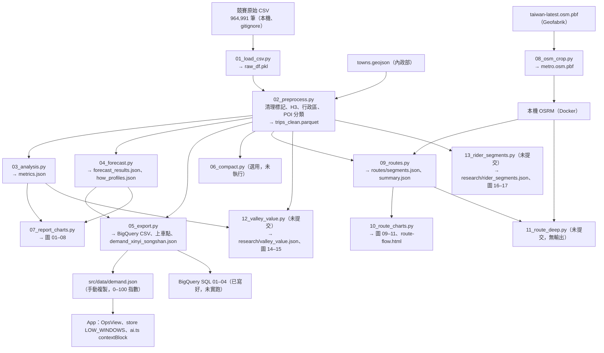

# 資料分析與資料狀態

> 日期：2026-10-12｜分析基準 commit：`18e94b3`（origin/main；文件分支 `docs/project-discussion-20261012`）
> 範圍：yoxi 競賽資料、資料管線（`data-pipeline/`）、App 內的彙總資料（`src/data/`）、未提交的研究分析
> 相關文件：[01 專案現況](01-project-overview.md)｜[02 待決議 30 題](02-thirty-decision-questions.md)｜[03 架構、亮點與 Demo](03-architecture-innovation-and-demo.md)｜既有報告 [`docs/data-analysis-report.md`](../data-analysis-report.md)
>
> 證據標記：【程式碼確認】讀過程式或設定｜【執行驗證】本次實際執行或用 Python 讀檔核對｜【推論】合理推論｜【待確認】需要團隊或主辦方確認｜【提案】未來建議
>
> 本文件只引用彙總數字，不含任何逐筆行程、乘客編號或精確座標。**本次沒有重跑資料管線**，數字都是讀取既有輸出檔（`data-pipeline/data/processed/`）後用 Python 核對而得。

## 目錄

- [0. 會議快讀（5 分鐘）](#0-會議快讀5-分鐘)
- [1. 一頁摘要](#1-一頁摘要)
- [2. 資料資產清冊](#2-資料資產清冊)
- [3. 管線階段地圖](#3-管線階段地圖)
- [4. 清理規則與資料品質](#4-清理規則與資料品質)
- [5. 關鍵發現與數字核對](#5-關鍵發現與數字核對)
- [6. App 內的資料：demand.json](#6-app-內的資料demandjson)
- [7. 未提交的研究分析（I14）](#7-未提交的研究分析i14)
- [8. 需求預測](#8-需求預測)
- [9. 隱私、合規與公開範圍](#9-隱私合規與公開範圍)
- [10. 重現步驟與環境](#10-重現步驟與環境)
- [11. 資料缺口與下一步](#11-資料缺口與下一步)
- [12. 給組員的 FAQ](#12-給組員的-faq)
- [附錄：對應的決策題與問題編號](#附錄對應的決策題與問題編號)

---

## 0. 會議快讀（5 分鐘）

| 問題 | 一句話回答 |
|---|---|
| 我們有什麼資料？ | yoxi 競賽資料 964,991 筆行程（2026/2/1–5/1 凌晨，實質 2/1–4/30），另有行政區界、OpenStreetMap 路網、氣象署 API（只有 App 端用）。 |
| 處理到哪裡？ | 清理、指標、預測、匯出、路線推估（00–10 號腳本）都已完成並提交；11–13 號是**未提交**的延伸研究，其中 12、13 有輸出，11 沒有輸出。 |
| App 用了什麼？ | 只有 `src/data/demand.json`（20 KB）：信義＋松山 152 個 H3 第 9 級格子的 0–100 指數、星期×小時需求與等車、低谷時段、5/1–5/7 預測、8 個上車點。 |
| 哪些結論最可信？ | 低頻（89% 的日子不搭車）、常客集中（34% 乘客貢獻 83% 行程）、時段型態與低谷時段、隔日預測勝過基準。這些都有完整樣本與可重現程式。 |
| 最大的缺口？ | ①沒有供給端（司機、空車）資料，「空車多」只能用等車時間代替；②天氣沒有進預測模型；③BigQuery ML 沒實跑；④**repo 是公開的**，提交的衍生資料是否符合競賽資料規範尚未確認。 |
| 組員下一步？ | 先確認資料使用規範與 repo 公開範圍（P0），再決定未提交研究怎麼納入簡報，最後才是 BigQuery ML 與天氣特徵。 |

---

## 1. 一頁摘要

**資料是什麼。** 主辦方提供的 yoxi 叫車行程資料，一筆一趟，含乘客編號（RiderId）、叫車／上車／下車時間、上下車精確座標與地點名稱、行駛距離與時間、車資區間。另附 `欄位說明.docx`。【執行驗證】`metrics.json` 的 `n_raw = 964991`、`n_riders = 131962`、`period = 2026-02-01 00:03 ～ 2026-05-01 00:48`。

**處理到哪裡。**

- 已完成並提交【程式碼確認】：讀檔與欄位檢查（01）、清理與衍生欄位（02）、指標（03）、預測與驗證（04）、BigQuery 表與 App 指數匯出（05）、報告圖（07）、OSM 裁切與本機 OSRM 路線推估（08–10）。
- 已寫好但沒提交【執行驗證】：`11_route_deep.py`（沒有任何輸出檔，判斷為尚未成功執行）、`12_valley_value.py`（有 `valley_value.json` 與圖 14–15）、`13_rider_segments.py`（有 `rider_segments.json` 與圖 16–17）。作者與是否納入報告【待確認】。
- 未做：BigQuery ML ARIMA_PLUS 實跑（SQL 已寫好）、天氣特徵、供給端分析。

**App 用了什麼。** 只用彙總後的 `src/data/demand.json`，與管線輸出 `data/processed/demo/demand_xinyi_songshan.json` 位元組完全相同【執行驗證】。使用者在 App 看到的「需求熱度、低谷時段、下一週預測、預測誤差」以及 Gemini 任務的「低谷時段」脈絡都來自這個檔案。

**哪些結論可信。** 見第 5 節表格。可信度高的是全量統計（低頻、常客集中、時段型態、等車時間分布）與有基準比較的預測驗證；可信度中等的是單一行政區的低谷判斷（每小時只有約 20 趟，誤差 15–16%）；試算性質的是 12 號腳本的乘車金與 SOM 情境，引用時一定要標「試算」。

**最大缺口。** ①沒有供給端資料，「空車多」是以「等車時間短」推論；②預測模型沒用天氣，但影片腳本與簡報說法有提到降雨（I7）；③營運頁顯示的是 5/1–5/7 的歷史預測，不是即時預測（I17）；④repo 為 PUBLIC，已提交的衍生資料（逐時計數、路段流量、上車點）是否允許公開【待確認】。

**組員下一步（依序）。** ①確認競賽資料使用規範與 repo 可見度（[Q18](02-thirty-decision-questions.md#q18)）；②決定 11–13 號研究是否納入、怎麼標示（[Q17](02-thirty-decision-questions.md#q17)）；③統一簡報與影片中的資料說法（車資 NT$254、預測不含天氣）；④決賽前才做 BigQuery ML 與天氣特徵（[Q15](02-thirty-decision-questions.md#q15)、[Q16](02-thirty-decision-questions.md#q16)）。

---

## 2. 資料資產清冊

檔案大小用 `du -sh`、時間為檔案修改時間（2026 年），版控狀態用 `git ls-files` 與 `git check-ignore -v` 確認【執行驗證】。

### 2.1 原始與逐筆資料（只在本機，**不可外流**）

| 資產 | 位置 | 大小 | 版控 | 敏感度 | 產生方式 | 修改時間 | 狀態 |
|---|---|---|---|---|---|---|---|
| 競賽原始 CSV＋欄位說明 | `data-pipeline/data/raw/yoxi - 不搭車，也打開 yoxi —— …/`（`yoxi_數據資料.csv` 158.8 MB、`欄位說明.docx` 25 KB） | 152 MB | 忽略（`.gitignore:9` `data-pipeline/data/raw/*`） | **極高**：乘客編號＋精確座標＋時間 | 主辦方提供 | 6/2 | 本機存在。注意放的是**已解壓的資料夾**，不是 README 說的 7z |
| 解壓後 CSV（副本） | `data-pipeline/data/extracted/yoxi/yoxi_數據資料.csv` | 152 MB | 忽略（`.gitignore:11`） | 極高 | `00_extract_7z.py` 或手動複製 | 10/12 15:17 | 與上面重複一份 |
| 逐筆 DataFrame | `data-pipeline/data/raw_df.pkl` | 96 MB | 忽略（`.gitignore:13`） | 極高 | `01_load_csv.py` | 10/12 15:18 | 本機存在 |
| 清理後逐筆 | `data-pipeline/data/processed/trips_clean.parquet` | 86 MB | 忽略（`.gitignore:14` `processed/*.parquet`） | 極高 | `02_preprocess.py` | 10/12 15:19 | 本機存在；03–05、09、11–13 都讀它 |
| 精簡逐筆（選用） | `data-pipeline/data/processed/yoxi_trips_clean.parquet` | — | 會被忽略 | 極高 | `06_compact.py` | — | **不存在**，未執行 |
| 起訖格子路線快取 | `data-pipeline/data/osrm/pair_routes.parquet` | 2.1 MB | 忽略（`.gitignore:19` `data/osrm/`） | 高（格子中心層級的起訖組合） | `09_routes.py` | 10/12 16:31 | 本機存在 |
| 道路名稱快取 | `data-pipeline/data/osrm/pair_roads.parquet` | — | 會被忽略 | 高 | `11_route_deep.py` | — | **不存在**（11 號未成功執行） |

> 【推論】同一份原始資料在本機有 4 種形式（raw 資料夾、extracted 副本、pkl、parquet），全部被 `.gitignore` 擋住，風險主要在「複製到別處」或 `git add -f`。建議只保留 `extracted/` 與 `trips_clean.parquet`，並由一位負責人保管（見第 9 節）。

### 2.2 外部與參考資料

| 資產 | 位置 | 大小 | 版控 | 敏感度 | 來源 | 狀態 |
|---|---|---|---|---|---|---|
| 鄉鎮市區界 | `data-pipeline/geo/towns.geojson` | 3.3 MB | 已提交 | 公開資料 | 內政部（見 `data-pipeline/README.md`） | 用於判定行政區 |
| 台灣 OSM 路網 | `data-pipeline/data/osrm/taiwan-latest.osm.pbf` | 328 MB | 忽略 | 公開資料 | Geofabrik | 本機存在 |
| 雙北道路路網與 OSRM 處理檔 | `data-pipeline/data/osrm/metro.osm.pbf`、`metro.osrm.*` | 合計約 165 MB | 忽略 | 公開資料 | `08_osm_crop.py`＋Docker `osrm-backend:v5.27.1` | 本機存在（10/12 16:07） |
| 離線底圖行政區界 | `src/data/districts.json` | 33 KB | 已提交 | 公開資料 | 【推論】由內政部界線裁出台北市與部分新北市 | App 使用 |
| 氣象署 F-C0032-001 | 由 App 即時呼叫（`src/lib/weather.ts` `fetchCwa`） | — | 無檔案 | 公開資料，需授權碼 | 中央氣象署 | **只有 App 端用，管線與預測沒有用**【程式碼確認】 |

### 2.3 已提交的彙總輸出（因 repo 公開，等同已公開）

| 資產 | 位置 | 大小 | 內容 | 門檻／粒度 | 使用者 |
|---|---|---|---|---|---|
| 分析指標 | `data-pipeline/data/processed/metrics.json` | 9 KB | 全部報告數字、每日趟數、乘客分層、熱門上車點名稱與趟數 | 全量彙總 | 報告、CLAUDE.md、簡報 |
| 預測結果 | `data-pipeline/data/processed/forecast_results.json` | 85 KB | 5 個序列的 WAPE、4/17–4/30 逐時實際與預測、5/1–5/7 預測 | 行政區×小時 | 05 匯出、報告 |
| 星期×小時型態 | `data-pipeline/data/processed/how_profiles.json` | 4 KB | 信義、松山的需求與等車中位數 | 行政區×星期×小時 | 05 匯出 |
| 上車點 | `data-pipeline/data/processed/yoxi_pickup_spots.csv` | 3 KB | 44 個 yoxi 指定上車點名稱、趟數、座標中位數 | 每點 ≥ 100 趟 | `src/lib/geo.ts` POI 座標 |
| BigQuery 逐時表（行政區） | `data-pipeline/data/processed/bigquery/hourly_pickups_town_metro.csv` | 4.5 MB | 雙北各區逐時上車數與等車中位數，85,440 列 | **無門檻**，含 0–2 趟的小時 | BigQuery SQL |
| BigQuery 逐時表（H3 第 8 級） | `data-pipeline/data/processed/bigquery/hourly_pickups_h3r8_xinyi_songshan.csv` | 2.1 MB | 信義松山 r8 格逐時上車數，53,400 列 | 格子總量 ≥ 500 趟，但逐時**含 1–2 趟** | BigQuery SQL（未實跑） |
| 路段流量 | `data-pipeline/data/processed/routes/segments.json`、`docs/route-flow.html` | 5.7 MB、5.7 MB | 108,285 段路的四種流量 | 每時段 ≥ 10 趟 | 報告第 8 章 |
| 路線摘要 | `data-pipeline/data/processed/routes/summary.json` | 5 KB | 繞路比、壅塞係數 | 全量彙總 | 報告 |
| App 指數 | `data-pipeline/data/processed/demo/demand_xinyi_songshan.json` = `src/data/demand.json` | 20 KB | 見第 6 節 | 格子 ≥ 30 趟，0–100 指數 | App，且隨 GitHub Pages 公開 |
| 報告圖 01–11 | `docs/data-analysis/01–11_*.png` | — | 彙總圖表 | — | 報告、簡報 |

### 2.4 未提交的研究輸出（工作區有、Git 沒有）

| 資產 | 位置 | 修改時間 | 狀態 |
|---|---|---|---|
| 腳本 11–13 | `data-pipeline/scripts/11_route_deep.py`、`12_valley_value.py`、`13_rider_segments.py` | 10/12 20:00–20:04 | 未追蹤 |
| 研究 JSON | `data-pipeline/data/processed/research/valley_value.json`、`rider_segments.json` | 10/12 20:01、20:05 | 未追蹤；`research/` **沒有**被 `.gitignore` 擋住，`git add .` 會一起加入 |
| 研究圖 14–17 | `docs/data-analysis/14_wait_vs_demand.png`、`15_credit_breakeven.png`、`16_rider_segments.png`、`17_rider_open_days.png` | 10/12 20:01–20:05 | 未追蹤；本文件刻意不放成連結，因為還沒進 Git，GitHub 上會是壞連結 |

---

## 3. 管線階段地圖



| 階段 | 輸入 | 輸出 | 需要 | 狀態 |
|---|---|---|---|---|
| 00 解壓 | `data/raw/*.7z` | `data/extracted/yoxi/` | py7zr | 本機實際是放已解壓資料夾，00 號可能沒用到【推論】 |
| 01–05 | CSV | 見上圖 | Python 3.11、pandas、h3 | 已完成（輸出時間 10/12 15:18–15:19） |
| 06 | parquet | 精簡 parquet | — | 未執行（選用） |
| 07 | metrics、forecast | 圖 01–08 | matplotlib、中文字型 | 已完成 |
| 08–10 | parquet＋OSM | 路段流量、圖 09–11 | **Docker＋本機 OSRM**、osmium | 已完成（16:07–16:31） |
| 11 | parquet＋OSRM | `research/routes_deep.json`、圖 12–13 | Docker＋本機 OSRM（第一次約 10 分鐘） | **沒有輸出**；圖 12–13 編號空著 |
| 12–13 | parquet | research JSON、圖 14–17 | Python | 有輸出，未提交 |
| 匯出到 App | `demo/demand_xinyi_songshan.json` | `src/data/demand.json` | 手動 `cp`（`/data` 指令第 3 步） | 兩檔一致【執行驗證】 |

`.claude/commands/data.md`（`/data` 指令）定義的流程是 00→05、複製 demand.json、比對 `metrics.json` 與 `CLAUDE.md`；**不含 07–13**，改了清理規則後圖表與路線不會自動更新【程式碼確認】。

---

## 4. 清理規則與資料品質

### 4.1 清理規則（只標記不刪除）

規則在 `data-pipeline/scripts/02_preprocess.py` 第 27–33 行【程式碼確認】，筆數取自 `data-pipeline/README.md` 表格（本次未重跑）：

| 標記 | 條件 | 筆數 |
|---|---|---|
| `flag_coord` | 座標不在台灣範圍 | 0（README：座標全部在台灣範圍內） |
| `flag_short` | 行駛距離 < 100 公尺 | 1,122 |
| `flag_long` | > 200 公里或 > 240 分鐘 | 241 |
| `flag_speed` | 平均時速 > 130 公里 | 128 |
| `flag_lead_neg` | 叫車到上車 < −1 分鐘 | 0 |
| `valid` | 以上皆否 | **963,525**（`metrics.json` `n_valid`）【執行驗證】 |
| `is_reserve` | 叫車到上車 > 60 分鐘（視為預約單） | 1,031（約 0.11%，`metrics.json` `reserve_share = 0.106`） |

三種標記合計 1,491 筆，但無效只有 1,466 筆（964,991 − 963,525），代表有 25 筆同時符合多種標記【執行驗證】。

### 4.2 資料品質與限制

| 項目 | 狀況 | 影響 | 證據 |
|---|---|---|---|
| 期間 | 2/1–4/30，外加 5/1 凌晨 40 筆 | 「每日平均」若含 5/1 會被拉低（見 5.2） | `metrics.json` `daily.2026-05-01 = 40` |
| 季節 | 只有 3 個月，**含春節**（2/14–2/22）、228、清明連假 | 看不到暑假、颱風、年底；春節期間需求明顯下降 | `02_preprocess.py` 第 20 行假日表 |
| 預測驗證期 | 4/17–4/30，**沒有連假** | 預測在連假的表現未知 | 報告第 7、10 章 |
| 地點名稱 | 68.2% 上車點沒有名稱（`pu_cat.none` 657,026 筆） | 「住家／公司」比例被低估（上車標住家 9.19%、公司 3.2%） | `metrics.json` `pu_cat`、`pu_home_label_share` |
| 下車「住家」 | `do_cat.home` 只有 1 筆 | 下車點的住家分類基本無效【推論】：可能是欄位格式差異 | `metrics.json` `do_cat.home = 1` |
| 車資 | 只有區間（如 `[100,200]`） | 平均車資用區間中點估計（NT$254），有誤差 | `fare_mean_mid = 254.0` |
| 供給端 | **沒有**司機上線、空車位置、派單紀錄 | 「空車多」只能用「等車短」代替，也受天氣路況影響 | 報告第 10 章 |
| 路線 | 只有起終點，路線是 OSRM 推估 | 熱門路段代表起訖需求走廊，不是實際車流；裁切時沒保留轉向限制 | 報告第 8、10 章 |
| 代表性 | 競賽提供的資料不一定是 yoxi 全量 | 營收、市場規模只能說「依競賽資料估計」 | 報告第 10 章 |
| 高頻帳號 | 62 個帳號（平均每搭車日 > 3 趟且 ≥ 30 趟）占 2.47% 行程 | 疑似企業或代叫，13 號腳本排除；03 號的常客指標**沒有排除** | `rider_segments.json` `excluded_high_freq_accounts` |

---

## 5. 關鍵發現與數字核對

### 5.1 發現表

「可放簡報」欄位：✅ 可直接引用、⚠️ 引用時要加註、❌ 不建議。

| # | 發現 | 數字 | 來源欄位 | 可信度與限制 | 產品用途 | 簡報 |
|---|---|---|---|---|---|---|
| F1 | 雙北占大宗 | 雙北上車 62.2%（台北市 42.92%、新北市 19.27%） | `metrics.json` `metro_share`、`county_share` | 高 | 試辦選雙北 | ✅ |
| F2 | 每天約 1.08 萬趟 | 不含 5/1 為 10,826 趟／日；含 5/1 為 10,706 | `daily`、`daily_mean`（見 5.2） | 高；只代表競賽資料 | 規模估計 | ⚠️ 用 1.08 萬並註明期間 |
| F3 | 乘客數 | 131,962 位 | `n_riders` | 高 | 市場規模 | ✅ |
| F4 | **叫車是低頻行為** | 當月有搭車者平均 89.36% 的日子不搭車 | `nonride_day_share_mean` | 高；「不搭車」不等於「不打開 App」（沒有 App 開啟資料） | 題目痛點、北極星指標基準 | ✅ 措辭用「不搭車」 |
| F5 | 留存 | 2 月乘客 3 月再搭 58.79%、4 月再搭 56.78% | `ret_feb_mar`、`ret_feb_apr` | 高；2 月含春節 | 留存基準 | ✅ |
| F6 | 一次性乘客多 | 33.04% 乘客三個月只搭 1 次 | `rider_bucket_riders.1` | 高 | 喚回對象 | ✅ |
| F7 | **常客撐起行程** | 搭 5 次以上 34.47% 乘客貢獻 83.49% 行程；前 10% 乘客貢獻 54.26% | `heavy_riders_share`、`heavy_trip_share`、`top10pct_trip_share` | 高；含 62 個高頻帳號 | 目標客群（[Q02](02-thirty-decision-questions.md#q02)） | ✅ |
| F8 | **常客生活規律** | 上下車點中位數 58.33% 集中在 2 個 H3 格；48.0% 行程在同一個 3 小時；77.16% 常客的前 2 格占一半以上 | `top2_place_share_median`、`top3h_share_median`、`top2_place_share_ge50` | 高；格子是 r9（約 0.1 km²） | 個人化任務的依據（[Q03](02-thirty-decision-questions.md#q03)） | ✅ |
| F9 | 等車時間 | 全體中位數 5.85 分（P90 11.34）；雙北平日 7–8 點 6.46–6.47、17 點 6.72、**18 點 7.22** | `lead_overall`、`metro_weekday_lead_p50` | 高；排除預約單 | 傍晚預約任務 | ✅ |
| F10 | 尖峰與週末差異 | 雙北平日 9 點每小時 636.8 趟，週末同時段 262.6 趟（2.4 倍） | `metro_weekday_hourly[9]`、`metro_offday_hourly[9]` | 高 | 時段策略 | ✅ |
| F11 | **低谷時段** | 信義平日 11、12、14、15、20 點；松山 11–16、20 點 | `demand.json` `low_windows.*.hours` | 中；單區每小時約 20 趟，噪音大；定義為「需求 ≤ 該區平日尖峰 70% 且等車 ≤ 白天中位數」（`05_export.py` 第 39–44 行） | 任務與乘車金排程 | ✅ 附定義 |
| F12 | **隔日預測勝過基準** | WAPE 雙北 6.71%（基準 7.65%）、信義 16.39%（19.79%）、松山 15.46%（19.68%） | `forecast_results.json` `metrics.*` | 中高；驗證只有 14 天且無連假 | 營運頁、AI 整合度 | ✅ 附驗證期 |
| F13 | 車資 | 平均 NT$254（雙北 NT$266.3）；中位區間 100–200 元 | `fare_mean_mid`、`fare_mean_metro` | 中；區間中點估計 | 商業試算（簡報原用 NT$300 要改） | ⚠️ 標「區間中點估計」 |
| F14 | 月 GMV（資料內） | 約 8,157 萬元 | `gmv_month_est = 81.57`（百萬） | 中低；車資估計＋資料不一定是全量 | — | ❌ 不建議當 yoxi 營收 |
| F15 | 行程距離 | 行駛距離中位數 4.84 公里、14 分鐘 | `travel_m_p50`、`travel_min_p50` | 高 | 任務設計 | ✅ |
| F16 | **車流集中** | 前 1%／5%／10% 路段承載 30.3%／60.9%／75.8% 行駛量（趟數×公里） | `routes/segments.json` 計算 | 中；推估路線 | 熱門路段圖層 | ⚠️ 標「推估」 |
| F17 | 低谷車程較快 | OSRM 壅塞係數平日 10 點 2.061、17 點 2.648 → 少 22%；實際資料同起訖 10–11 點 ÷ 17–18 點行駛時間中位數 0.812（少約 19%） | `summary.json` `congestion_weekday_by_hour`；`valley_value.json` `travel_same_od`（未提交） | 中；兩種方法方向一致 | 低谷任務文案「車程比較快」 | ⚠️ |
| F18 | 沒有系統性繞路 | 繞路比中位數 0.979（P25–P75 0.903–1.058），> 1.3 只有 4.33% | `summary.json` `detour.all` | 中 | 不適合當切入點 | ✅（作為排除的論點） |
| F19 | 上下車地點型態 | 下車到車站 51,229、醫院 32,765、機場 8,974 筆，遠多於上車 | `pu_cat`、`do_cat` | 中；68% 無名稱 | 主題任務 | ⚠️ |

### 5.2 數字核對結果

用 Python 讀 `metrics.json`、`forecast_results.json`、`how_profiles.json`、`routes/summary.json`、`routes/segments.json`、`demand.json`，與 `CLAUDE.md`「資料分析重點」及 [`docs/data-analysis-report.md`](../data-analysis-report.md) 比對【執行驗證】：

| CLAUDE.md／報告的說法 | 檔案數值 | 結果 |
|---|---|---|
| 雙北占 62% | 62.2 | 一致 |
| 平均每天約 1.08 萬趟；`daily_mean` 1.07 萬是把 5/1 算成一天 | `daily_mean = 10705.8` = 963,525 ÷ 90 天；不含 5/1 為 (963,525 − 40) ÷ 89 = 10,825.7 | 一致，原因如說明。**建議**改在 `03_analysis.py` 直接排除 5/1，避免再次誤用 |
| 乘客 131,962 位 | 131,962（13 號腳本得 131,958，因排除只在 5/1 搭車的 4 人） | 一致 |
| 89% 的日子不搭車 | 89.36 | 一致 |
| 2 月乘客 3 月再搭 59% | 58.79 | 一致 |
| 33% 三個月只搭 1 次 | 33.04 | 一致 |
| 34% 貢獻 83% | 34.47／83.49 | 一致 |
| 58% 集中 2 格、48% 同一 3 小時 | 58.33／48.0 | 一致 |
| 等車中位數 5.9 分，平日尖峰 6.5–7.2 分 | 5.85；7–8 點 6.46–6.47、17–18 點 6.72–7.22 | 一致（6.46 四捨五入為 6.5） |
| 信義低谷 11–12、14–15、20；松山 11–16、20 | [11,12,14,15,20]／[11,12,13,14,15,16,20] | 一致 |
| WAPE 6.7／16.4／15.5，基準 7.7／19.8／19.7 | 6.71／16.39／15.46；7.65／19.79／19.68 | 一致 |
| 平均車資 NT$254（雙北 266） | 254.0／266.3 | 一致 |
| 前 10% 路段承載 76% | 75.8 | 一致 |
| 10 點比 17 點少約 22% | 1 − 2.061 ÷ 2.648 = 22.2% | 一致 |
| 繞路比中位數 0.98 | 0.979 | 一致 |
| 報告「雙北平日 9 點每小時約 637 趟，是週末的 2.4 倍」 | 636.8 ÷ 262.6 = 2.42 | 一致 |

**不一致或需要注意的地方**

1. **營運頁的「需求指數」與低谷表不同口徑**：`OpsView.tsx` 用「今天星期幾」那一列的 `profiles.demand_idx[dow][hour]`（例如週一 14 點顯示 59），低谷判斷用的是週一到週五平均（`low_windows.weekday_demand_idx`，14 點為 64）。兩者都對，但示範時若被問「為什麼 59 也算低谷」，要能解釋【程式碼確認】【執行驗證】（e2e 截圖 `07_ops`）。
2. **營運頁示範理由與畫面數字可能不符**：示範資料 `FALLBACK_OPS.reason` 寫「叫車到上車也比全天中位數短」，但週一 14 點畫面顯示等車 5.6 分、中位數 5.6 分（相等）【執行驗證】。屬示範文案問題，見 [01](01-project-overview.md) 的問題清單。
3. **影片腳本說「BigQuery ML 用叫車資料和降雨預報預測」**（`docs/video-script.md` 旁白⑤），但目前預測不含天氣、BigQuery ML 也沒實跑（I7）。
4. **常客指標含高頻帳號**：03 號的 34%／83% 沒有排除 62 個疑似企業帳號（占 2.47% 行程），影響很小，但 13 號分群有排除，兩邊數字不能直接相加。
5. **`demand.json` 的格子指數是對數尺度**：`idx = log1p(趟數) ÷ log1p(最大值) × 100`（`05_export.py` 第 29 行），營運頁再乘以時段型態當成熱度；這是「相對熱度」，不能解讀成「趟數的百分比」【程式碼確認】。

---

## 6. App 內的資料：demand.json

`src/data/demand.json`（20,429 bytes），結構如下【執行驗證】：

| 欄位 | 內容 | 粒度與門檻 | 使用位置 |
|---|---|---|---|
| `source` | 「yoxi 競賽資料 2026/02/01–04/30（已彙總為指數，不含個別行程）」 | — | — |
| `cells` | 152 個 H3 **第 9 級**格子，`idx` 39–100 | 信義／松山上車＋下車合計 ≥ 30 趟；對數正規化 | `src/views/OpsView.tsx` `CELLS`（再用行政區界過濾） |
| `profiles` | 信義、松山各 `demand_idx[7][24]`、`lead_p50[7][24]` | 行政區×星期×小時，峰值 = 100 | `OpsView.tsx` `PROFILE` |
| `low_windows` | 兩區的低谷小時、平日平均需求與等車 | 平日 8–22 點 | `src/lib/store.tsx` `LOW_WINDOWS` → `MapView`、`SpriteChat`、`ai.ts` `contextBlock()`（送給 Gemini 當「需求低谷時段」） |
| `forecast` | 兩區 168 小時（**5/1–5/7**）的 `value_idx` | 該週最大值 = 100 | `OpsView.tsx` 預測曲線 |
| `forecast_metrics` | 5 個序列的 WAPE | — | `OpsView.tsx` 卡片標題 |
| `spots` | 8 個信義松山範圍內的 yoxi 上車點名稱與座標 | 每點 ≥ 100 趟，座標是該點所有上車座標的中位數 | 【程式碼確認】App 程式沒有直接讀 `spots`；`src/lib/geo.ts` 的 5 個 `spot-*` POI 座標是手動抄自競賽資料中位數 |

**與 18e94b3 的關係**：該 commit 把個人點燈地圖改成 H3 **第 10 級**（`src/lib/geo.ts` `RES = 10`），並把舊的第 9 級足跡展開成子格（`store.tsx` `expandToCurrentResolution`）。需求指數仍是第 9 級，兩者**不衝突**：點燈地圖是使用者個人足跡（本機 localStorage），需求熱度只在營運頁畫，各自用自己的格網【程式碼確認】。`docs/implementation-decisions.md` 第 15 題也已註明「分析資料維持第 9 級，不因地圖視覺調整而重算」。

**營運頁的預測是歷史預測（I17）**：曲線是「以 4/30 前資料預測 5/1–5/7」，畫面文字有寫明，但沒有日期軸；demo 時要說清楚這是「方法展示」，不是「下週」的即時預測。

---

## 7. 未提交的研究分析（I14）

工作區有三支未追蹤的腳本與兩份 JSON、四張圖（10/12 20:00–20:05 產生）。**作者、完成度、是否要放進報告與簡報都【待確認】**。這裡只整理內容與彙總結果，方便 [Q17](02-thirty-decision-questions.md#q17) 討論。

### 7.1 `11_route_deep.py`：路線深入分析

- 目的：區對區流向、主要道路逐時行駛量、低谷「車多人少」地區、各區繞路與壅塞。
- 需要本機 OSRM（程式裡 `assert` 只允許 `127.0.0.1`／`localhost`，這點做得好）。
- 狀態：`research/routes_deep.json`、圖 12–13、`data/osrm/pair_roads.parquet` **都不存在** → 尚未成功執行【執行驗證】。

### 7.2 `12_valley_value.py`：低谷導流的價值試算

輸出 `research/valley_value.json` 與圖 14、15。**假設全部寫在 `ASSUME`，不是實測，引用一定要標「試算」**。主要結果（雙北、平日、排除預約單）：

| 主題 | 結果 | 解讀 |
|---|---|---|
| 供需關係 | 同時段需求每多 1%，等車中位數約多 0.15%（尖峰 0.29%）；需求比平常多 15% 以上的小時，等車 ×1.051 | 需求增加對等車的影響溫和，低谷還有承載空間 |
| 尖峰 vs 低谷 | 每小時 476.7 vs 425.0 趟；等車中位數 6.43 vs 5.50 分；等超過 10 分鐘 18.4% vs 10.8% | **雙北整體的低谷趟數只比尖峰少 11%**，差別主要在等車時間；「低谷」是相對概念 |
| 同起訖行駛時間 | 低谷 ÷ 尖峰 0.929；10–11 點 ÷ 17–18 點 0.812 | 用實際資料佐證 F17 |
| 尖峰移 3／5／10% 到低谷 | 每平日 86／143／286 趟；尖峰等車 −0.86／−1.45／−2.96%；乘客每年省 1,005／1,651／3,177 小時 | 效益存在但不大，適合當「雙邊受惠」的輔助論點 |
| 每趟拆分 | 司機淨收 239 元、yoxi 派遣費 27 元、司機油耗耗損 22 元 | 派遣費 10% 來自研究筆記，【待確認】 |
| SOM 情境（雙北 10 萬月活） | 每年新增 30／60／120 萬趟；GMV 0.80／1.60／3.19 億；yoxi 派遣費 0.08／0.16／0.32 億；雲端成本 85.2 萬 | 與簡報 SOM 口徑不同，需對齊（[Q10](02-thirty-decision-questions.md#q10)） |
| **乘車金損益兩平** | 只用 yoxi 派遣費：每趟最多補 8／13.3／18.6 元；yoxi＋司機共同負擔：73／122／171 元 | App 任務目前給 20–50 元乘車金（`ai.ts` `TASK_SYSTEM` 規則 3、示範任務 30 元），**高於只靠派遣費的兩平點**，需要司機分擔、集團出獎或縮小發放範圍 |
| **低谷容量** | 若新增行程全進低谷，低谷負載 +43.9／+87.8／+175.6%，等車中位數變 5.99／6.37／6.97 分 | 中間以上情境會把低谷塞到接近尖峰（6.43 分）→ 乘車金要有**時段配額** |

### 7.3 `13_rider_segments.py`：乘客分群與留存

輸出 `research/rider_segments.json` 與圖 16、17。規則式分群（非 k-means），每群 ≥ 10 人；先排除 62 個高頻帳號（2.47% 行程）。

| 分群 | 乘客占比 | 行程占比 | 每月搭車天數 | 次月留存（2→3／3→4 月） | 最集中的 3 小時 |
|---|---|---|---|---|---|
| 通勤族 | 6.9% | 17.7% | 5.63 | 76.5%／76.4% | 7–10 點（43.0%） |
| 夜歸族 | 5.2% | 11.0% | 4.65 | 73.3%／76.2% | 22–1 點 |
| 週末出遊族 | 4.9% | 6.9% | 3.19 | 67.2%／69.2% | 17–20 點 |
| 平日白天常客 | 17.4% | **45.3%** | 5.24 | **79.6%／79.8%** | 10–13 點 |
| 機場旅客 | 2.3% | 0.5% | 1.33 | 35.1%／38.3% | 4–7 點 |
| 偶爾搭（≤ 4 趟） | **63.3%** | 16.1% | 1.30 | 37.8%／40.1% | 16–19 點 |

解讀【推論】：

- 「平日白天常客」有 38.8% 行程本來就在平日 10–16 點，是低谷任務最自然的對象；「通勤族」62.2% 在尖峰，是「移到低谷」最難的一群。
- 「偶爾搭」占六成乘客、一個月只搭 1.3 天，不搭車的人天數最多（每月約 104 萬人天），是「不搭車也打開」的最大池子，但留存只有約 4 成。
- 這直接影響目標客群與示範人物設定（[Q02](02-thirty-decision-questions.md#q02)、[Q03](02-thirty-decision-questions.md#q03)）：示範玩家「小涵」的設定比較接近「通勤族」。

### 7.4 建議如何納入【提案】

1. 先確認作者與數字是否定稿，再一起提交腳本＋JSON＋圖（目前 `research/` 沒被忽略，避免誤用 `git add .`）。
2. 12 號的乘車金兩平與低谷容量**很適合**回答評審「乘車金會不會虧錢」的追問，但所有數字要標「試算、假設見 ASSUME」。
3. 13 號分群適合放在「目標使用者」頁；高頻帳號排除規則要寫在註腳。
4. 11 號若決賽前用不到，可以先不跑（需要 Docker 與約 10 分鐘以上）。
5. 納入時同步更新 [`docs/data-analysis-report.md`](../data-analysis-report.md)（新增章節）與 `CLAUDE.md`「資料分析重點」。

---

## 8. 需求預測

### 8.1 方法與驗證

【程式碼確認】`data-pipeline/scripts/04_forecast.py`、報告第 7 章：

- 目標：隔天 24 小時、每小時的上車數（雙北與 4 個行政區）。
- 模型：近 4 週非連假、同星期同小時平均（型態）× 最近 7 天實際量 ÷ 型態預期量（水位，限制在 0.8–1.25）。
- 驗證：用 2/23–4/16 建模，4/17–4/30 每天只用當天以前的資料預測隔天（滾動起點），共 336 小時。
- 基準：上週同時段（seasonal naive）。也試過與基準各半混合（`wape_blend_dayahead`），沒有更好。

### 8.2 結果

| 序列 | 平均每小時上車數 | 基準 WAPE | 本模型 WAPE | 混合 WAPE | 改善 |
|---|---|---|---|---|---|
| 雙北 | 280.4 | 7.65% | **6.71%** | 6.78% | 12.3% |
| 台北市信義區 | 20.9 | 19.79% | **16.39%** | 17.15% | 17.2% |
| 台北市松山區 | 21.9 | 19.68% | **15.46%** | 16.60% | 21.4% |
| 台北市大安區 | 35.8 | 16.37% | **13.09%** | 14.10% | 20.0% |
| 台北市中山區 | 40.7 | 16.61% | **13.82%** | 14.53% | 16.8% |

來源：`forecast_results.json` `metrics`【執行驗證】。

判讀：雙北層級可用來排隔天任務與乘車金；單一行政區只適合判斷「哪幾個小時是低谷」，不適合精準調度車輛。

### 8.3 狀態與缺口

| 項目 | 狀態 | 對應 |
|---|---|---|
| BigQuery ML ARIMA_PLUS | SQL 01–04 已寫（`data-pipeline/data/processed/bigquery/sql/`，含 `holiday_region = 'TW'`），**沒有實跑**，沒有可比較的 WAPE | [Q15](02-thirty-decision-questions.md#q15) |
| 天氣特徵 | 管線與 SQL 都**沒有**天氣；App 端的氣象署資料只用於任務生成脈絡與畫面提示 | I7、[Q16](02-thirty-decision-questions.md#q16) |
| 營運頁預測 | 顯示 5/1–5/7 歷史預測、已標註方法，但沒有日期軸 | I17 |
| 5/1 勞動節 | 預測週第一天是勞動節（部分行業放假），模型沒有處理【推論】 | 只影響示範曲線解讀 |
| 自動更新 | 沒有排程；正式版構想是 BigQuery 排程每天更新【提案】 | — |
| 誤差監控 | 只有離線 WAPE；沒有上線後的監控設計【提案】 | — |

若要在決賽前加天氣：需要氣象署**歷史**逐時降雨資料（與 2/1–4/30 對齊），而目前 App 用的 F-C0032-001 只有未來 36 小時預報，不能直接拿來訓練【推論】。

---

## 9. 隱私、合規與公開範圍

### 9.1 絕不可外流

- 原始 CSV、`欄位說明.docx`（是否可公開【待確認】）、`raw_df.pkl`、所有 `*.parquet`、`data/osrm/pair_*.parquet`。
- 任何「單一乘客」層級的輸出：乘客編號、精確上下車座標、個人時間序列、從資料挑出的真實個人路線（`CLAUDE.md` 已明定 demo 只用虛構人物「小涵」）。
- 起終點座標不得送到外部路線服務（Google、OSRM 公開伺服器）；目前只送本機 OSRM【程式碼確認】（`09_routes.py`、`11_route_deep.py` 的 `assert`）。

### 9.2 目前的防護【程式碼確認】【執行驗證】

| 防護 | 位置 |
|---|---|
| 原始與逐筆資料、OSRM 目錄被 `.gitignore` 擋住 | `.gitignore` 第 8–19 行；`git check-ignore -v` 驗證 |
| App 只放 0–100 指數，且格子 ≥ 30 趟 | `05_export.py` 第 26–29 行 |
| 路段流量每時段 ≥ 10 趟才保留 | `routes/segments.json` `min_trips = 10` |
| 上車點每點 ≥ 100 趟 | `05_export.py` 第 48 行 |
| 研究分群每群 ≥ 10 人 | `13_rider_segments.py` `MIN_RIDERS = 10` |
| 個人點燈足跡只存在使用者裝置 | `src/lib/store.tsx`（localStorage） |

### 9.3 殘餘風險（依影響排序）

1. **repo 是 PUBLIC**【執行驗證】（`gh repo view N-cobblers/Lighting-City --json visibility` → `PUBLIC`）。所有已提交的衍生資料（2.3 節）都等於公開，App 也透過 GitHub Pages 公開 `demand.json`。這些都是彙總結果，個資風險低【推論】，但**競賽資料使用規範是否允許公開衍生資料，目前沒有任何文件確認**【待確認】。這是 P0：若規範禁止，需要改成 private 或移除部分檔案（並注意 Git 歷史仍保留）。對應 [Q18](02-thirty-decision-questions.md#q18)。
2. **BigQuery 逐時表的小計數**：`hourly_pickups_h3r8_xinyi_songshan.csv` 有 40,248 列（75%）是 0–2 趟；`hourly_pickups_town_metro.csv` 有 47,319 列 ≤ 2 趟，而且在只有 1 趟的小時，`lead_p50` 就等於那一趟的等車時間【執行驗證】。單獨看難以回推個人，但比其他輸出細很多【推論】。建議：此檔只在上傳 BigQuery 時產生、不提交，或把小時粒度改成 ≥ 5 趟才保留【提案】（[Q19](02-thirty-decision-questions.md#q19)）。
3. **`metrics.json` 含熱門上車點名稱與趟數、`forecast_results.json` 含 4/17–4/30 逐時實際量**：屬營運資訊而非個資，但公開與否同樣受規範約束【待確認】。
4. **本機多份原始資料副本**（2.1 節）：一台電腦上有 4 種形式。建議只保留必要的一份、限定保管人，競賽結束後依規範刪除【提案】。
5. **`research/` 未被忽略**：若之後的研究腳本輸出逐筆中間檔到這裡，`git add .` 會誤提交。建議在 `.gitignore` 補上 `data-pipeline/data/processed/research/*.parquet`【提案】。

---

## 10. 重現步驟與環境

**環境**：Python 3.11 以上；`data-pipeline/requirements.txt`（pandas ≥ 2.2、numpy、pyarrow、h3 ≥ 4.1、shapely、statsmodels、py7zr、matplotlib、osmium）；路線部分需要 Docker 與 `ghcr.io/project-osrm/osrm-backend:v5.27.1`。原始資料要自己放到 `data-pipeline/data/extracted/yoxi/`（向資料保管人索取，**不要**透過 Git 或公開雲端傳）。

```bash
cd data-pipeline
pip install -r requirements.txt
python scripts/01_load_csv.py         # → data/raw_df.pkl
python scripts/02_preprocess.py       # → data/processed/trips_clean.parquet
python scripts/03_analysis.py         # → metrics.json
python scripts/04_forecast.py         # → forecast_results.json、how_profiles.json
python scripts/05_export.py           # → BigQuery CSV、上車點、demo/demand_xinyi_songshan.json
python scripts/07_report_charts.py    # → ../docs/data-analysis/01–08
cp data/processed/demo/demand_xinyi_songshan.json ../src/data/demand.json
# 路線（需要 Docker，約 10 分鐘以上）：見 data-pipeline/README.md「最短路線與熱門路段」
```

| 部分 | 時間（README 所述） | 本次是否執行 |
|---|---|---|
| 01–05、07 | 約 1 分鐘 | **沒有重跑** |
| 08–10 路線 | OSM 裁切約 2 分鐘＋路線約 10 分鐘 | **沒有重跑** |
| 11–13 研究 | 未記載 | **沒有重跑** |
| 數字核對 | — | **有**：用 Python 讀既有 JSON／CSV 驗證第 5 節所有數字 |

注意：重跑會覆寫已提交的 `docs/data-analysis/*.png` 與 `processed/*.json`，字型不同時圖檔會產生無意義的差異；建議只在資料或規則有變時重跑，並由一人負責提交【提案】。

---

## 11. 資料缺口與下一步

依重要性排序；工作量為相對估計（S＜M＜L）。

| 順序 | 項目 | 為什麼 | 工作量 | 依賴 | 對應 | 建議角色 |
|---|---|---|---|---|---|---|
| 1 | 確認競賽資料使用規範、repo 是否維持公開、哪些衍生檔可以公開 | 已經公開中，越晚處理越難收回 | S（查規範）～M（若需改 private 或清檔） | 主辦方規範文件 | [Q18](02-thirty-decision-questions.md#q18)、[Q19](02-thirty-decision-questions.md#q19) | 隊長＋資料負責人 |
| 2 | 決定 11–13 研究是否納入；確認作者與假設 | 乘車金兩平、低谷容量、分群可回答商業追問 | S（決策）＋M（整理進報告） | 第 1 項 | [Q17](02-thirty-decision-questions.md#q17)、[Q10](02-thirty-decision-questions.md#q10) | 資料＋商業 |
| 3 | 統一對外說法：車資 NT$254／SOM、預測不含天氣、「不搭車」不等於「不打開」 | 簡報與影片腳本仍有舊說法 | S | — | I7 | 簡報負責人 |
| 4 | 目標客群用分群數據重新確認（通勤族 vs 平日白天常客 vs 偶爾搭） | 影響示範故事與任務設計 | S～M | 第 2 項 | [Q02](02-thirty-decision-questions.md#q02)、[Q03](02-thirty-decision-questions.md#q03) | 產品 |
| 5 | BigQuery ML ARIMA_PLUS 實跑並與本地模型比 WAPE | 決賽「AI 整合度」與架構一致性 | M | 第 1 項（資料能否上雲） | [Q15](02-thirty-decision-questions.md#q15) | 資料／後端 |
| 6 | 天氣特徵：取得歷史逐時降雨、加入模型或至少做「下雨日 vs 非下雨日」對照 | 「下雨前預約」是主故事，目前沒有資料佐證 | M～L | 歷史氣象資料來源 | I7、[Q16](02-thirty-decision-questions.md#q16) | 資料 |
| 7 | 營運頁預測加日期軸、改成「最新可得資料的下一週」 | 避免被追問「這是哪一週」 | S | 第 5 項（若換模型） | I17 | 前端 |
| 8 | 清理 `/data` 流程：加入 07、排除 5/1、`.gitignore` 補 `research/*.parquet` | 降低重跑出錯與誤提交 | S | — | — | 資料 |
| 9 | 供給端代理指標說明（等車時間 ≠ 空車數）與決賽 Q&A 準備 | 評審最可能追問 | S | — | — | 資料＋簡報 |
| 10 | 連假與季節性：至少說明限制；若能取得更長資料再驗證 | 預測驗證期沒有連假 | S（說明）／L（新資料） | 主辦方是否提供更多資料 | — | 資料 |

---

## 12. 給組員的 FAQ

**Q1. 我可以把 `docs/data-analysis/` 的圖放進簡報嗎？**
01–11 號是彙總圖，已在報告中使用，可以放；請保留圖下方的資料來源註記。14–17 號還沒提交、假設未定稿，放之前先跟資料負責人確認，並標「試算」（14、15）。

**Q2. 我需要原始資料，要去哪裡拿？**
向資料保管人當面或用團隊私有管道索取，放到 `data-pipeline/data/extracted/yoxi/`。不要上傳到公開雲端、不要貼到聊天機器人或任何外部服務，也不要放進 `src/`、`public/`、`dist/`。

**Q3. 我想改低谷的定義（例如 70% 改成 60%）要怎麼做？**
改 `data-pipeline/scripts/05_export.py` 第 43 行，重跑 05，再把 `demo/demand_xinyi_songshan.json` 複製到 `src/data/demand.json`。之後要同步更新：報告第 6 章、`CLAUDE.md`、示範任務文案（`src/data/demo.ts` 寫死了「14–15 點是低谷」）。

**Q4. 我想加一個行政區（例如大安區）到 App？**
目前 `05_export.py` 的 `cells` 只取信義、松山，`profiles` 來自 `how_profiles.json`（04 號只算信義、松山）。要改 04、05 兩支腳本，App 的 `OpsView.tsx`（寫死兩個按鈕與 `PROFILE`）與 `src/lib/geo.ts` `AREA` 也要跟著改。預測 WAPE 已經有大安、中山可以參考。

**Q5. 為什麼地圖是第 10 級格子，需求熱度卻是第 9 級？**
點燈地圖是個人足跡，18e94b3 為了視覺更細緻改成第 10 級；需求指數來自競賽資料彙總，維持第 9 級才符合 ≥ 30 趟的門檻。兩者各自獨立，不需要對齊。

**Q6. 「89% 的日子不搭車」可以說成「89% 的日子不打開 App」嗎？**
不行。我們沒有 App 開啟資料，只有搭車資料。正確說法是「不搭車」；「打開」的部分是我們的假設與北極星指標要驗證的事。

**Q7. 「空車多」有資料嗎？**
沒有直接資料。我們用「叫車到上車時間短」當作替代指標，這也受天氣與路況影響。簡報與 Q&A 都要這樣說明。

**Q8. 預測有用到天氣嗎？**
沒有。目前預測只用歷史叫車量；天氣只用在 App 生成任務時的情境。影片腳本「用降雨預報預測」的說法需要修正或改成「下一步」。

**Q9. 營運頁的「下一週預測」是哪一週？**
是用 4/30 以前資料預測的 5/1–5/7，屬於方法示範，不是即時預測。

**Q10. 平均車資到底用 254 還是 266？**
全台用 NT$254、雙北用 NT$266（都是區間中點估計）。簡報原本的 NT$300 要改，SOM 從約 1.8 億改成約 1.6 億；若採用 12 號腳本的 SOM 情境，口徑不同，需要先對齊（[Q10](02-thirty-decision-questions.md#q10)）。

**Q11. 我跑了腳本，`git status` 出現一堆改過的圖片，怎麼辦？**
不同電腦的字型會讓圖片位元組不同。沒有改規則就不要提交，用 `git checkout -- docs/data-analysis/` 還原；有改規則就由資料負責人統一提交。

**Q12. repo 是公開的，我可以再提交新的彙總檔嗎？**
在 [Q18](02-thirty-decision-questions.md#q18) 確認資料規範前，先不要新增任何由競賽資料衍生的檔案到 Git。

---

## 附錄：對應的決策題與問題編號

題目原文以 [02 待決議 30 題](02-thirty-decision-questions.md) 為準；這裡只列資料面向的關聯。

| 編號 | 本文件中的資料關聯 | 章節 |
|---|---|---|
| [Q02](02-thirty-decision-questions.md#q02) | 目標客群：常客集中（F7）與分群結果（7.3） | 5、7.3 |
| [Q03](02-thirty-decision-questions.md#q03) | 個人化依據：58%／48% 規律性（F8）、示範人物設定 | 5、7.3 |
| [Q10](02-thirty-decision-questions.md#q10) | 商業試算：車資 NT$254、乘車金兩平、SOM 口徑 | 5、7.2 |
| [Q15](02-thirty-decision-questions.md#q15) | BigQuery ML 實跑與模型比較 | 8.3 |
| [Q16](02-thirty-decision-questions.md#q16) | 天氣是否進入預測 | 8.3 |
| [Q17](02-thirty-decision-questions.md#q17) | 未提交研究 11–13 的納入方式 | 7 |
| [Q18](02-thirty-decision-questions.md#q18) | 競賽資料使用規範與 repo 公開範圍 | 9 |
| [Q19](02-thirty-decision-questions.md#q19) | 彙總門檻與已提交衍生檔的處理 | 9.3 |
| I7 | 預測沒有天氣，但對外說法有 | 5.2、8.3 |
| I14 | 未提交的研究腳本與輸出 | 2.4、7 |
| I17 | 營運頁顯示 5/1–5/7 歷史預測 | 6、8.3 |
